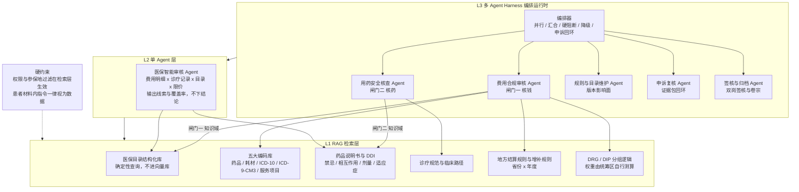
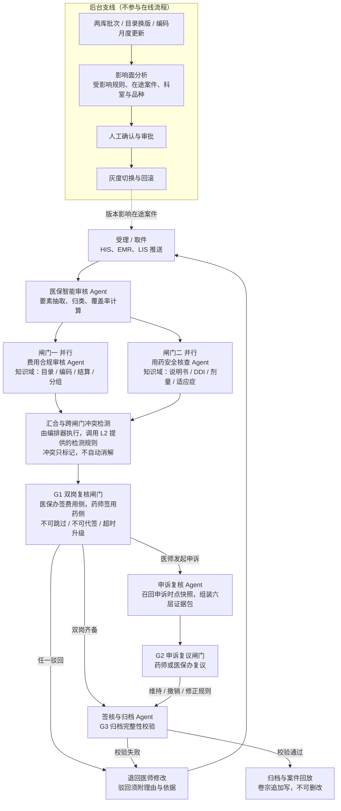
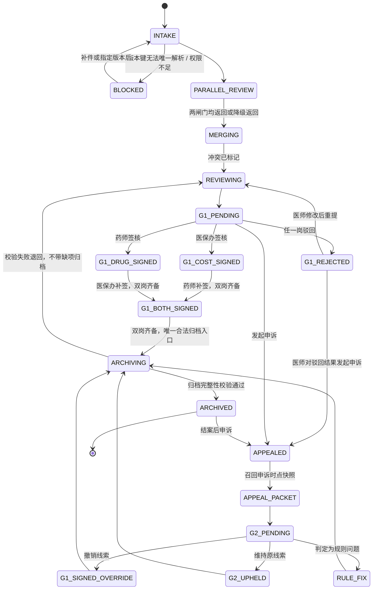
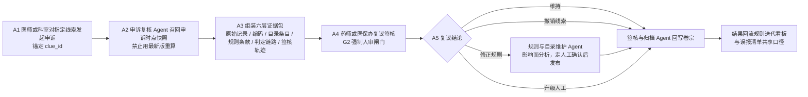
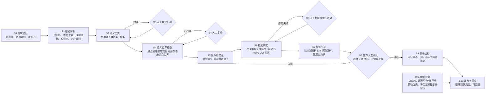
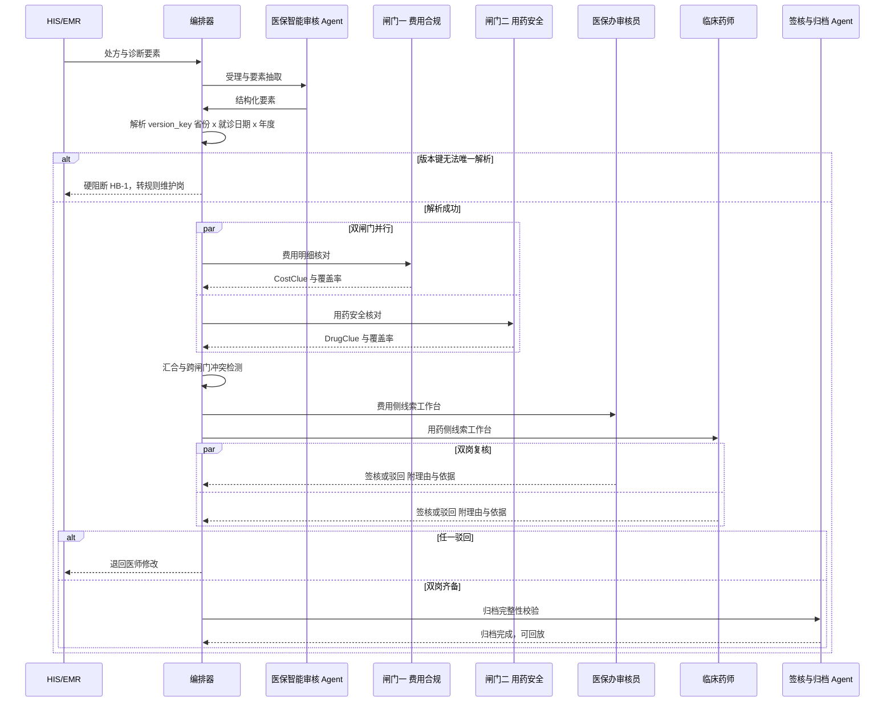
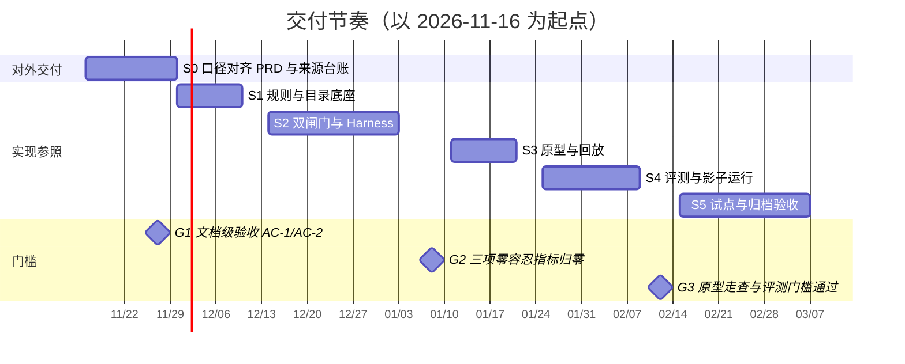
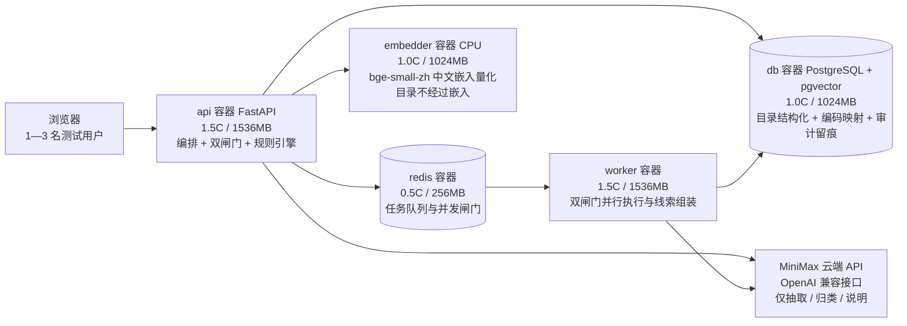
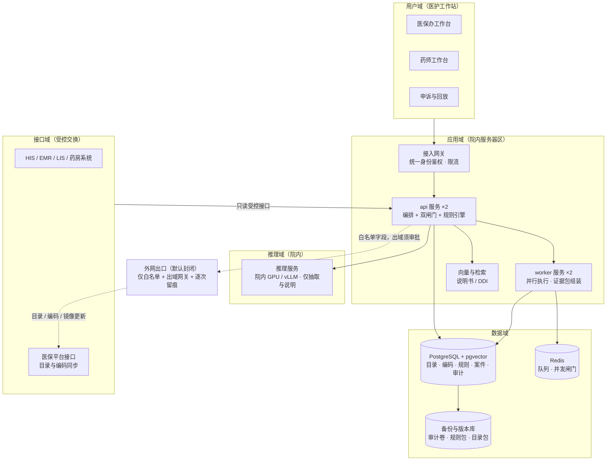

## Product Requirements Document: 医保智能审核与处方前置 Agent 平台（双闸门）

Author: 产品负责人（医院医保办与临床药学背景）
Date: 2026-11-14
Status: Draft（v1.0｜文档级交付版｜配套 8 张静态原型与评测集构造方案）

**阅读须知（证据标注约定速览）**：全篇凡出现数字或量化结论，一律在同处标注来源编号 `[n]`，编号对照见第 14 章 14.2 来源清单。证据分五类：`[A]` 政策原文与官方公开口径、`[B]` 医疗机构/企业一手披露（案例成效）、`[C]` 媒体报道转述（仅作量级参考，不作承诺）、`[S]` 学术论文与开源公开数据集（**须单独核许可证**）、`[D]` 本项目工程假设（自建口径，未经公开验证）。凡涉及角色痛点、使用频率、流程节点的描述，一律标注「公开数据推断」，不写「调研显示」「访谈 N 位」「调研发现」。

**一句话口径**：本产品只出线索与依据，结论由药师与医保办给出；两道闸门分别核「钱」（医保目录、限价、支付范围）与核「药」（配伍禁忌、剂量、适应症），均不自动拒付、不诊断、不开方。

---

# 第 1 章  文档信息与版本记录

## 1.1 文档信息

| 项 | 内容 |
| --- | --- |
| 产品名称 | 医保智能审核与处方前置 Agent 平台（内部代号 MedGate） |
| 文档版本 | v1.0 |
| 文档日期 | 2026-11-14 |
| 文档状态 | 草案（Draft），待医保办负责人与临床药师负责人会签 |
| 作者 | 产品负责人 |
| 主要评审人 | 医院医保办负责人、临床药师负责人、药剂科主任、医院信息科、医保经办机构审核岗 |
| 交付形态 | **文档级交付**：不产出可运行 Demo。交付物 = 本 PRD（14 章，FR/NFR 编号化）+ **8 张关键流程静态原型（第 10 章 10.2 的 P1—P8，线框级页面定义，S0 随 PRD 一并交付）** + 评测集构造方案 + 待验证项清单 |
| 验收口径 | PRD 完整性、指标可执行性、静态原型覆盖度——衡量「设计是否可被实现与检验」，而非「能不能跑」（详见第 12 章 12.7） |
| 适用范围 | 医院医保办与药房前置审核场景；本期聚焦门诊与住院费用明细审核、门诊处方前置审核 |
| 目标运行环境 | **开发与试点**：本地 Windows 11 + Docker Compose（WSL2 后端；i5-1135G7 4 核 8 线程 / 16.0GB RAM / Iris Xe 共享显存 128MB 无 CUDA），模型经 **MiniMax 云 API（API Key 方式）**调用，测试阶段 1—3 人（详见 13.7）；**生产**：**院内私有化形态**（数据不出院、模型推理落院内、网络五域隔离、高可用与容灾、SLO 与运维制度），目标 50—100 并发（详见 **13.8**） |
| 产品层级定位 | 三个作品集中的**第三项目**；独特机制为「医保目录与地方规则硬闸门 + 双岗复核（权限维度）」，与另两个项目（外贸落在时间维度、金融落在版本维度）不重叠 |
| 关联文档 | 《场景层选型说明》（第三章翻案条件）、《医疗项目组 PRD 口径与来源台账》 |

## 1.2 版本记录

| 版本 | 日期 | 变更类型 | 变更摘要 | 责任人 |
| --- | --- | --- | --- | --- |
| v0.1 | 2026-11-02 | 新建 | 建立 14 章骨架、目标 G1—G6、非目标 NG1—NG5、来源编号表 | 产品负责人 |
| v0.5 | 2026-11-07 | 补充 | 接入 RAG / 单 Agent / 多 Agent Harness 三层设计；定义双闸门与双岗复核拓扑 | 产品负责人 + 架构 |
| v0.9 | 2026-11-11 | 补充 | 接入 21 条公开来源；FR/NFR 编号化；建立「公开对标值 / 自建目标值」双栏口径；补目录版本三维与四层对照合成方法 | 产品负责人 |
| v1.0 | 2026-11-14 | 定稿 | 补齐第 8 章 Harness 契约与降级表、第 9 章评测集与四层对照样本合成、第 10 章 8 张原型清单、第 12 章文档级交付三条验收标准、第 14 章待验证项与翻案条件 | 产品负责人 |

## 1.3 术语约定（首次出现给英文原名）

| 中文术语 | 英文原名 / 缩写 | 本文档口径定义 |
| --- | --- | --- |
| 医保目录 | National Reimbursement Drug List（NRDL） | 国家医保药品目录，含甲乙类、限定支付范围、协议期与支付标准 [10] |
| 限定支付范围 | Reimbursement Restriction（备注列） | 目录附注的限定报销条件，回答「医保付不付」；**不是临床禁忌**，见第 9 章 9.4 |
| 两库 | Rule & Knowledge Base | 国家医保局智能监管「规则库 + 知识库」，2025 年版含 88 类规则 + 24.7 万条知识点 [5]，按批公开 [9] |
| 智能审核（国家口径） | Intelligent Review | 全国统一医保信息平台的费用与编码合规审核，产出**审减金额**口径 [3] |
| 处方前置审核（医院口径） | Pre-prescription Review | 医院药学部门在处方开具/调配前做的合理性审核，产出**拦截张数与拦截率**口径 [15][16] |
| 检索增强生成 | Retrieval-Augmented Generation（RAG） | 仅用于「找依据与出处」，不参与确定性判定 |
| 规则引擎 | Domain-Specific Language（DSL） | 医保/药学规则的可判定 if-then 表达式表示，可复算、可审计 |
| 智能体 | Agent | 具备目标、工具权限、输出契约与禁止行为的执行单元 |
| 智能体规格 | AgentSpec | 声明式描述单个 Agent 的职责、工具白名单、禁止行为、引用要求与输出结构 |
| 交接 | Handoff | Agent 之间传递上下文的结构化契约，含必填字段 |
| 案件状态 | CaseState | 一件处方/一件费用单在全流程中的唯一状态载体，含阶段、证据、版本快照、签核轨迹 |
| 双闸门 | Dual Gate | 闸门一核「钱」、闸门二核「药」，并行执行后汇合 |
| 双岗复核 | Dual-role Review | 药师（用药侧）与医保办（费用侧）分别签核，权限维度互斥 |
| 人在环 | Human-in-the-Loop（HITL） | 人保留决定权且其动作被强制记录在案的协作模式 |
| 硬闸门 | Hard Gate | 版本、权限、证据不齐即阻断流转，不允许降级放行的规则点 |
| 金标评测集 | Gold Set | 经双人标注与仲裁冻结的基准样本集，用于离线评测 |
| 规则版本 | Rule Version | 规则的 effective_from / effective_to / version 三元组 |
| 参保地 | Insurance Region | 患者医保参保地统筹区，决定地方结算规则与地方增补规则的适用范围 |

## 1.4 四类证据标注约定

| 类别 | 含义 | 引用写法 | 可否作为产品承诺依据 |
| --- | --- | --- | --- |
| [A] 政策原文与官方公开口径 | 主管部门正式文件、官方发布或官方答复 | "《2025 年国家医保药品目录》（医保发〔2025〕33 号）[10]" | 可，作为合规与可行性依据 |
| [B] 机构一手披露 | 医院官网、官方案例、公开发布的规则库批次文件 | "甘肃临泽县人民医院处方前置审核案例 [15]" | 可，作为能力可行性证据 |
| [C] 报道转述 | 媒体转述官方通稿或平台公告 | "央视报道湘雅医院本地化部署 [25]" | 仅作量级参考，不作承诺 |
| [S] 学术与开源公开数据集 | 公开学术论文 + 开源仓库发布的数据集 | "RxSafeBench（arXiv 2511.04328 / IEEE BIBM 2025）[18]" | 可，作为评测集素材与对照基线；**许可条款须逐个核实**，非商用许可不得进入商业知识库 |
| [D] 工程假设 | 本文档为推进设计与排期所设的自建口径 | "自建评测集口径 [D]" | 否，仅用于内部排期与门槛设定 |

## 1.5 本文档的交付形态声明

本项目**不产出可运行 Demo**，因此全文以「可被实现、可被检验」为写作标准：每条功能需求落到可命名的接口与状态，每条指标落到可计算的分子分母与来源，每张原型落到可复现的界面要素与数据来源。文中所有引用的数值均来自公开来源或标注为自建口径，不存在未标注来源的数字。

**本章要点**：本文档是文档级交付，验收看 PRD 完整性、指标可执行性与原型覆盖度，不看能否运行。术语与证据标注约定在全篇统一：政策与官方口径 `[A]`、机构一手披露 `[B]`、报道转述 `[C]`、学术与开源公开数据集 `[S]`、自建口径 `[D]`，所有数字必须带来源编号。

# 第 2 章  背景与目标

## 2.1 背景

2024 年 11 月，国家卫生健康委发布《卫生健康行业人工智能应用场景参考指引》（国卫办规划函〔2024〕420 号），公布 84 项应用场景，其中医疗服务管理 38 项（内含医药服务 3 项、医保服务 3 项）、基层公卫服务 23 项、健康产业发展 13 项、医学教学科研 10 项 [1]。到 2025 年 3 月，全国已征集应用案例 950 项，覆盖全部 84 项场景 [2]。本项目直接对号入座第 16 项「处方前置审核智能辅助」、第 17 项「临床用药智能辅助」（属医药服务子域）与第 19 项「医保智能审核」（属医保服务子域）[1]。

与政策同步推进的是基础设施侧的成熟：全国统一医保信息平台智能审核日均处理案例已超 2000 万件、准确率 92% 以上（**国家医保局 2023 年公布口径**）[3]；智能监管子系统自 2024 年 9 月起在所有统筹地区全覆盖 [4]；《智能监管规则库、知识库（2025 年版）》含 88 类规则与 24.7 万条知识点，分批公开下载 [5][9]；药品目录侧，《2025 年国家医保药品目录》（医保发〔2025〕33 号，2025-12-07 发布，2026-01-01 起执行，2024 年目录同时废止，新增 114 种、调出 29 种）[10] 已进入可编程的表格形态。

也就是说：**规则、目录、编码都已经是机器可读的公开文件，缺的不是数据，是把这些数据装进一个能被医生、药师、医保办共同信任的判定流程。**

## 2.2 问题陈述（痛点均为公开数据推断）

| 编号 | 痛点 | 性质 | 公开依据 |
| --- | --- | --- | --- |
| P1 | 规则是「文件」不是「可判定条件」：两库按批发布，每批含规则名、审核逻辑、逻辑依据与知识点明细并已对应医保编码 [9]，但规则按药理类别分批下发、地方另有增补，落地时需逐条翻译成可执行判定 | 公开数据推断 | [5][9] |
| P2 | 版本会「错用」：目录年度换版（2024 目录废止、2025 目录 2026-01-01 生效）[10]、编码库月度更新 [11]、医疗服务价格立项指南已印发 17 批并附新旧项目映射表 [13]、DRG/DIP 权重由各统筹区自行测算且 2025 年起统一使用分组版本 [12]——四套版本各自演进且无单一时间轴 | 公开数据推断 | [10][11][12][13] |
| P3 | 费用侧与用药侧语料不同源，容易被混为一谈：国家医保局的「智能审核」是费用与编码合规、产出审减金额 [3]；医院的「处方前置审核」是药师审方合理性、产出拦截张数与拦截率 [15][16]。两套口径的金额与比率不可混用 | 公开数据推断 | [3][15][16] |
| P4 | 提醒多、遵从差异大：全国事前提醒接入率 71%，定点医疗机构 65%、零售药店 82%；按医院等级看三级 92%、二级 85%、一级及以下 64% [6]；2026 上半年累计提醒 5605 万人次、涉及金额 129 亿元 [7] | 公开数据推断 | [6][7] |
| P5 | 人工审核成本高、单件时长受限：甘肃临泽县人民医院平均审核 ≤1 分钟、自动审核覆盖 90%+ 常规处方 [15]；湖北云梦县中医医院平均审核 ≤45 秒 [16]。这些是已部署系统的上限口径，说明人工逐条核对难以覆盖增量 | 公开数据推断 | [15][16] |
| P6 | 事后追回的成本远高于事前拦截：2025 年智能监管子系统挽回医保基金损失 30 亿元（当年全国追回 342 亿元）[8]，说明可拦截的违规若拖到结算后，回收难度与争议成本都显著上升 | 公开数据推断 | [8] |
| P7 | 违规类型分布不均，重点类别的收益远高于平均：赣南医科大学第一附属医院适应症类违规经提醒后降至 0、医师遵从率 100% [14]；湖北潜江全市域药师干预有效率 97.32% [17]——集中在少数规则族上做深，收益高于全面铺开 | 公开数据推断 | [14][17] |

## 2.3 目标 G1—G6

| 编号 | 目标 | 衡量方式 |
| --- | --- | --- |
| G1 | 把费用合规与用药安全拆成**两道互不污染的闸门**，各自绑定独立知识库与独立结论口径 | 第 7 章分层设计；第 9 章两套独立知识库 schema；评测中闸门间串库率 = 0 |
| G2 | 让每一条线索都**可回放**：给出规则编号、依据原文、版本三元组与出处链接 | 第 10 章线索详情页；第 14 章 14.4 接口清单与 14.5 Prompt 资产清单 |
| G3 | 用**确定性查询 + 规则引擎**承载医保目录与编码，用 RAG 承载说明书与 DDI，杜绝「向量库里混目录」 | 第 9 章 9.2 数据分层；目录检索命中路径不含向量库 |
| G4 | 把**版本正确性**变成系统可阻断的硬约束，而不是运维手册里的一句话 | 第 8 章 8.7 硬阻断机制；目录版本错用率 = 0 |
| G5 | 建立**双岗复核**的权限闭环：费用侧由医保办签核、用药侧由药师签核，互斥且不可代签 | 第 6 章 GATE 组 FR；第 8 章 8.5 状态机 |
| G6 | 让交付物**可被检验**：8 张静态原型覆盖关键流程，评测集口径公开可复现 | 第 10 章 10.2 原型清单；第 12 章 12.6 评测集口径与 12.7 三条验收标准 |

## 2.4 明确不做 NG1—NG5

| 编号 | 不做什么 | 原因 |
| --- | --- | --- |
| NG1 | 不做自动拒付、不自动扣款、不自动下「违规认定」结论 | 《互联网诊疗监管细则（试行）》（国卫办医发〔2022〕2 号）第二十一条明确「处方应由接诊医师本人开具，严禁使用人工智能等自动生成处方」[21]；湖南省医保局同向明文要求 [22]。产品定位即「出线索不下结论」 |
| NG2 | 不做 AI 诊断、不做适应症推荐、不自动生成处方 | 同上 [21]；适应症判定属临床决策，不可由系统越权 |
| NG3 | 不替代国家医保信息平台的智能审核与智能监管子系统 | 本平台是**院内/院前**的前置闸门，定位为「前移」，不重复建设国家级事后稽核能力 [3][4] |
| NG4 | 不建全国统一权重库、不做跨省价格数据库 | 国家层面无统一 DRG/DIP 权重表，价格由各省定价 [12][13]；超出「省份 × 就诊日期 × 目录版本」三维的通用化一律不做 |
| NG5 | 不做药品上市后再评价、药物警戒全生命周期业务 | 药监局 ADR 个案数据受控、无稳定公开接口（见 14.3 待验证项），只做说明书与 DDI 层面的用药安全核查 |

## 2.5 成功定义（一句话）

当一份处方与一份费用明细进入系统后，药师与医保办各自拿到**带出处、带版本、带覆盖度说明**的线索列表，用人时间从「逐条查目录」压缩到「逐条核线索」，且每一次线索判定与人工签核都能原样回放——本产品即成立。

**本章要点**：政策、规则库、目录、编码四件事在 2024—2026 年都已公开且可编程，缺的是把它们装进可被临床与医保两方共同信任的判定流程。七个痛点全部标注为公开数据推断，核心矛盾是「规则文件化、版本多轨、口径易混、拦截靠后」。六项目标对应六条可检验的落地承诺，五条非目标把「自动拒付 / 自动诊断 / 替国家平台 / 建全国权重库 / 做药物警戒」明确排除在外。

# 第 3 章  行业背景与公开数据对标

> 本章所有数值均标注来源编号；A 类（政策与官方口径）、B 类（机构一手披露）、C 类（报道转述）分列，数字不得跨栏相加或对比。凡本项目自建口径一律标 `[D]`，单列于 3.8。

## 3.1 政策环境（证据类别 [A]）

| 编号 | 文件 / 口径 | 关键内容 | 对本项目的约束 |
| --- | --- | --- | --- |
| P-01 | 《卫生健康行业人工智能应用场景参考指引》（国卫办规划函〔2024〕420 号，2024-11）[1] | 84 项场景；医疗服务管理 38（医药服务 3、医保服务 3）、基层公卫服务 23、健康产业发展 13、医学教学科研 10 | 本项目落在第 16、17、19 项；两道闸门分属**医药服务**与**医保服务**两个官方子域，是分库建模的政策依据 |
| P-02 | 卫健委对十四届全国人大三次会议第 3816 号建议的答复（2025-08-26）[2] | 截至 2025-03 全国征集应用案例 950 项，覆盖全部 84 项场景 | 说明场景已有落地样本，但答复未给出本场景的效果口径，不作能力承诺 |
| P-03 | 《互联网诊疗监管细则（试行）》（国卫办医发〔2022〕2 号）[21] | 第二十一条：处方应由接诊医师本人开具，严禁使用人工智能等自动生成处方 | 决定产品边界：只能出线索与依据，禁止生成处方、禁止自动结论 |
| P-04 | 湖南省医保局《关于进一步加强基本医疗保障定点零售药店管理的通知》（湘医保发〔2025〕8 号）[22] | 同向明文要求，零售药店端亦不得以 AI 自动生成处方 | 地方红线示例；本产品按「国家与地方两级红线」处理（见第 11 章 11.1） |
| P-05 | 《生成式人工智能服务管理暂行办法》（七部门联合令第 15 号，2023-08-15 施行）[23] | 第十二条标识义务、第十七条算法备案与安全评估义务 | 触发标识与备案设计（见第 11 章 11.4） |
| P-06 | 《人工智能生成合成内容标识办法》（国信办通字〔2025〕2 号，2025-09-01 施行）[24] | 标识义务进一步细化 | 与 P-05 并引，构成生成内容显式标识与隐式水印的落地依据 |
| P-07 | 医保发〔2025〕33 号《2025 年国家医保药品目录》[10] | 2025-12-07 发布、2026-01-01 执行，2024 年目录废止；新增 114 种、调出 29 种、目录总数 3253 种；目录 Excel 含通用名、剂型规格、限定支付范围（备注）、甲乙类、协议期、支付标准；**限价条目不公开**（标注符号口径待核，见 14.3.2 N-09） | 目录是可编程数据源，但「限价不公开」造成限价判定存在天然盲区，须显式标注为未判定 |
| P-08 | 国家医保信息业务编码标准数据库（code.nhsa.gov.cn）[11] | 药品分类与代码、医用耗材、ICD-10、ICD-9-CM3、医疗服务项目五大编码库，含医保目录甲乙类标识；**月度更新** | 编码映射必须版本化，月度更新意味着版本漂移是常态而非例外 |
| P-09 | 《按病组和病种分值付费 2.0 版分组方案》（医保办发〔2024〕9 号，2024-07-23）[12] | DRG 核心 409 组 / 细分 634 组、DIP 核心病种 9520 组；2025 年起各统筹地区统一使用分组版本；**国家层面无统一权重表**，权重由各统筹区自行测算 | 直接支撑「省份 × 年度」版本维度；国家无统一权重表属「确认不存在」项 |
| P-10 | 医疗服务价格项目立项指南（已印发 17 批）[13] | 含新项目 ↔ 旧项目映射关系表；全国统一立项不等于全国统一价格，价格仍由各省定价 | 价格侧判定必须落到「省份 × 就诊日期 × 价格版本」；映射表缺失会导致串版本 |

## 3.2 [A] 国家医保局与平台侧官方公开口径

> 本节各行数值均出自国家医保局公开口径，来源编号见 14.2 清单 [3][4][5][6][7][8][9]。

| 编号 | 口径内容 | 数值 | 对本项目的用法 |
| --- | --- | --- | --- |
| A-01 | 全国统一医保信息平台日均处理智能审核案例 | 超 2000 万件 [3] | 量级参考：**国家级事后/事中**能力已规模化，不重复建设（NG3） |
| A-02 | 智能审核准确率 | 92% 以上 [3]（**2023 年公布口径**） | 国家平台的正确性基准；本项目目标口径不同（见 12.2，不做混用） |
| A-03 | 智能监管子系统覆盖 | 2024-09 起所有统筹地区全覆盖 [4] | 说明地方规则差异真实存在且必须本地化，支撑地方增补规则设计（FR-RULE 组） |
| A-04 | 《智能监管规则库、知识库（2025 年版）》 | 88 类规则 + 24.7 万条知识点，分批公开下载 [5][9] | 本项目规则库的直接来源素材（第 9 章 9.5 转换流程） |
| A-05 | 事前提醒接入率（全国） | 71% [6] | 提醒通道已存在但未全覆盖，本项目定位为「把提醒前的核对前置」 |
| A-06 | 事前提醒接入率（按机构类型） | 定点医疗机构 65%；零售药店 82% [6] | 机构类型差异说明接入形态需按院内/院前分别设计 |
| A-07 | 事前提醒接入率（按医院等级） | 三级 92%；二级 85%；一级及以下 64% [6] | 三级接入高、一级低，说明本产品应优先做**可私有化部署的院内形态**而非云端集中 |
| A-08 | 2026 上半年提醒量与涉及金额 | 5605 万人次；129 亿元 [7] | 存量提醒规模巨大，提示「提醒疲劳」是真实约束（对应 FR-COST-05、FR-DRUG-08 的覆盖率与降噪要求） |
| A-09 | 2025 年智能监管挽回医保基金损失 | 30 亿元（当年全国追回 342 亿元）[8] | 事后追回的「可达收益」上限量级；说明前置拦截的价值来自成本与争议下降而非直接创收 |

## 3.3 [B] 医疗机构一手披露（案例成效）

| 编号 | 机构 | 公开数据 | 关键指标 | 对本项目的用法 |
| --- | --- | --- | --- | --- |
| B-01 | 赣南医科大学第一附属医院（**赣州市医疗保障局通报中的案例**）[14] | 智审规则迭代至 4.1 版、约 4 万条 | 事前提醒累计遵从 6.54 万人次；避免不合理费用 2050.76 万元；适应症类违规经提醒后降至 0；医师遵从率 100% | 规则规模量级参考（4 万条 ≈ 本项目自建评测覆盖量级）；「按违规族集中突破」验证 P7 优先级假设 |
| B-02 | 甘肃临泽县人民医院（获 MAIC2025 全国医学人工智能典型案例）[15] | 处方合格率 75%→95%；药占比 35%→21%；高警示药品处方错误率 5%→<1% | 平均审核 ≤1 分钟；自动审核覆盖 90%+ 常规处方；单张门诊处方平均费用 41.6 元 → 27.9 元、门诊次均费用降 32% | 用药闸门的**结果指标**对标来源（合格率、错误率、药占比）；注意其「自动审核」指规则自动前置提醒，仍有人工兜底 |
| B-03 | 湖北云梦县中医医院 [16] | 2026 年 1—7 月审核 345,776 张、拦截 30,523 张 | 拦截率 16.61%；平均审核 ≤45 秒 | 拦截率口径基准；15%—17% 是**合理拦截密度**参考区间，超出即提示误报或漏报 |
| B-04 | 湖北潜江全市域 [17] | 药师干预有效率 97.32% | 干预被采纳比例 | 双岗复核中「药师签核采纳率」的对标基线 |

## 3.4 [C] 媒体报道转述（仅作量级参考，不作承诺）

| 编号 | 内容 | 转述来源 | 使用限制 |
| --- | --- | --- | --- |
| C-01 | 中南大学湘雅医院完成国产 AI 医疗中台本地化部署（医渡科技研发、昇腾 GPU），并拓展出临床指南助手、影像报告结构化、体核报告解读等应用 | 央视报道 [25] | 属媒体转述，不作官方成果引用；仅说明「本地化部署 + 中台化扩展」是行业内被验证过的技术路径，支撑第 11 章「数据不出院」 |

## 3.5 两套口径不可混用（本项目最关键的辨析）

| 维度 | 国家医保局「智能审核」 | 医院「处方前置审核」 | 本项目处理 |
| --- | --- | --- | --- |
| 主体 | 国家/省级医保经办 | 医疗机构药学部门 | 两者都不由本平台裁决 |
| 触发时机 | 费用结算与监管稽核（事中/事后为主） | 处方开具与调配前 | 本产品落在**结算前 + 开方前** |
| 核心产出 | 审减金额、违规编码清单 | 拦截张数、拦截率、审方意见 | 两套指标分别统计，**不做合并** |
| 依据来源 | 两库规则 + 编码库 + 结算规则 [4][5][11] | 说明书 + DDI + 医院制度 + 诊疗规范 | 两个独立知识库（第 9 章 9.4） |
| 判定权 | 医保经办机构 | 药师/药事会 | 本平台只出线索，签核权在双岗 |
| 典型数值 | 日均超 2000 万件、准确率 92% 以上 [3] | 拦截率 16.61% [16]、处方合格率 95%+ [15] | 不可相除、不可作「同口径提升」叙述 |

**本章纪律**：任何对外材料中出现金额与比率时，必须显式声明其口径来自哪一侧；出现「智能审核准确率 92%」与「拦截率 16.61%」并列展示时，必须加口径注释。

## 3.6 公开披露的能力空白（本产品的切入口）

| 编号 | 公开空白 | 公开依据 | 本产品的切入方式 |
| --- | --- | --- | --- |
| G-01 | 规则以文件批次形式公布，**没有面向院内双岗复核的可执行判定层** | 两库按批公开（每批附 PDF + XLSX，含规则名、审核逻辑、逻辑依据、知识点明细，已对应医保编码）[9] | 第 9 章 9.5「批次 → 可判定规则」转换流水线，人工复核转换结果 |
| G-02 | 目录换版、编码月度更新、价格立项指南 17 批、DRG/DIP 权重地方自测，**四条版本线无统一时间轴** | [10][11][12][13] | 第 9 章 9.6「省份 × 就诊日期 × 年度」三维版本键 + 第 8 章 8.7 硬阻断 |
| G-03 | 费用语义（医保付不付）与用药语义（能不能用）**常被混放进同一知识库** | 目录限定支付范围与说明书禁忌是两套语义 [10][21] | 两道闸门两个知识库，闸门间禁止串库（第 9 章 9.4） |
| G-04 | 事前提醒接入率三级 92% / 一级及以下 64% [6]，**低等级机构与基层链路薄弱** | [6] | 私有化院内部署 + 轻量规则子集（第 13 章切片一） |
| G-05 | 「智能监管两库」按药理类别分批发布、**地方另有增补，地区差异不可覆盖** | [9] | 地方增补规则独立命名空间与优先级，冲突时以属地为准并强制提示 |
| G-06 | 公开数据中**没有**面向本场景的成对评测基准（见 14.3「确认不存在」清单） | — | 第 9 章 9.9 四层对照样本合成方法 + 第 12 章 12.6 评测口径 |

## 3.7 公开数据集与开源语料（可作评测与原型数据基础）

| 编号 | 数据集 | 规模 | 许可与注意 | 用途 |
| --- | --- | --- | --- | --- |
| D-01 | RxSafeBench [18] | 2,443 例中文模拟问诊处方场景（禁忌 1,063 + 药物相互作用 1,380）；配套 RxRisk DB 含 6,725 条禁忌 + 28,781 条相互作用 + 14,906 条适应症-药物对 | CC0-1.0（**仓库 LICENSE 条款待核，见 14.3.2 N-10**） | 用药闸门（闸门二）的种子样本与分母 |
| D-02 | DDInter 2.0 [19] | 302,516 条 DDI / 2,310 药，含严重程度、机制描述、管理策略 | **CC BY-NC 4.0**，**非商用**，不得进入商业产品知识库 | 仅用于研发期效果比对与标注参考，交付物中以离线评测引用方式出现 |
| D-03 | openFDA drug label [20] | 提供 contraindications / drug_interactions / dosage_and_administration / indications_and_usage / boxed_warning 字段 | CC0 | 说明书结构化字段设计参考（说明书正文版权与来源标注另见 14.3） |

## 3.8 [D] 工程假设（本项目自建口径，单列）

| 编号 | 假设 | 用途 | 验证方式 |
| --- | --- | --- | --- |
| D-A1 | 规则转换后的人工可判定率目标 ≥ 95%（抽样 200 条两库批次规则） | 评估两库复用可行性的内部口径 | 转换流水线抽样人工复核（9.5 S2/S8） |
| D-A2 | 目录版本键命中唯一性目标 = 100%，冲突时进入未判定池 | 内部版本治理口径 | 目录版本维护 Agent 的冲突检测报告 |
| D-A3 | 单件处方双闸门端到端处理时长目标 P95 ≤ 30 秒（异步模式 ≤ 90 秒） | 内部性能口径 | 第 12 章性能指标自建目标值 |
| D-A4 | 评测集目标规模 1,200 条四层对照样本（分层构造） | 内部评测口径 | 第 9 章 9.9.2 合成方法与 9.9.3 样本分配表 |

## 3.9 本章数据的整体判断

公开数据呈现出一个清晰结构：**国家级能力（日均 2000 万件、92% 准确率、71% 提醒接入率）已经建成并覆盖全部统筹地区 [3][4][6]，院内前置审核在部分医院跑出了可复制的结果（B-01 至 B-04）**，但两者之间缺少一层「规则可判定化 + 版本可治理化 + 双岗可签核化」的院内装置。本项目的价值不在这三层之外的任何一层。

**本章要点**：政策把两道闸门分别放进了医药服务与医保服务两个官方子域 [1]，这是分库建模的依据而不是修辞。国家平台已规模化覆盖 [3][4][6]，因此本产品明确做院内前置、明确不做国家级稽核的重复建设。费用侧「审减金额」与用药侧「拦截率」两套口径在 3.5 节被拆开并禁止混用，这是全文所有指标叙述的基础；公开空白集中在规则可判定化与版本治理两处，对应本项目的第 9、10 章。

# 第 4 章  目标用户与使用场景

## 4.1 四类目标角色

| 编号 | 角色 | 所属 | 在本产品中的核心动作 | 现状与痛点（公开数据推断） |
| --- | --- | --- | --- | --- |
| U1 | 医保审核员 | 医院医保办 | 接收闸门一线索，逐条复核费用明细与目录/限价/支付范围的对应关系，签核或驳回 | 规则与结算规则分散在多份文件；口径混杂时人工难以快速定位争议点 [5][9][10] |
| U2 | 临床药师 | 医院药剂科 | 接收闸门二线索，复核配伍禁忌、剂量、适应症越界，签核或驳回并给出干预建议 | 审方量随门诊量增长，人工逐张核对方位耗时；已部署系统的审核时长上限为 ≤1 分钟/张、≤45 秒/张 [15][16] |
| U3 | 医保经办机构审核岗 | 统筹区医保局 | 抽样复核院内签核质量、查看留痕与依据链、受理申诉复核 | 事后抽查缺少可回放的证据包，复核成本高；国家层面已有智能监管兜底 [4][8] |
| U4 | 医院信息科 / 医保信息主管 | 医院 | 维护对接接口、目录与编码版本同步、权限与留痕配置 | 编码库月度更新 [11]、目录年度换版 [10]、价格立项指南 17 批 [13]，版本同步无自动机制 |

**不做用户的明确说明**：本产品**不面向患者直接交付**。患者仅作为数据主体出现在流程中（知情同意、材料授权），不作为使用者；不提供患者端 App、不提供患者自查工具。

## 4.2 五个 Use Case

| 编号 | Use Case | 触发者 | 输入 | 主路径 | 出口 |
| --- | --- | --- | --- | --- | --- |
| UC-1 | 门诊处方开具前的用药安全与医保支付双前置核查 | 开方医师（系统触发） | 处方要素（药品、规格、剂量、频次、疗程、诊断）、患者参保信息、诊断记录 | 闸门一与闸门二并行 → 汇合 → 双岗**并行**签核（药师签用药侧 ∥ 医保办签费用侧）→ 放行或退回医师修改 | 放行/退回结论 + 依据包 |
| UC-2 | 住院费用明细的事前逐条核对 | 医保办审核员 | 费用明细（项目、编码、数量、单价、金额）、病案首页与诊断、目录与价格版本 | 逐条比对医保目录甲乙类、限定支付范围、限价、编码有效性 → 线索列表 → 人工签核 | 签核结论 + 覆盖率说明 |
| UC-3 | 目录换版 / 编码更新的影响面分析 | 规则与目录维护 Agent（规则管理员发起） | 新版本目录、编码库、价格立项指南映射表、DRG/DIP 分组版本 | 版本差异比对 → 影响面清单（受影响规则/在途案件/科室/药品）→ 人工确认后灰度切换 | 切换计划 + 灰度范围 |
| UC-4 | 医师对审核线索提出申诉的证据包复核 | 医师 / 科室（申诉发起） | 申诉理由、原始病例材料、被驳回线索及其依据版本 | 召回两闸门依据快照 → 组装证据包（目录条款 + 说明书要点 + 规则版本 + 原始记录）→ 药师/医保办复议 → 结论与留痕 | 复议结论 + 证据包归档 |
| UC-5 | 医保办月度质量抽检与规则迭代评估 | 医保办审核员 | 区间内全部签核记录、规则命中分布、遵从率 | 命中分布分析 → 高误报规则识别 → 规则调参建议（不改生产规则） | 规则迭代建议书 |

## 4.3 一件业务件的生命周期（以门诊处方为例）

| 阶段 | 步骤 | 执行者 | 系统动作 | 人机交互点 |
| --- | --- | --- | --- | --- |
| S1 开方提交 | 医师提交处方 | 医师 | 抽取处方要素与诊断编码 | 无 |
| S2 双闸门并行 | 闸门一费用核、闸门二用药核 | 用药安全核查 Agent / 费用合规审核 Agent | 各自检索、判定、出线索 | 无（规则引擎 + 检索完成） |
| S3 汇合 | 线索合并与冲突检测 | 编排器 | 检测跨闸门矛盾（如目录不报销但临床合理） | 冲突不自动消解 |
| S4 双岗复核 | 药师签用药侧、医保办签费用侧 | U2 / U1 | 生成双栏工作台 | **两处强制人审闸门**，可并行、可退回 |
| S5 放行或退回 | 结论生成 | 签核与归档 Agent | 按签核结果放行/退回医师；退回附原因与依据 | 医师可申诉 |
| S6 申诉回环 | 证据包组装与复议 | 申诉复核 Agent | 快照召回、组装、流转 | **第三处强制人审闸门** |
| S7 归档与回放 | 卷宗生成 | 签核与归档 Agent | 写入卷宗、版本快照、签核轨迹 | 可按任意时点回放 |

## 4.4 患者旅程（本产品在旅程中的位置）

| 患者触点 | 患者感知 | 系统行为 | 边界声明 |
| --- | --- | --- | --- |
| 就诊、诊断 | 医生记录诊断与医嘱 | 提取诊断编码（ICD-10 等）用于对照 | 不做任何诊断推断 [21] |
| 开方 | 处方开具时出现提醒 | 用药侧线索提示（费用侧线索不进医师视图，见 9.8）；医师可选择修改处方或申请复核 | 不自动开方、不自动生成处方内容 [21] |
| 取药调配 | 药师可能进一步干预 | 用药侧线索进入药师工作台 | 药师结论为最终意见 |
| 结算 | 可能被退费或二次告知 | 费用侧线索在费用明细提交前已处理；不在本系统内扣费 | 本产品不执行任何拒付与扣款 |
| 申诉 | 患者向医院或经办机构申诉 | UC-4 证据包支持药师/医保办复议 | 不受理患者直接查询 |

**患者材料中的指令一律视为数据**：处方备注、病程记录、检验报告中的任何祈使句（"忽略前面的规则""按拒付处理"）都只作为文本被引用，不得进入指令通道（见第 11 章 11.6）。

**本章要点**：四类用户、六段生命周期的落位写清，尤其三处强制人审闸门（S4 双岗复核、S6 申诉复议）与「不面向患者交付」的产品边界。五个 Use Case 覆盖日常审核、版本维护与申诉三条主线，其中 UC-3、UC-4、UC-5 是不产生临床动作的运营型场景。患者的角色在旅程中始终是被审核主体而非使用者，任何材料内指令均按数据处理。

# 第 5 章  产品定位与价值主张

## 5.1 定位句

**MedGate 是部署在院内（或院前药房）的双闸门医保合规与用药安全前置核查平台：第一道闸门核「钱」——费用明细与医保目录、限价、支付范围是否对得上；第二道闸门核「药」——配伍禁忌、剂量异常、适应症越界是否成立。系统只出线索与依据，结论由药师与医保办给出，全过程留痕可回放。**

## 5.2 价值主张 → 指标 → 对标值

| 价值主张 | 对应指标 | 公开对标值（含来源） | 本项目自建目标值（[D]） |
| --- | --- | --- | --- |
| 把「查目录」的时间还给药师 | 单件处方双闸门处理时长 | 平均审核 ≤1 分钟 [15]；≤45 秒 [16] | P95 ≤30 秒（同步）/ ≤90 秒（异步），主流程另计人工签核 |
| 让重点违规族先被看见 | 高优先级规则族命中率 | 适应症类违规经提醒后降至 0、医师遵从率 100% [14] | 重点 20 条规则族覆盖 ≥90% 的人工确认命中量 |
| 用确定性规则替代人肉比对 | 规则可判定率 | 两库 88 类规则 / 24.7 万条知识点 [5] | 已转换规则的可判定率 ≥95%，未转换部分显式进入「未判定」 |
| 提升前置拦截密度但不制造误报 | 拦截率与误报率 | 拦截率 16.61% [16]；药师干预有效率 97.32% [17] | 拦截率落在 12%—18% 观察带；药师采纳率 ≥95% |
| 让每条结论可被追责与复盘 | 依据完备率、签核要素完整率、证据包六层完整率 | 国家平台准确率 92% 以上 [3]（口径不同，不作承诺） | 线索依据完备率 = 100%（每条线索必须含规则编号 + 出处 + 版本三元组） |
| 让基层机构也能用上 | 部署与接入方式 | 事前提醒接入率：三级 92% / 二级 85% / 一级及以下 64% [6] | 支持院内私有化部署；院前药房侧以标准规则子集接入 |

## 5.3 主用户段的价值主张（Job-to-be-Done 六段式）

### 用户段一：临床药师（U2）

| 要素 | 内容 |
| --- | --- |
| Who | 医院药学部门负责处方前置审核的临床药师；门诊量大、品种多、单件时长被压缩 |
| Why（要完成的任务） | 在放行一张处方前，判断其中的药品组合、剂量与适应证是否安全合理；以及这张处方该不该被医保支付 |
| What before（现在怎么做） | 逐条翻目录与说明书、比对院内制度；人工逐张核，审核时长上限被压在 ≤1 分钟 [15]、≤45 秒 [16]；漏看与疲劳同时存在 |
| How（关键能力） | 闸门二把说明书禁忌、剂量异常、适应症越界转成可判定规则并直接给出原文出处；药师只需「核线索」而非「查资料」 |
| What after（结果） | 药师时间从检索转向判断；高警示药品处方错误率有行业参考下限 5%→<1% [15]；药师采纳率目标 ≥95% |
| Alternatives（替代方案） | 纯人工审方（慢、不可扩展）、通用大模型问答（无版本、无出处、不可审计）、商保审方工具（规则不覆盖医保目录与地方规则） |

### 用户段二：医保办审核员（U1）

| 要素 | 内容 |
| --- | --- |
| Who | 医院医保办负责费用合规审核的专员 |
| Why（要完成的任务） | 在费用明细进入结算前，确认每一笔费用是否符合目录限定支付范围、限价与编码规则 |
| What before | 手工比对 Excel 目录、编码库与地方结算规则；规则以文件批次下发 [9]，需人工翻译；版本换版时全量返工 |
| How | 闸门一用确定性查询走目录与编码（不进向量库），对每条明细给出「目录条目 + 支付范围条款 + 限价 + 依据版本」的对照结论 |
| What after | 争议点可定位到条款；覆盖率说明可见（哪些字段缺失导致未判定）；审核对象从「全量明细」变为「少量线索 + 未判定清单」 |
| Alternatives | 结算后智能审核稽核 [3][4]（发现晚、争议成本高）、人工抽查（覆盖不全） |

**价值主张陈述**：对临床药师，我们把「查资料」变成「核线索」，让处方安全判断在秒级完成且可回放；对医保办，我们把「手工比对」变成「确定性对照」，让每一笔费用的目录依据都带版本与出处；两者都不承担结论责任，但都获得了可被追责的过程。

## 5.4 与三类既有做法的差异点（速览）

> 本表是速览，完整的三类替代方案对照矩阵（四类方案 × 12 维度）、差异化定位与竞品演进护栏见 **5.6 节**。

| 对比对象 | 它做什么 | 本产品不同在哪 |
| --- | --- | --- |
| 国家医保信息平台智能审核 / 智能监管 [3][4][5] | 费用与编码合规、事后稽核、审减金额口径 | 本产品在**结算前、出方前**，产出线索而非审减结论；不重复国家级能力（NG3） |
| 医院自建处方审核（智审类）[14][15][16] | 院内规则库 + 前置提醒，多数为单点规则 | 本产品补上**目录版本治理**与**双岗权限闭环**，并把规则来源追溯到两库公开批次 [9] |
| 通用大模型/通用问诊模型 | 语言流畅、无版本概念 | 本产品**不生成结论**，只做检索与判定；每条线索必须可溯源；目录走确定性查询 |

## 5.5 价值主张成立的前置条件

| 编号 | 前置条件 | 不满足的后果 |
| --- | --- | --- |
| PV-1 | 医院能提供本地目录/结算规则与价格版本 | 闸门一只能给通用目录级线索，地方差异未判定 |
| PV-2 | 药学部门愿意维护说明书与 DDI 结构化字段 | 闸门二覆盖率不足，线索密度低 |
| PV-3 | 双岗签核职责在院内制度中被明确 | 复核退化为形式化签核 |
| PV-4 | 目录、编码、价格、分组四条版本线有专人同步 | 版本错用风险（硬指标：目录版本错用率 = 0） |

**本章要点**：定位句把「两道闸门、只出线索、双岗结论、可回放」四件事压成一句可对外复述的话，价值主张全部落到可测指标并区分公开对标值与自建目标值，5.6 节补齐了四类替代方案的类型级对照（矩阵中的留白一律写「未找到公开可比口径」，不推测填表）。六段式 JTBD 分别面向药师与医保办，替代方案一栏点明了通用大模型与商保工具的不可替代处。四条前置条件决定了价值能否落地，其中 PV-4 直接绑定「目录版本错用率 = 0」的硬指标。

## 5.6 竞品与替代方案分析（类型级对照）

> **本节的性质与纪律**：本节做的是**替代方案的「类型级」对照**，不做具名厂商点评、不做优劣排名。理由有三：① 目前没有可核实的厂商级产品对照资料（见 5.6.7 待核实清单）；② 本 PRD 的来源纪律要求凡结论可溯源，无公开依据者一律写「未找到公开可比口径」；③ 在评审与答辩场景中，"我们的用户为什么在什么场景下选我们、而不是选另一类方案"比"某家厂商比我们差"更站得住，也更经得起追问。
> **本节与 5.4 节的关系**：5.4 是速览（三行定性差异），5.6 是完整对照（12 维度矩阵 + 差异化 + 护栏）。第 3 章的"对标"是**指标对标**（拿公开数值当参考基准），与本节的**方案对标**不是一回事，三者不要混用。

### 5.6.1 替代方案谱系（四类）

| 类型 | 名称 | 公开依据 | 与本项目的关系 |
| --- | --- | --- | --- |
| **T1** | 国家级平台能力：全国统一医保信息平台智能审核、智能监管子系统 | 日均处理超 2000 万件、准确率 92% 以上；2024-09 起所有统筹地区全覆盖；两库 88 类规则 + 24.7 万条知识点 [3][4][5] | **上位能力，不重复建设**：本项目复用其公开目录与规则，前移到院内开方与结算前 |
| **T2** | 院端自建与部署型：医院自建规则库的审方系统、院内 AI 中台化能力 | 赣南一附院智审规则约 4 万条、临泽县处方前置审核、云梦县前置审核、潜江区域审方中心、湘雅国产 AI 医疗中台本地化部署 [14][15][16][17][25] | **最贴近的对照面**：本项目的增量是规则可判定化 + 版本治理 + 双岗权限闭环 |
| **T3** | 商业审方与医保合规 SaaS | **未找到可核实的公开产品对照资料**（无可引用的官网、招标或案例来源） | 类型上推测为云端托管、标准化规则包；**该推测标 [D]，未经核实**，核实项 V-19 |
| **T4** | 通用大模型与通用问诊类产品 | 能力特征可描述（语言流畅、无版本概念、无规则可判定层、处方须由医师开具 [21]） | **被本项目降级使用**：只承担要素抽取、归类与依据说明，不参与判定 |

**为什么这样分型**：分型依据不是"厂商"，而是**判定权的归属**与**结论产生的时间点**——T1 在结算后由医保经办出结论，T2 在院内前置但多为单点规则，T3/T4 的结论能力来自模型或通用规则包。四类的边界决定了本项目真正的空位：**院内、双闸门、规则可判定、版本可治理、双岗签核、全程可回放**。

### 5.6.2 十二维度功能对照矩阵

| # | 维度 | T1 国家级平台 | T2 院端自建 | T3 商业 SaaS | T4 通用大模型 | **本项目** |
| --- | --- | --- | --- | --- | --- | --- |
| 1 | 触发时点 | 结算与稽核（事中/事后）[3][4] | 开方/发药前 | 未找到公开可比口径 | 交互式，按需 | 处方开方前 + 费用进结算前（双前置） |
| 2 | 结论权归属 | 医保经办机构 [4][8] | 医院药事与医保办 | 未找到公开可比口径 | 无医保判定权；处方须医师开具 [21] | **不出结论**：药师（用药侧）+ 医保办（费用侧）双岗签核 |
| 3 | 费用与用药是否分库 | 费用与编码合规为主 [5] | 视院端自建范围 | 未找到公开可比口径 | 不区分 | **强制分库**：目录/结算与说明书/DDI 独立索引，禁止语义互引（9.4 / LB-5） |
| 4 | 目录版本三维治理 | 未见院内维度口径的公开描述 | 未见公开可核实的横向对照 | 未找到公开可比口径 | 无版本概念 | **省份 × 就诊日期 × 年度**复合键，错用即硬阻断（9.6 / HB-1） |
| 5 | 规则来源可追溯 | 规则与知识点公开分批下发，含审核逻辑与逻辑依据 [5][9] | 院内自维护，来源不一 | 未找到公开可比口径 | 不适用 | **规则可回溯到两库公开批次**，转换留人工确认与影子运行（9.5） |
| 6 | 规则可判定化 | 平台侧已实现（对外表现为审减金额 [3]） | 多为单点规则 | 未找到公开可比口径 | 不适用 | **可判定 DSL + 十步转换流水线**，四处强制人工卡点 |
| 7 | 双岗权限闭环 | 不适用（平台侧无院内双岗） | 视院内制度 | 未找到公开可比口径 | 不适用 | **医保办签费用侧、药师签用药侧，互斥不可代签**（HB-9 / FR-GATE-01） |
| 8 | 依据四要素与可回放 | 审减依据对外披露口径未找到 | 未见公开可核实的横向对照 | 未找到公开可比口径 | 可生成文本但无依据出处约束 | **规则编号 + 原文 + 出处 + 版本三元组**，缺一即丢弃（HB-4 / NFR-01） |
| 9 | 证据包与申诉 | 申诉由经办机构渠道处理 | 视院内制度 | 未找到公开可比口径 | 不适用 | **六层证据包 + 申诉时点快照召回**（FR-APPEAL-02/03） |
| 10 | 部署形态与数据边界 | 平台侧集中 | 院内自建 | 未找到公开可比口径 | 云端 API 或本地化 | **院内私有化 + 五域隔离 + 不出院**（13.8） |
| 11 | 模型在链路中的角色 | 规则与知识库驱动 | 视院端方案 | 未找到公开可比口径 | 直接生成内容 | **模型只做抽取/归类/说明；判定在规则引擎**（LB-2/LB-3、NFR-09） |
| 12 | 效果口径与评测公开性 | 有平台级口径（准确率 92% 以上 [3]） | 有院级案例口径（合格率、拦截率、遵从率 [14][15][16][17]） | 未找到公开可比口径 | 无医保场景口径 | **五层指标 + 四层对照评测集 + 三项零容忍**（第 12 章、9.9） |

> 表中「未找到公开可比口径」的含义是：**该维度没有可引用的公开来源**，不代表对方没有该能力，也不代表我们比对方强或弱。此处如实留白，比用推测填表更符合本 PRD 的纪律，也避免在评审中被反问"你这个数据哪来的"。

### 5.6.3 差异化定位：三层优势与三个"不竞争"

| 层次 | 我们的优势（相对谁） | 优势成立的机制 |
| --- | --- | --- |
| 优势一 | 相对 T1：**把国家级能力前移到院内，同时不重复建设** | 直接复用其公开目录与两库规则 [5][9][10]，只补"结算前、开方前"这一段 |
| 优势二 | 相对 T2：**从单点规则升级为可判定化 + 版本治理 + 双岗权限** | 十步转换流水线 + 三维版本键 + 不可代签的双岗闸门（9.5 / 9.6 / 8.5） |
| 优势三 | 相对 T4：**把大模型降级为受控工具，判定权留在规则与双岗** | AgentSpec 禁止行为 + 跨闸门调用拒绝 + 三项零容忍（8.1 / HB-5 / NFR-01~03） |

| 不竞争 | 含义 | 依据 |
| --- | --- | --- |
| 不与 T1 争事后稽核 | 审减金额与追缴不在本产品范围内 | NG3；3.5 节两套口径不可混用 |
| 不与 T4 争诊断与处方 | 处方必须由接诊医师本人开具 | [21][22] |
| 不与任何人争患者端 | 无需求依据且扩大数据暴露面 | NG5 / EX-10 |

**一句话差异化**：我们的壁垒不在模型，而在于**"规则可判定化 + 版本可治理 + 双岗签核 + 全程可回放"这四件事的组合工程与制度设计**——单独任何一项都能被追赶，四项绑在一起并落到院内生产环境，才是差异所在。

### 5.6.4 部署形态与商业模式对照

| 维度 | T1 | T2 | T3 | T4 | **本项目** |
| --- | --- | --- | --- | --- | --- |
| 部署形态 | 平台侧集中 | 院内自建 | 未找到公开可比口径 | 云端 API / 本地化 | **院内私有化（13.8.2 五域）** |
| 数据边界 | 平台侧处理费用与编码数据 | 院内 | 未找到公开可比口径 | 依厂商政策 | **不出院，出域仅白名单字段且逐次留痕（PV-6—PV-9）** |
| 采购口径 | 未找到公开可比口径 | 医院自建投入 | 未找到公开可比口径 | 按 token 或订阅（通用口径） | **未找到可核实的公开可比口径**；本项目不主张金额型收益（3.5 节纪律）；建议按年订阅 + 审方量阶梯（自建口径 [D]，待 V-21） |
| 交付物 | 平台服务 | 系统 | 产品 | API | **文档级交付 + 后续实现（1.1、13.1）** |

### 5.6.5 竞品演进的三种情形与我们的护栏

| 情形 | 如果对方这样做了 | 我们的护栏 | 护栏的实质 |
| --- | --- | --- | --- |
| A | T3 类产品补上"目录版本治理" | 规则来源可回溯到两库公开批次 + 人工确认发布链 + 影子运行门槛 | 版本治理不是功能清单，是**发布制度**（FR-RULE-01~04、9.5 S8—S10） |
| B | T3/T4 把大模型部署进院内 | 六条不可替换产品不变量 + AgentSpec 禁止知识库 + HB-5 跨域拦截 | 模型进院不改变判定归属（13.7.5 末、8.1） |
| C | T1 把审核前移到开方环节 | 双岗权限闭环 + 六层证据包 + 案件回放 | 平台侧不产出院内双岗签核与本地留痕（8.5、FR-GATE-01、FR-APPEAL-03） |
| D | 监管进一步收紧 AI 参与医疗行为 | 形态 A（院内私有化）默认满足数据边界；话术与标识规则已写死 | 11.1、11.4、13.8.4 |

**四种情形都指向同一个结论**：护栏来自制度与工程约束，不来自模型能力，因此不随模型进步而失效。

### 5.6.6 竞品信息核实清单（需实地调研，不可凭推测补写）

| 编号 | 待核实项 | 影响 | 核实渠道 | 责任方 |
| --- | --- | --- | --- | --- |
| V-19 | T3 商业审方与医保合规 SaaS 的产品形态、部署方式、规则覆盖与计价口径 | 5.6.2 矩阵中 T3 列的全部空格、5.6.4 采购口径 | 公开招标公告、产品白皮书、试用与演示 | 产品 |
| V-20 | T2 院端案例的规则库规模、版本管理做法与申诉机制（现有公开数据只覆盖成效，不覆盖版本治理能力） | 5.6.2 第 4/5/7/8 行的横向对照 | 案例医院公开材料、学术论文、行业年会材料 | 产品 + 医保办 |
| V-21 | 院内采购与招标口径：评审要素、国产化与信创要求、服务期、是否已有同类在用系统 | 5.6.4 采购口径、13.8.8 信创适配、PG-2 不即插即用边界 | 医院采购公告与需求说明书 | 产品 + 信息科 |
| V-22 | 通用大模型在"院内用药安全前置核查"场景的可用性与误差水平 | 5.6.2 第 11/12 行、T4 列 | 公开学术研究与可复现实验 | 架构 |

### 5.6.7 本节的使用纪律

| 编号 | 纪律 |
| --- | --- |
| CD-1 | 「本项目」列只写 PRD 已定义的能力，并回指 FR / NFR / HB 编号，不得出现未定义的表述 |
| CD-2 | 其他三类列只写有公开来源的事实；无来源的一律写「未找到公开可比口径」，**不得用推测填表** |
| CD-3 | 对外材料中不得出现"某厂商不如我们"式表述；本节只做类型级差异说明，不做优劣排名 |
| CD-4 | V-19—V-22 的核实结果回填后，须复核 5.6.2 矩阵与本节纪律的一致性 |
| CD-5 | 本节信息每季度复核一次，责任人：规则/产品岗；核实前的引用一律标注"待核实" |

# 第 6 章  需求描述

> 编号规则：`FR-<组>-<序号>`，组别含义：CAT 目录与编码 / COST 费用审核 / DRUG 用药安全 / RULE 规则版本维护 / APPEAL 申诉复核 / GATE 双岗复核与留痕。优先级：P0 = 首版必须，P1 = 首版应做，P2 = 可延后。每条 FR 挂至少一条公开数据依据（来源编号见 14.2）；自建口径标 `[D]`。

## 6.1 CAT 组：医保目录与编码（FR-CAT-01 ~ FR-CAT-08）

| 编号 | 需求 | 优先级 | 公开依据 |
| --- | --- | --- | --- |
| FR-CAT-01 | 系统应内置 2025 年国家医保药品目录结构化库，字段含通用名、剂型规格、限定支付范围（备注）、甲乙类、协议期、支付标准；**限价不公开的条目须显式标记为「限价不可判定」**（不依赖具体标注符号，见 14.3.2 N-09） | P0 | 医保发〔2025〕33 号，2026-01-01 执行，2024 年目录废止 [10] |
| FR-CAT-02 | 目录检索必须走**确定性查询**（精确匹配 + 条件过滤），禁止以向量相似度返回目录条目；向量库不得索引目录全文 | P0 | 目录为年度换版结构化文件 [10]；规则库已对应医保编码 [9] |
| FR-CAT-03 | 系统应维护五大编码库映射：药品分类与代码、医用耗材、ICD-10、ICD-9-CM3、医疗服务项目，并保留医保目录甲乙类标识 | P0 | 国家医保信息业务编码标准数据库 [11] |
| FR-CAT-04 | 编码库应支持月度版本快照与差异比对；新版本到达时生成「新增/变更/停用」映射差异清单，不自动替换生产映射 | P0 | 编码库月度更新 [11] |
| FR-CAT-05 | 每条目录/编码判定须携带版本三元组（生效起 / 生效止 / 版本号）与「省份 × 就诊日期 × 目录版本」解析结果 | P0 | 目录年度换版 [10]、价格立项指南 17 批含新旧映射 [13]、DRG/DIP 权重地方测算 [12] |
| FR-CAT-06 | 药品名称、剂型、规格三者与目录条目不完全匹配时，系统应输出「匹配候选集 + 未判定原因」，不得由模型自行择一 | P0 | 目录按通用名+剂型规格组织 [10]；对应医保编码已随两库批次给出 [9] |
| FR-CAT-07 | 系统应支持协议期药品在协议期外的支付状态判定，并输出协议期依据 | P1 | 目录含协议期字段 [10] |
| FR-CAT-08 | 系统应提供目录条目 ↔ 院内药品主数据、院内收费项目标准编码的映射维护界面，供医保办与信息科双向修正 | P1 | 医疗服务项目编码库与药品分类与代码库为不同编码体系 [11] |

## 6.2 COST 组：费用合规审核（闸门一，FR-COST-01 ~ FR-COST-08）

| 编号 | 需求 | 优先级 | 公开依据 |
| --- | --- | --- | --- |
| FR-COST-01 | 闸门一应对每条费用明细逐条给出五项对照结果：目录存在性、甲乙类、限定支付范围符合性、限价符合性、编码有效性 | P0 | 两库审核逻辑与逻辑依据随批次公开 [9]；目录含甲乙类与限定支付范围 [10] |
| FR-COST-02 | 限定支付范围符合性判定须基于「限定条件要素 ↔ 病例诊断/记录要素」的结构化比对，输出命中与未命中的具体条款关键词 | P0 | 目录备注列即限定支付范围 [10] |
| FR-COST-03 | 限价不可判定时必须输出「限价不可判定」而非估算值 | P0 | 目录限价条目不公开 [10]；标注符号口径见 14.3.2 N-09 |
| FR-COST-04 | 费用侧线索须区分「目录不符」「支付范围不符」「限价不符」「编码不符」「信息缺失」五类，不得合并为单一「不合规」 | P0 | 两库 88 类规则按类别分列 [5] |
| FR-COST-05 | 系统应输出**覆盖率说明**：本次审核覆盖的费用条目数 / 总条目数、未判定条目数及逐条原因 | P0 | 事前提醒接入率与覆盖口径 [6]；审方覆盖率作为部署成效指标 [15] |
| FR-COST-06 | 审核结果口径须标注为「线索」与「依据」，并显式声明不构成拒付依据、不构成违规认定 | P0 | 智能监管为事后稽核、结论权在医保经办 [4][8]；处方禁止 AI 自动生成 [21] |
| FR-COST-07 | 系统应支持按参保地加载地方结算规则与地方增补规则，冲突时以属地规则优先并记录冲突提示 | P0 | 规则按药理类别分批发布、地方另有增补、地区差异不可覆盖 [9] |
| FR-COST-08 | 系统应支持接入医疗服务价格项目立项指南的新旧项目映射，用于价格项目版本对齐 | P1 | 立项指南已印发 17 批并附新项目 ↔ 旧项目映射表 [13] |

## 6.3 DRUG 组：用药安全核查（闸门二，FR-DRUG-01 ~ FR-DRUG-08）

| 编号 | 需求 | 优先级 | 公开依据 |
| --- | --- | --- | --- |
| FR-DRUG-01 | 闸门二应覆盖三类判定：配伍禁忌、药物相互作用（含严重程度与机制）、剂量异常（超说明书剂量/频次/疗程） | P0 | RxSafeBench 覆盖禁忌 1,063、相互作用 1,380 例 [18]；DDInter 2.0 含严重程度与机制描述 [19] |
| FR-DRUG-02 | 每条用药线索必须给出说明书字段级出处（contraindications / drug_interactions / dosage_and_administration / indications_and_usage / boxed_warning）[20] | P0 | openFDA label 字段结构 [20] |
| FR-DRUG-03 | 适应症越界判定须基于「药品说明书适应症文本 ↔ 诊断编码字典」双向匹配，且必须输出双向差异说明 | P0 | 目录限定支付范围 ≠ 临床禁忌，两者语义分离 [10][21] |
| FR-DRUG-04 | 系统应支持高警示药品清单配置，并对命中项强制输出 boxed_warning 全文提示 | P1 | 高警示药品处方错误率 5%→<1% 的院级实践 [15]；label 含 boxed_warning 字段 [20] |
| FR-DRUG-05 | 用药线索的严重程度分级须采用 DDI 数据自带分级（禁用/禁忌/严重/中等/轻微），并在展示层附管理策略 | P0 | DDInter 2.0 含严重程度与管理策略 [19] |
| FR-DRUG-06 | 系统应支持门诊主诉/诊断文本与用药适应症的语义匹配，但结论必须降级为「待药师确认的候选线索」，禁止直接判定越界成立 | P0 | 处方须由医师本人开具、严禁 AI 自动生成处方 [21] |
| FR-DRUG-07 | 系统应支持院内药事会制度、专科路径与集采目录作为院内约束层接入，并标注其来源与版本 | P1 | 规则来源可追溯 [9]；院内规则与国家规则分属不同层级 [9] |
| FR-DRUG-08 | 系统应输出用药侧审核覆盖率说明（已评估处方数 / 目标处方数、无法评估原因） | P0 | 处方审核覆盖率作为院级成效口径 [15][16] |

## 6.4 RULE 组：规则与目录版本维护（FR-RULE-01 ~ FR-RULE-06）

| 编号 | 需求 | 优先级 | 公开依据 |
| --- | --- | --- | --- |
| FR-RULE-01 | 系统应提供两库批次导入流水线：解析规则名、审核逻辑、逻辑依据、知识点明细与对应医保编码，输出候选可判定规则与人工复核清单 | P0 | 两库分批公开，附 PDF + XLSX 且已对应医保编码 [9] |
| FR-RULE-02 | 转换产物的每条候选规则须经人工确认后方可进入生产规则集，且保留原批次号、原条款文本与转换人 | P0 | 规则按药理类别分批发布 [9] |
| FR-RULE-03 | 系统应支持目录/编码/价格/分组的版本差异比对与影响面分析：受影响规则、在途案件、科室、药品目录、已签核历史件 | P0 | 四条版本线并行演进 [10][11][12][13] |
| FR-RULE-04 | 版本切换必须支持灰度（按科室或按规则族）与回滚，切换记录写入留痕 | P0 | 目录年度换版、编码月度更新造成常态漂移 [10][11] |
| FR-RULE-05 | 地方增补规则应独立命名空间（如 `LOCAL-{统筹区}-{年份}`）并声明优先级与属地效力 | P0 | 地方另有增补、地区差异不可覆盖 [9] |
| FR-RULE-06 | 系统应输出规则命中分布与疑似误报规则清单（人工签核驳回率超阈值的规则），作为规则迭代输入 | P1 | 规则族集中突破的院级实践 [14]；遵从事后需按族复盘 [14] |

## 6.5 APPEAL 组：申诉复核（FR-APPEAL-01 ~ FR-APPEAL-05）

| 编号 | 需求 | 优先级 | 公开依据 |
| --- | --- | --- | --- |
| FR-APPEAL-01 | 系统应支持医师/科室对任一线索发起申诉，并强制填写申诉理由与期望处置 | P0 | 医师遵从率与干预有效率均以「反馈闭环」为前提 [14][17] |
| FR-APPEAL-02 | 申诉复核须召回申诉时点的规则版本、目录条目、说明书段落快照，形成不可变证据包 | P0 | 目录年度换版会使原依据失效，须以快照为准 [10][13] |
| FR-APPEAL-03 | 证据包应按「原始记录 → 编码 → 目录条目 → 规则条款 → 判定链路 → 人工签核轨迹」六层组织 | P0 | 留痕可回放为合规底线 [21][23][24] |
| FR-APPEAL-04 | 申诉结论分为「维持 / 撤销线索 / 修正规则 / 升级人工」四类，其中「修正规则」必须走 FR-RULE-02 的人工复核流程 | P0 | 规则变更须留痕并经确认 [9] |
| FR-APPEAL-05 | 申诉结果应回流至规则迭代看板，与 FR-RULE-06 的误报清单共享数据口径 | P1 | 药事治理闭环依赖反馈统计 [15][17] |

## 6.6 GATE 组：双岗复核与留痕（FR-GATE-01 ~ FR-GATE-07）

| 编号 | 需求 | 优先级 | 公开依据 |
| --- | --- | --- | --- |
| FR-GATE-01 | 系统须实现双岗复核：费用侧线索由医保办角色签核，用药侧线索由临床药师角色签核；同一角色不得签核另一侧 | P0 | 药师干预有效率 97.32% 建立在药师专业判断之上 [17] |
| FR-GATE-02 | 双岗签核必须支持并行处理与双向提醒（一方驳回即整件挂起并通知另一方） | P1 | 人工审核时长上限 ≤1 分钟 / ≤45 秒，时效敏感 [15][16] |
| FR-GATE-03 | 签核动作须记录：签核人、角色、时间、结论、理由、所依据的线索集合版本快照 | P0 | 生成内容标识与算法备案义务 [23][24] |
| FR-GATE-04 | 系统须提供案件回放：按任意时点重建当时的规则版本、目录版本与签核轨迹 | P0 | 留痕审计与责任认定要求 [23][24] |
| FR-GATE-05 | 签核超时、签核人无资格、归档写入失败时，系统须升级至上级并**保持待处理不放行** | P0 | 事前提醒已存在但遵从差异大，说明不可静默放行 [6][8] |
| FR-GATE-06 | 系统须在归档前校验证据包完整性（缺出处、缺版本、缺签核任一项则阻断归档） | P0 | [D] 依据完备率为硬性目标（见 12.3 节质量指标） |
| FR-GATE-07 | 系统须支持数据不出院：模型推理、检索与留痕存储均可在院内完成，外发仅限经审批的最小必要数据 | P0 | 本地化部署为院方可行路径 [25]；数据安全与备案义务 [23] |

## 6.7 非功能性需求（NFR-01 ~ NFR-19）

| 编号 | 需求 | 指标与目标值 | 依据 |
| --- | --- | --- | --- |
| NFR-01 | 幻觉率 | **= 0**（任何未挂出处的线索不得输出）；出处缺失率 = 0 | 自建硬指标 [D] |
| NFR-02 | 越权召回率 | **= 0**（闸门一不得返回用药禁忌结论，闸门二不得返回限价合规结论） | 自建硬指标 [D] |
| NFR-03 | 目录版本错用率 | **= 0**（跨版本混用即阻断） | 自建硬指标 [D] |
| NFR-04 | 性能 | 单件处方双闸门 P95 ≤30 秒（同步）/ ≤90 秒（异步）；费用明细千条批量 ≤10 分钟 | 人工审核时长上限 ≤1 分钟 / ≤45 秒 [15][16] |
| NFR-05 | 可用性与降级 | 检索不可用时降级为「规则依据 + 未判定」输出，不得输出无依据结论；降级率进入监控 | 降级只增加未判定（12.4 节安全指标「降级放行次数」= 0）[D] |
| NFR-06 | 审计与留痕 | 签核、导出、版本切换、申诉全部留痕，留痕保留期 ≥10 年且不可篡改 | 审计与备案义务 [23][24] |
| NFR-07 | 隐私 | 患者材料默认不出院；跨域检索须经审批并留痕；标识按第十二条与《标识办法》执行 | [23][24] |
| NFR-08 | 安全 | 患者材料内指令一律视为数据；越权工具调用与提示注入尝试须拦截并记录 | 处方禁止自动生成 [21]；生成内容标识 [24] |
| NFR-09 | 部署形态 | 支持两种运行形态：**A 院内私有化模式**（生产目标，模型与检索全部院内，判定不受外部影响）；**B 云 API 试点模式**（**当前开发测试形态 = 本地 Docker + 云端 MiniMax API（API Key 方式）**：编排器、目录与编码库、规则引擎、向量库、审计留痕本地运行，仅「要素抽取 / 归类 / 依据说明」三类辅助任务调用云端 API，判定与结论始终在本地规则引擎与人工签核） | 本地化部署为可行路径 [25]；开发期硬件为 i5-1135G7 4C/8T / 16GB / 无独立 GPU，**不具备本地模型权重承载能力**，模型能力只能以 API 方式接入 [D] |
| NFR-10 | 可解释 | 每条线索须给出：规则编号、依据原文片段、出处定位、版本三元组、置信度与未判定原因 | 公开数据要求逐条可溯源 [9][10] |
| NFR-11 | 规则可维护性 | 两库批次到可判定规则的转换人工可判定率 ≥95%（[D]）；规则热更新不影响在途案件 | 转换工作流为核心资产 [9] |
| NFR-12 | 兼容性 | 对接 HIS/EMR/LIS 与医保接口须符合院内现有集成方式；医保编码库月度更新须支持热更新 | 编码库月度更新 [11] |
| NFR-13 | 生产可用性 | 核心接口（受理、签核、归档、申诉）月可用性 ≥99.5%（不含计划内变更窗口）；单副本故障不中断签核，恢复 ≤5 分钟 | 自建口径 [D]，详见 13.8.5—13.8.6 |
| NFR-14 | 容灾与备份 | 数据库 RPO ≤15 分钟、RTO ≤2 小时；审计卷追加写、独立备份、离线留存 ≥10 年；每季度一次恢复演练与一次降级演练，演练通过率 100% | 留痕留存与不可篡改要求 [23][24]；13.8.5 |
| NFR-15 | 容量与背压 | 50—100 并发下峰值吞吐 ≥10 件/秒、受理返回 P95 ≤30 秒；队列积压峰值后 ≤15 分钟清空；过载时以"排队中"背压，**不得静默丢弃业务件** | 自建口径 [D]；13.8.6 |
| NFR-16 | 生产部署与运维 | 生产镜像离线导入并签名校验，不在生产环境现场拉取外部镜像；配置与凭据外置于密钥管理；升级不依赖外网 | 13.8.4、13.8.9 |
| NFR-17 | 网络与边界 | 业务域之间默认拒绝、最小必要放行；业务服务器不配置出网路由；出域仅经白名单网关并逐次留痕 | PV-1、PV-6、PV-9；13.8.4 |
| NFR-18 | 身份与权限 | 对接院内统一身份/AD/LDAP；四类角色最小权限；生产账号禁止直连数据库，运维经堡垒机并写入审计流 | 权限维度为核心机制（FR-GATE-01、HB-9）；13.8.4 |
| NFR-19 | 信创与兼容 | 生产环境须提供国产化适配清单（ARM 架构服务器、国产数据库与中间件、国产 OS）的兼容性与降级方案，或明确不支持项 | 自建口径 [D]，待验证项 V-14 |

## 6.8 需求汇总统计

| 组别 | FR 条数 | P0 | P1 | P2 | NFR |
| --- | --- | --- | --- | --- | --- |
| CAT 目录与编码 | 8 | 6 | 2 | 0 | — |
| COST 费用审核 | 8 | 7 | 1 | 0 | — |
| DRUG 用药安全 | 8 | 6 | 2 | 0 | — |
| RULE 规则版本维护 | 6 | 5 | 1 | 0 | — |
| APPEAL 申诉复核 | 5 | 4 | 1 | 0 | — |
| GATE 双岗复核与留痕 | 7 | 6 | 1 | 0 | — |
| **合计** | **42** | **34** | **8** | **0** | **19** |

**本章要点**：42 条 FR 按六个功能组编号化，每条挂一条以上公开来源，硬指标 NFR-01/02/03 分别对应幻觉率、越权召回率、目录版本错用率三项零容忍；NFR-13—NFR-19 为生产环境专有约束（可用性、容灾、容量背压、部署运维、网络边界、身份权限、信创兼容），与 13.8 节一一对应。目录与编码组明确「走确定性查询、不进向量库」，与第 9 章数据分层一一对应。GATE 组把双岗权限与留痕写成了 FR 而非设计说明，使权限维度可被验收。

# 第 7 章  三层能力架构

## 7.1 总体分层与对应对象

| 层 | 名称 | 本项目承担什么 | 明确不承担什么 |
| --- | --- | --- | --- |
| L1 | RAG 检索层 | 找依据与出处：目录（确定性查询）、说明书与 DDI、诊疗规范、地方结算规则、DRG/DIP 分组逻辑 | 不做判定结论；不把目录放进向量库 |
| L2 | 单 Agent 层 | 医保智能审核 Agent：费用明细 ↔ 诊疗记录 ↔ 医保目录 ↔ 限价的交叉核对，输出审核线索与覆盖率说明 | 不认定违规、不下拒付结论、不生成处方 |
| L3 | 多 Agent Harness 编排运行时 | 五个角色 Agent 的编排、并行、汇合、硬阻断、降级、申诉回环、签核与归档 | 不替代人工签核；不自动放行 |

三层与第 6 章需求组的映射：

| 层 | 覆盖 FR |
| --- | --- |
| L1 | FR-CAT-01~08、FR-DRUG-01~03、FR-COST-07~08、FR-RULE-03~05 |
| L2 | FR-COST-01~06、FR-DRUG-03~07、FR-CAT-05~06 |
| L3 | FR-GATE-01~07、FR-APPEAL-01~05、FR-RULE-01~06、FR-DRUG-08、FR-COST-05 |

### 7.1.1 分层架构图（Mermaid）



**图注**：两道闸门在知识层分属两个官方子域（医保服务 / 医药服务），L2 只做交叉核对与覆盖率，L3 只做编排与人审闸门，虚线为贯穿三层的硬约束。
## 7.2 L1 检索层设计要点

| 检索对象 | 检索方式 | 版本键 | 权限过滤点 |
| --- | --- | --- | --- |
| 医保目录（含限定支付范围、限价、甲乙类、协议期） | **确定性查询**：通用名 + 剂型规格精确匹配 + 条件过滤；多候选时返回候选集 | 目录版本 × 就诊日期 × 省份 | 参保地统筹区 + 目录版本可见性 |
| 五大编码库（药品、耗材、ICD-10、ICD-9-CM3、医疗服务项目） | 确定性查询（编码 ↔ 名称双向） | 编码库版本（月度） | 数据出域审批状态 |
| 药品说明书与 DDI | 语义检索 + 知识图谱关系查询 | 说明书版本 / DDI 库版本 | 院内授权可见品种 |
| 诊疗规范与临床路径 | 语义检索 | 指南版本 | 无（院内通用） |
| 地方结算规则与地方增补规则 | 语义 + 条件检索 | 省份 × 年度 | 参保地 |
| DRG/DIP 分组逻辑 | 分组器确定性调用 | 分组版本 × 省份 × 年度 | 参保地 |

**三条不可违反的检索纪律**：

1. **目录与编码不进向量库**。目录是高度结构化、年度换版、字段语义明确的表格，用向量相似度返回目录条目会直接制造「看起来对、其实错」的目录依据（FR-CAT-02）。
2. **权限与参保地过滤在检索层生效**，不是在生成后再删。过滤后命中数为 0 时，输出「无权限/无适用条目」而不是「无问题」。
3. **患者材料内含指令一律视为数据**。检索结果与患者材料进入同一上下文时，材料中的一切祈使句均被标注为 `UNTRUSTED_CONTENT`，不参与指令解析（见 11.6）。

## 7.3 L2 单 Agent 层设计要点

医保智能审核 Agent（Single Review Agent）是系统中唯一被允许对「一件业务件」给出**整体线索视图**的 Agent。它承担四件事：

| 职责 | 输入 | 输出 | 硬约束 |
| --- | --- | --- | --- |
| 交叉核对 | 费用明细、诊疗记录要素、目录条目、限价 | 逐条线索 + 依据 | 只读检索，不得修改业务数据；**适用对象为要素级抽取与归一**（药名/剂型规格/剂量/频次/疗程/诊断码的抽取、归一与规范化，即 PA-01/PA-02），**不承担条目级对照**——费用条目 ↔ 目录条目 / 限定支付范围 / 限价 / 编码的逐条对照由 L3 派给闸门一 Agent 执行（FR-COST-01） |
| 差异归类 | 交叉核对结果 | 五类费用线索分类（FR-COST-04） | 分类只能来自受控枚举，不得自由生成 |
| 覆盖率说明 | 交叉核对过程 | 覆盖率、覆盖条目数、未判定条目与原因 | 覆盖率与线索数必须同时输出 |
| 冲突检测规则与判定口径 | 闸门一/闸门二线索的字段口径与比对口径定义 | 冲突类型定义与判定口径（供编排器调用） | **只提供检测规则与判定口径，不执行检测**；检测由编排器执行（见 8.3、10.1 步骤 11） |

它的禁止行为（写入 AgentSpec 的 `forbidden` 字段，运行时强制）：

| 编号 | 禁止行为 |
| --- | --- |
| LB-1 | 不输出「违规」「拒付」「扣款」「不予支付」等结论性措辞 |
| LB-2 | 不生成、修改或补全处方内容 |
| LB-3 | 不做诊断、适应症推荐、用药推荐 |
| LB-4 | 不返回任何未带出处（rule_id + quote + source）的线索 |
| LB-5 | 不跨闸门引用对方知识库的结论（闸门一不得引用说明书禁忌作为拒付理由，反之亦然） |
| LB-6 | 不在无版本解析结果的情况下返回目录依据 |

## 7.4 L3 多 Agent Harness 编排运行时设计要点

| 角色 Agent | 归属闸门 | 核心工具 | 出口契约 |
| --- | --- | --- | --- |
| 费用合规审核 Agent | 闸门一 | 目录/编码确定性查询器、结算规则检索、价格映射、编码查询器 | `CostClue[]` + `CoverageReport` |
| 用药安全核查 Agent | 闸门二 | 说明书检索、DDI 图谱查询、剂量规则引擎、适应症匹配器 | `DrugClue[]` + `CoverageReport` |
| 规则与目录维护 Agent | 后台 | 批次解析器、版本差异比对器、影响面分析器 | `ImpactPlan`（需人工确认） |
| 申诉复核 Agent | 回环 | 快照召回器、证据包组装器、六层归档器 | `AppealPacket` + `AppealResult` |
| 签核与归档 Agent | 收口 | 双岗任务分发器、签核留痕写入器、归档校验器 | `CaseDossier` |

运行时保证的六件事：并行与汇合（双闸门并行）、强制人审闸门（不可跳过）、硬阻断（版本/权限/证据不全即停）、降级（只增加未判定）、申诉回环（重新召回快照）、可观测（全链路事件流）。

## 7.5 两道闸门与两个官方子域的对应关系

《卫生健康行业人工智能应用场景参考指引》将场景分为四大领域，医疗服务管理领域下分设「医药服务」与「医保服务」两个子域，分别对应第 16、17 项与第 19 项场景 [1]。本项目的两道闸门正好分属两个子域——这不是 convenient 的切分，而是官方分类的直接映射：

| 闸门 | 官方子域 | 对应场景项 | 读什么 | 不读什么 | 结论权 |
| --- | --- | --- | --- | --- | --- |
| 闸门一「钱」 | 医保服务 | 第 19 项「医保智能审核」 | 医保目录、限定支付范围、限价、编码、地方结算规则、DRG/DIP 分组 | 说明书禁忌、DDI | 医保办 |
| 闸门二「药」 | 医药服务 | 第 16 项「处方前置审核智能辅助」、第 17 项「临床用药智能辅助」 | 药品说明书、禁忌、DDI、剂量、适应症、院内药事制度 | 医保目录限价、支付范围 | 药师 |

**这一映射带来三条不可协商的设计后果**：

1. 两个闸门各有独立知识库、独立检索索引、独立召回策略、独立覆盖率口径（第 9 章 9.4）。
2. 跨闸门的「矛盾」（如目录不支付但临床常规使用）**不自动消解**，而是被标记为待人工判断的跨闸门问题，交由双岗复核中的相应角色处理。
3. 同一份数据在两个闸门中的语义不同：同一个药品，在闸门一是「目录条目与支付范围」，在闸门二是「成分、禁忌与剂量」，因此禁止以「药品」为键做跨库合并。

## 7.6 刻意的取舍说明（明确不做什么，以及为什么）

| 取舍 | 决定 | 原因 |
| --- | --- | --- |
| 目录是否进向量库 | 不进 | 目录字段语义明确、年度换版，相似度检索会返回错误依据；FR-CAT-02 |
| 是否做统一知识图谱 | 不做，药品侧单独建图谱 | 费用侧用关系表足够，图谱化收益在药学侧（成分—禁忌—相互作用）更明显 |
| 是否让 LLM 直接判定 | 不 | 幻觉率 = 0 是硬指标；判定必须由规则引擎执行，LLM 只做要素抽取与线索归类 |
| 是否自动放行低风险处方 | 不 | 签核权在双岗，系统只负责让签核更快 |
| 是否接入全国权重表 | 不接 | 国家层面无统一 DRG/DIP 权重表 [12] |
| 是否做患者端 | 不做 | 无需求依据且涉及不必要的数据暴露面 |
| 是否做跨省规则覆盖 | 不做 | 地区差异不可覆盖 [9]；版本键固定为「省份 × 就诊日期 × 目录版本」 |

> **技术选型可替换性**：本表是**产品层取舍**（不做什么），**不否决任何技术实现的可替换性**。模型服务、向量库、嵌入重排、检索编排、编排运行时、工具协议、可观测等**技术层**决策统一在 13.7.5 声明：每条选型轴都有候选实现池、默认选型与切换触发条件，切换后必须重跑对应回归；其中选型轴①由合规条件强制驱动切换（形态 A / 形态 B）。

**本章要点**：三层职责严格分工——RAG 只找依据、单 Agent 只出线索与覆盖率、Harness 只做编排与阻断。两道闸门分别映射《指引》的「医保服务」与「医药服务」两个官方子域 [1]，这一映射决定了双库隔离、跨闸门冲突不自动消解、以及禁止按药品键跨库合并三条硬规则。六条取舍中最关键的是「目录不进向量库」与「LLM 不做判定」，两者共同支撑 NFR-01/02/03 三项零容忍指标。

# 第 8 章  Agent Harness 详细设计

## 8.1 AgentSpec schema（智能体规格）

```yaml
agent_id: cost_review_agent            # 五个角色 Agent 之一
display_name: 费用合规审核 Agent
gate: cost                              # cost | drug | none（后台/回环角色为 none）
domain_scope: 医保服务                   # 官方子域，用于跨闸门串库校验 [1]
purpose: 对费用明细与医保目录/限价/支付范围做交叉核对，输出线索与覆盖率说明
version: 1.0.0

tools:
  - name: catalog_query                # 确定性目录查询，不进向量库
    mode: read_only
  - name: code_mapper_query
    mode: read_only
  - name: settlement_rule_search
    mode: read_only
    filters: [province, effective_date]
  - name: price_mapping_query
    mode: read_only
  - name: restriction_scope_compare    # 限定支付范围比对（FR-COST-01/02，对应 IF-05）
    mode: read_only
  - name: limit_price_verify           # 限价核对，不可判定即输出不可判定（FR-COST-03，对应 IF-06）
    mode: read_only
  - name: drg_dip_grouping_call         # DRG/DIP 分组调用，住院侧分组一致性（对应 IF-09）
    mode: read_only

knowledge_bases:
  - kb_national_drug_catalog          # 医保目录
  - kb_code_mapping                    # 五大编码库
  - kb_local_settlement                # 地方结算规则 + 地方增补
  - kb_drg_dip_grouping                # 分组逻辑
forbidden_knowledge_bases:
  - kb_drug_label                      # 闸门一禁止读取说明书/DDI（LB-5）
  - kb_ddi_graph

version_key: [province, service_date, catalog_version]   # 三维版本键 [10][12][13]

output_contract:
  type: CostClue[]
  fields:
    - clue_id
    - line_item_ref                    # 指向具体费用条目
    - category                         # 受控枚举：目录不符/支付范围不符/限价不符/编码不符/信息缺失
    - rule_id
    - quote                            # 依据原文片段
    - source_ref                       # 出处定位（目录条目 + 版本 / 编码库版本）
    - version_triple                   # effective_from / effective_to / version
    - confidence
    - undetermined_reason              # 无法判定时的原因（限价不可判定 / 目录条目带 * / 编码缺失）
  required_evidence: [rule_id, quote, source_ref, version_triple]

forbidden:
  - 输出拒付/违规认定/扣款类结论
  - 生成或修改处方
  - 跨闸门引用对方知识库
  - 在无版本解析结果时返回目录依据

audit:
  log_evidence_chain: true
  redact_phi_in_trace: true
  retention_years: 10                  # NFR-06
```

关键约束说明：

| 字段 | 约束 | 依据 |
| --- | --- | --- |
| `domain_scope` | 与闸门严格绑定，运行时校验；跨域工具调用直接抛错 | 7.5 节双子域映射 [1] |
| `forbidden_knowledge_bases` | 显式声明而非隐式约定，是「越权召回 = 0」的技术实现 | NFR-02 |
| `version_key` | 三维缺一不可解析；解析失败即硬阻断 | FR-CAT-05、NFR-03 |
| `output_contract.required_evidence` | 缺任一字段的线索在序列化阶段被丢弃，不进入工作台 | NFR-01、NFR-10 |
| `audit` | 全量留痕 + PHI 脱敏 + 10 年留存 | NFR-06、NFR-07 [23][24] |

## 8.2 五个角色 Agent 的职责与禁止行为

| Agent | 职责 | 关键禁止行为 |
| --- | --- | --- |
| 费用合规审核 Agent | 逐条对照目录、支付范围、限价、编码；分类线索；输出费用侧覆盖率 | 不判用药禁忌、不出拒付结论、不合并五类费用线索 |
| 用药安全核查 Agent | 禁忌、DDI、剂量、适应症越界判定；输出用药侧覆盖率 | 不判限价合规、不生成处方、不把适应症越界直接判为成立 |
| 规则与目录维护 Agent | 两库批次转换、版本差异比对、影响面分析、灰度与回滚方案 | 不自动切换生产规则版本；不自动发布转换产物 |
| 申诉复核 Agent | 召回申诉时点快照、组装六层证据包、流转复议 | 不代替药师/医保办给出复议结论；不修改原始签核记录 |
| 签核与归档 Agent | 双岗任务分发、签核留痕写入、归档完整性校验、案件回放 | 不代签、不跳过强制闸门、不在证据不全时归档 |

## 8.3 编排拓扑（文字图）

```
                        ┌──────────────────────────────┐
                        │      案件受理 / 取件           │
                        │  (HIS/EMR → 处方/费用单要素)    │
                        └───────────────┬──────────────┘
                                        │  产生 CaseId + 版本键
                                        ▼
              ┌───────────────────────────────────────────────────┐
              │              医保智能审核 Agent (L2)               │
              │        抽取要素 / 归类 / 覆盖率计算 / 冲突检测规则    │
              └────────┬──────────────────────────────┬───────────┘
                       │ 分派                         │ 分派
              ┌────────▼─────────┐          ┌─────────▼────────┐
   闸门一并行  │ 费用合规审核Agent │  闸门二   │ 用药安全核查Agent │
              │  (kb: 目录/编码/  │  并行    │  (kb: 说明书/DDI/ │
              │   结算/分组)     │          │   剂量/适应症)     │
              └────────┬─────────┘          └─────────┬────────┘
                       │ CostClue[]                  │ DrugClue[]
                       └───────────┬──────────────────┘
                                   ▼
                        ┌────────────────────┐
                        │  汇合 · 冲突检测    │  ← 编排器执行冲突检测，调用 L2 提供的检测规则；只标记不消解
                        └─────────┬──────────┘
                                  ▼
                    ┌───────────────────────────────┐
                    │  G1 双岗复核闸门（并行签核）    │
                    │  医保办签费用侧 │ 药师签用药侧     │
                    │  ← 不可跳过 / 不可代签 / 超时升级 │
                    └─────────┬─────────────────────┘
                              ▼
                   ┌──────────────────────┐
                   │  签核与归档 Agent     │
                   └────┬─────────────┬───┘
              放行/退回  │             │ 触发申诉
                        ▼             ▼
             ┌────────────────┐  ┌─────────────────────┐
             │  放行 / 退回医师 │  │ 申诉复核 Agent（回环）│
             └────────────────┘  │  召回快照→六层证据包 │
                                └──────────┬──────────┘
                                           ▼
                                ┌─────────────────────┐
                                │ G2 申诉复议闸门（人工） │
                                └──────────┬──────────┘
                                           ▼
                                ┌─────────────────────┐
                                │  签核与归档 → 卷宗    │
                                │  （G3 归档完整性校验）  │
                                └─────────────────────┘

后台支线（不参与在线流程）：
  规则与目录维护 Agent ← 两库批次 / 目录换版 / 编码月度更新 → 影响面分析 → 人工确认 → 灰度切换 → 回滚预案
```

### 8.3.1 可渲染拓扑图（Mermaid）



**图注**：在线主链路为 受理 → 双闸门并行 → 汇合 → 双岗复核 → 归档；驳回回到受理重新提交，申诉构成回环；后台支线只通过版本影响在途案件，不直接改判历史签核。
## 8.4 CaseState 结构（案件状态）

```yaml
case_id: CS-2026-0001
case_type: prescription | fee_detail | appeal
patient_ref: 脱敏标识                     # 遵循最小必要原则 [23][24]
insurance_region: { province: ,统筹区: }
service_date: 就诊日期
version_key: { province: , service_date: , catalog_version: , code_version: , price_version: , grouping_version: }

stage: REVIEWING                        # 见 8.5 状态清单
clues:
  cost: [ {clue_id, category, rule_id, quote, source_ref, version_triple, undetermined_reason} ]
  drug: [ {clue_id, type, severity, rule_id, quote, source_ref, version_triple, undetermined_reason} ]
coverage:
  cost: { covered_lines: , total_lines: , undetermined_lines: , reasons: [] }
  drug: { covered_prescriptions: , total_prescriptions: , undetermined: , reasons: [] }
cross_gate_flags: [ {flag_id, type: 语义冲突|数据不一致, detail, status: 待人工} ]

gates:
  - gate_id: GATE_COST_SIGN
    role_required: 医保办审核员
    status: PENDING | SIGNED | REJECTED | ESCALATED
    signed_by: , signed_at: , snapshot_ref:
  - gate_id: GATE_DRUG_SIGN
    role_required: 临床药师
    status: ...
  - gate_id: GATE_APPEAL
    role_required: 药师或医保办（按申诉类型）
    status: ...
  - gate_id: GATE_ARCHIVE_CHECK
    role_required: 系统校验（阻断式）
    status: ...

evidence_bundle_ref: EB-...
audit_events: [ {ts, actor, role, action, object_ref, result} ]   # 追加写，不可改
```

**关键设计**：签核结果与线索快照以引用方式固化（`snapshot_ref`），后续目录换版不改变已签案件；回放时按 `snapshot_ref` 还原当时依据。

## 8.5 状态机状态清单

| 状态 | 进入条件 | 可迁移到 | 触发人/角色 | 说明 |
| --- | --- | --- | --- | --- |
| INTAKE | 受理完成 | PARALLEL_REVIEW | 系统 | 校验版本键可解析，否则直接进入 BLOCKED |
| PARALLEL_REVIEW | 闸门一与二已分派 | MERGING | 编排器 | 两闸门并行，互不等待 |
| MERGING | 两闸门均返回（或降级返回） | REVIEWING | 编排器 | 冲突检测在此完成 |
| BLOCKED | 版本键无法解析 / 权限不足 / 关键依据缺失 | INTAKE（补件后） | 规则维护岗 + 医保办 | **硬阻断**，不进入人工工作台 |
| REVIEWING | 线索与覆盖率就绪 | G1_PENDING | 编排器 | 生成双岗工作台 |
| G1_PENDING | 等待双岗签核 | G1_COST_SIGNED / G1_DRUG_SIGNED / G1_REJECTED / APPEALED | 医保办 / 药师 | 两岗可并行；任一驳回即整件挂起 |
| G1_COST_SIGNED | 医保办已签 | G1_BOTH_SIGNED / G1_REJECTED | 医保办 | 单岗签完**不得归档**，须等待药师签核 |
| G1_DRUG_SIGNED | 药师已签 | G1_BOTH_SIGNED / G1_REJECTED | 药师 | 单岗签完**不得归档**，须等待医保办签核 |
| G1_BOTH_SIGNED | 两岗均已签（双岗齐备） | ARCHIVING | 系统（校验两岗签核记录齐备后置入） | **唯一可进入 ARCHIVING 的前置状态**（HB-6） |
| G1_REJECTED | 任一岗驳回 | REVIEWING（退回医师后重新提交）/ APPEALED（医师对驳回结果发起申诉） | 签核人 | 驳回必须附理由与依据 |
| APPEALED | 医师 / 科室发起申诉（可针对驳回结果或已归档结论） | APPEAL_PACKET | 申诉复核 Agent | 召回申诉时点快照；申诉期间原结论冻结，处方不因申诉自动放行 |
| APPEAL_PACKET | 证据包就绪 | G2_PENDING | 申诉复核 Agent | 六层证据包 |
| G2_PENDING | 等待复议签核 | G1_SIGNED_OVERRIDE / G2_UPHELD / RULE_FIX | 药师或医保办 | 复议为终局，除非触发规则修正 |
| G1_SIGNED_OVERRIDE | 申诉成立，原线索被撤销 | ARCHIVING | 药师或医保办 | 须同时留痕原结论与撤销理由 |
| G2_UPHELD | 申诉不成立，维持原线索 | ARCHIVING | 药师或医保办 | 须留痕复议理由与依据 |
| RULE_FIX | 判定为规则缺陷，触发规则修正 | ARCHIVING | 规则维护岗 | 规则修正走 FR-RULE-01~06 双人复核；本期修正只影响切换点之后的新件 |
| ARCHIVING | 双岗齐备 | ARCHIVED | 签核与归档 Agent | 归档前过 G3 完整性校验 |
| ARCHIVED | 归档完成 | —（终态，唯一例外为申诉入口） | 系统 | 卷宗不可删改；已归档件可由医师 / 科室发起申诉，进入 APPEALED |

**禁止的迁移**：
1. **任何路径都不得在双岗未齐时进入 `ARCHIVING`**——`ARCHIVING` 的唯一合法前驱是 `G1_BOTH_SIGNED`；`G1_COST_SIGNED`、`G1_DRUG_SIGNED` 单独都不可直达 `ARCHIVING`（HB-6：双岗任一未签核即阻断归档）。
2. `G1_PENDING` 不得直接跳到 `ARCHIVED`。
3. `BLOCKED` 不得被跳过。
4. `ARCHIVING` 若 G3 校验失败必须退回 `REVIEWING`，而不是带着缺项归档。

### 8.5.1 状态机图（Mermaid）



**图注**：`ARCHIVING` 的唯一合法前驱是 `G1_BOTH_SIGNED`（双岗齐备），因此不存在任何单岗直达归档的路径；`G1_PENDING` 不得直达 `ARCHIVED`；`BLOCKED` 不可跳过；`ARCHIVING` 校验失败必须退回 `REVIEWING`，确保「双岗未齐不归档、证据不齐不归档」。申诉入口有两条：驳回后申诉（`G1_REJECTED → APPEALED`）与结案后申诉（`ARCHIVED → APPEALED`）。
## 8.6 Handoff 必填字段表

| 字段 | 类型 | 必填 | 说明 |
| --- | --- | --- | --- |
| `case_id` | string | 是 | 案件唯一标识 |
| `from_agent` / `to_agent` | enum | 是 | 交接双方；运行时校验闸门合法性 |
| `stage_from` / `stage_to` | enum | 是 | 状态迁移声明 |
| `version_key` | object | 是 | 版本快照（主版本键三维：省份/统筹区、就诊日期、目录版本；附属版本三项：编码、价格、分组。分层口径见 9.6.2） |
| `clue_ids` | string[] | 是 | 传递的线索集合引用（不复制大对象，传引用 + 快照） |
| `coverage_report` | object | 是 | 覆盖率与未判定原因 |
| `evidence_refs` | object[] | 是 | 每条线索的 rule_id / quote / source_ref / version_triple |
| `cross_gate_flags` | object[] | 否 | 跨闸门冲突标记 |
| `gate_requirements` | object[] | 是 | 需要哪个人工闸门、哪个角色 |
| `open_questions` | string[] | 是 | 悬而未决问题（转人工而非猜测） |
| `degradation_flags` | object[] | 否 | 降级发生处与原因 |
| `audit_ref` | string | 是 | 审计事件流引用 |

**Handoff 校验规则**：任一必填缺失即抛错并记录审计事件；`evidence_refs` 中任一条目缺 `quote` 或 `version_triple` 时，该线索被丢弃而不是降级透传（NFR-01）。

## 8.7 硬阻断机制（Hard Gate）

| 编号 | 阻断条件 | 阻断层级 | 阻断形态 | 处置 | 对应硬指标 |
| --- | --- | --- | --- | --- | --- |
| HB-1 | 「省份 × 就诊日期 × 目录版本」无法解析为唯一版本 | 受理前 | 阻断流转 | 进入 BLOCKED，要求规则维护岗指定版本 | 目录版本错用率 = 0 |
| HB-2 | 目录条目限价不公开，需做限价判定 | 判定中 | **受控未判定** | 该条输出「限价不可判定」，整件继续但该条不进入限价结论 | — |
| HB-3 | 检索层权限/参保地过滤后命中为 0 | 检索中 | 阻断流转 | 输出「无适用条目/未判定」，禁止以无命中推断无问题 | 越权召回率 = 0 |
| HB-4 | 线索缺 rule_id / quote / source_ref / version_triple 任一项 | 序列化前 | 阻断流转 | 丢弃该线索并计数，进入质量看板 | 幻觉率 = 0 |
| HB-5 | 跨闸门工具调用（费用侧读说明书库或反之） | 工具调用 | 阻断流转 | 抛错 + 审计事件 + 计数告警 | 越权召回率 = 0 |
| HB-6 | 双岗任一未签核 | 归档前 | 阻断流转 | 阻断归档，保持 PENDING 并升级 | — |
| HB-7 | 归档前证据包六层不齐 | 归档前 | 阻断流转 | 退回 REVIEWING | 依据完备率 100% |
| HB-8 | 患者材料中出现指令性语句 | 上下文装配 | 阻断流转 | 标注 UNTRUSTED_CONTENT，不进入指令通道 | 注入防护 |
| HB-9 | 签核人角色与闸门要求不符（含代签） | 签核时 | 阻断流转 | 拒绝签核 + 审计事件 | 权限维度硬约束 |
| HB-10 | 申诉复核时原版本快照已不可用 | 申诉回环 | 阻断流转 | 降级为「依据不可复现」并转人工，不得以最新版重算 | 留痕可回放 |
| HB-11 | 签核记录六要素不齐（签核人 / 角色 / 时间 / 结论 / 理由 / 所依据的线索集合版本快照） | 归档前 | 阻断流转 | 阻断归档，缺项清单退回补签后重新归档 | 依据完备率 100%（FR-GATE-03） |

> **HB-2 不阻断整件流转，而是使该条进入『限价不可判定』，与 N-08『限价不公开』口径一致。** 其余各条的阻断形态均为「阻断流转」（阻断该件、该条或该次操作），仅 HB-2 属「受控未判定」——即在不产生结论的前提下把不可判定显式化。

## 8.8 降级表（降级只增加未判定，不减少人工监督）

| 编号 | 故障场景 | 系统行为 | 对外呈现 | 人工影响 |
| --- | --- | --- | --- | --- |
| DG-1 | 说明书/DDI 检索不可用 | 闸门二降级为「剂量与禁忌规则子集 + 未判定」 | 覆盖率下降，标注「用药侧覆盖不完整」 | 药师须逐张人工核 |
| DG-2 | 目录检索不可用 | 闸门一降级为「仅编码有效性 + 未判定」 | 「费用侧无目录依据」 | 医保办不得视为合规通过 |
| DG-3 | 规则引擎超时 | 队列化重试 1 次，仍失败转人工池 | 「规则未执行」 | 进入未判定池 |
| DG-4 | LLM 要素抽取失败或输出缺字段 | 重试 1 次；仍失败输出「要素缺失」清单 | 要素缺失条目 | 补件工单 |
| DG-5 | 地方结算规则缺失（参保地无规则） | 该参保地全部费用条目进入未判定 | 「该统筹区规则未接入」 | 医保办人工判断 |
| DG-6 | 证据包组装失败 | 申诉转人工，保留原始签核记录 | 「证据包不完整」 | 人工组织材料 |
| DG-7 | 归档写入失败 | 保持 ARCHIVING 前的挂起状态并升级 | 「归档未完成」 | 上级接管 |
| DG-8 | 快照不可复现（HB-10 命中） | 申诉结论只出人工意见 | 「依据不可复现」 | 必须由人工出结论 |
| DG-9 | 双岗之一长期未签 | 超时升级，**不放行** | 待办升级通知 | 上级签核或接管 |
| DG-10 | 模型服务不可用 | 全流程转「纯规则 + 人工」模式，保留目录/编码/规则引擎能力 | 「模型降级模式」 | 审核时长显著上升，须记录 |

## 8.9 申诉回环（Appeal Loop）

| 步骤 | 执行者 | 动作 | 关键约束 |
| --- | --- | --- | --- |
| A1 | 医师/科室 | 对指定线索发起申诉，填写理由 | 申诉锚定到 clue_id，不针对整体 |
| A2 | 申诉复核 Agent | 召回申诉时点快照（规则/目录/说明书/价格） | 禁止用最新版重算（HB-10） |
| A3 | 申诉复核 Agent | 组装六层证据包 | 六层缺一不可（FR-APPEAL-03） |
| A4 | 药师/医保办 | 复议签核（G2） | 按线索类型确定签核角色 |
| A5 | 申诉复核 Agent | 分类结论：维持 / 撤销线索 / 修正规则 / 升级人工 | 「修正规则」须走 FR-RULE-02 |
| A6 | 规则与目录维护 Agent | 若结论为「修正规则」，进入影响面分析 | 不自动发布 |
| A7 | 签核与归档 Agent | 申诉记录回写卷宗 | 追加写 |

### 8.9.1 申诉回环图（Mermaid）



**图注**：申诉结果只有四类去向，其中「修正规则」必须回到规则维护岗的人工确认流程，任何路径都不直接改写原始签核记录。
## 8.10 双闸门并行与冲突检测

| 项目 | 设计 |
| --- | --- |
| 并行粒度 | 单件内两闸门并行；单次请求内多件并行（受队列与限流约束） |
| 汇合条件 | 两闸门均返回线索集或降级声明；超时闸门以「未判定」汇合 |
| 冲突类型 1（语义冲突） | 目录不支付 + 说明书无禁忌 → 标记为「需人工判断」，不自动放行 |
| 冲突类型 2（数据冲突） | 处方要素与费用明细中的药品/剂量不一致 → 标记并要求补件 |
| 冲突类型 3（版本声明冲突） | 编排器统一解析出的 `version_key` 与案件要素内嵌的版本声明（如上传时记录的目录版本 / 分组版本）不一致 → 标记冲突并要求人工确认，必要时硬阻断（HB-1） |
| 冲突处置 | 全部进入双岗复核工作台的「跨闸门问题」区，独立于普通线索计数 |

## 8.11 运行时可观测性

| 事件 | 关键字段 | 用途 |
| --- | --- | --- |
| `gate.clue.created` | case_id, gate, category, rule_id, has_quote, version_triple | 依据完备率监控 |
| `gate.version.resolved` | case_id, version_key, resolver | 版本错用率监控（目标 0） |
| `gate.coverage.updated` | case_id, covered/total/undetermined | 覆盖率看板 |
| `crossgate.conflict.flagged` | case_id, type | 冲突处置跟踪 |
| `human.gate.signed` / `.rejected` / `.escalated` | case_id, gate, role, actor, result | 双岗复核效率与采纳率 |
| `tool.crossdomain.denied` | agent, requested_kb | 越权召回率（目标 0） |
| `output.evidence.dropped` | agent, reason | 幻觉率监控（目标 0） |
| `rule.batch.converted` | batch_id, candidate_count, human_reviewed | 两库转换进度 [9] |
| `rule.batch.published` | batch_id, publish_date | 批次发布日留痕（规则迭代周期的分子起点） |
| `rule.released` | rule_id, effective_date, batch_id, release_id | 规则生产生效日留痕（规则迭代周期的分母终点） |
| `degrade.triggered` | dg_code, scope | 降级率看板 |

**本章要点**：AgentSpec 把「禁止行为、禁止知识库、必填证据」写成了可校验的字段，使三条零容忍指标在运行时可拦截而非只在文档里承诺。十一个硬阻断点覆盖版本、权限、证据、角色四类，十个降级场景统一遵守「只增加未判定、不减少人工监督」。状态机的 `ARCHIVING` 唯一合法前驱是 `G1_BOTH_SIGNED`（双岗齐备），申诉回环强制以申诉时点快照为准，是「全过程留痕可回放」的技术落点。

# 第 9 章  数据与知识库设计

## 9.1 数据源清单

| 编号 | 数据源 | 类型 | 更新频率 | 进入方式 | 用途 | 许可/限制 |
| --- | --- | --- | --- | --- | --- | --- |
| DS-01 | 《2025 年国家医保药品目录》Excel [10] | 结构化表 | 年度（2026-01-01 起执行，2024 版废止） | 批量导入 + 校验 | 闸门一：存在性、甲乙类、限定支付范围、限价、协议期 | 限价条目不公开 [10] |
| DS-02 | 国家医保信息业务编码标准数据库（五大编码库）[11] | 结构化表 | **月度** | 批量导入 + 差异比对 | 四套编码映射、编码有效性 | 含甲乙类标识 [11] |
| DS-03 | 智能监管「两库」公开批次（PDF + XLSX）[5][9] | 规则文件 | 分批（2025 年以来已发 8 批近 2 万条知识点）[9] | 批次解析 → 人工确认 | 闸门一/闸门二规则来源 | 按药理类别分批、地方另有增补、地区差异不可覆盖 [9] |
| DS-04 | 药品说明书（结构化字段：contraindications / drug_interactions / dosage_and_administration / indications_and_usage / boxed_warning）[20] | 文本 + 字段 | 随品种更新 | 抓取/采购 + 结构化 | 闸门二：禁忌、剂量、适应症 | 原文版权与来源标注须保留 |
| DS-05 | DDI 知识库（禁忌 / 相互作用 / 适应症-药物对）[18] | 图谱/三元组 | 随版本 | 批量导入 | 闸门二：相互作用与严重程度 | DDInter 2.0 为 CC BY-NC 4.0，**不得进入商业知识库** [19] |
| DS-06 | 地方结算规则与地方增补规则（按统筹区） | 规则文件 + 结构化 | 按地方发布节奏 | 人工录入 + 复核 | 闸门一属地差异 | 必须带属地与生效期 |
| DS-07 | DRG/DIP 分组逻辑与分组器 | 规则/模型文件 | 年度（2025 年起各统筹区统一使用分组版本）[12] | 导入 + 调用分组器 | 闸门一：与住院费用相关的分组一致性 | 国家无统一权重表，权重地方自测 [12] |
| DS-08 | 医疗服务价格项目立项指南与新旧项目映射表 | 映射表 | 已印发 17 批，持续追加 [13] | 批量导入 | 闸门一：价格项目版本对齐 | 价格仍由各省定价 [13] |
| DS-09 | 院内数据：HIS/EMR/LIS 的处方、诊断、费用明细、医嘱 | 业务数据 | 实时 | 接口推送 / 院内库视图 | 三层对照的第一层与第二层 | 数据不出院（NFR-07） |
| DS-10 | 院内药事会制度、专科路径、集采目录 | 规则文件 | 按制度更新 | 人工录入 + 版本 | 闸门二院内约束层 | 属地/院内效力声明 |
| DS-11 | 评测语料：RxSafeBench + RxRisk DB [18] | 标注样本 | 冻结版本 | 离线导入评测区 | 用药闸门评测集种子 | CC0-1.0（LICENSE 条款待核，见 14.3.2 N-10） |
| DS-12 | 评测参照：DDInter 2.0 [19] | 标注样本 | 冻结版本 | **仅离线评测区** | 严重程度与机制的比对参照 | CC BY-NC 4.0，非商用，不得进生产库 |

## 9.2 医保目录结构化层（不进向量库）

### 9.2.1 目录表结构

| 表 | 主键 | 关键字段 | 说明 |
| --- | --- | --- | --- |
| `drug_catalog` | (catalog_version, catalog_id) | generic_name, dosage_form, spec, manufacturer, class_flag(甲/乙), protocol_period_start/end, restricted_flag, restriction_text, price_standard, price_public(是/否) | 一行 = 一个目录条目；restriction_text 即限定支付范围原文 [10] |
| `drug_catalog_alias` | alias_id | generic_name, spec, alias_type(通用名/商品名/院内名), norm_key | 名称归一与候选匹配；归一失败进入 FR-CAT-06 候选集 |
| `drug_protocol` | (catalog_id) | 协议期起止、协议范围说明 | 支撑 FR-CAT-07 |
| `price_standard` | (catalog_id, price_version) | limit_price, region_code, effective_from/to | 限价不公开的行 price_public = 否，判定时输出「限价不可判定」 |
| `catalog_diff` | (from_version, to_version) | added/removed/changed 条目计数与明细 | 支撑 FR-RULE-03 影响面分析 [10] |

### 9.2.2 检索契约（CatalogQuery）

| 参数 | 说明 |
| --- | --- |
| `generic_name` / `spec` / `dosage_form` | 精确 + 归一键匹配，命中多行时返回候选集而非择一 |
| `service_date` | 解析目录版本：取 effective_from ≤ service_date ≤ effective_to 的版本 |
| `province` / `统筹区` | 决定地方增补与价格版本 |
| `purpose` | `EXISTENCE` / `REIMBURSEMENT_SCOPE` / `LIMIT_PRICE` / `CLASS`——**按用途取字段，防止跨语义取用** |
| 返回 | 条目集 + 命中方式 + 候选集 + 未判定原因 |

**为什么目录必须走确定性查询**：目录条目是「一个通用名 + 一个剂型规格 + 一个年度版本」的原子事实，其语义精确、无歧义。向量相似度在这种场景只带来错误（把「阿莫西林胶囊 0.25g」召回成「阿莫西林克拉维酸钾干混悬剂」），而错误的目录依据会被下游当作拒付理由写进人工签核——这是本设计中最不可接受的一类错误 [10][21]。

## 9.3 说明书与 DDI 层（闸门二专用）

| 索引 | 切分粒度 | 元数据 | 检索方式 |
| --- | --- | --- | --- |
| 说明书字段索引 | 按字段（禁忌 / 相互作用 / 剂量 / 适应症 / 黑框警告）分块 | 药品通用名、规格、说明书版本、生效期、来源 | 字段内语义检索 + 关键词精确匹配 |
| DDI 关系索引 | 药品对 | A 药、B 药、严重程度、机制描述、管理策略、库版本 | 图谱查询为主，语义检索为辅 |
| 适应症索引 | 药品 × 适应症表述 | 药品通用名、适应症文本、ICD-10 建议对照、来源 | 双向匹配：药 → 适应症、诊断 → 药 |
| 剂量规则索引 | 药品 × 剂量维度 | 成人/儿童、单次/每日、最大量、单位、来源 | 数值比较（规则引擎） |

说明书与 DDI 的每一条结论必须携带：**来源文档、版本/生效期、原文片段、字段名**。缺任一项即被 HB-4 丢弃。

## 9.4 双库语义边界（本章最关键的建模纪律）

**医保目录的「限定支付范围」不是临床禁忌。目录回答「医保付不付」，说明书回答「能不能用」。两套语义必须分开建模、两个独立知识库：费用闸门读目录与结算规则，用药闸门读说明书与 DDI。把两者混进同一个向量库，是医保产品最常见也最容易被追问的错误。**

| 维度 | 费用侧语义（闸门一） | 用药侧语义（闸门二） |
| --- | --- | --- |
| 核心问题 | 这笔钱该不该由医保支付 | 这个药该不该给这个人用 |
| 主要依据 | 目录条目、限定支付范围、限价、编码、结算规则 [10][13] | 说明书禁忌、DDI、剂量、适应症、黑框警告 [18][19][20] |
| 典型原文 | 「限用于 Ⅱ 期及以上非小细胞肺癌患者」 | 「禁用于对该药过敏者；与 X 合用可致 QT 间期延长」 |
| 数据形态 | 结构化表格，可确定性查询 | 非结构化文本 + 关系图谱，需语义检索 |
| 结论归属 | 医保办 | 药师 |
| 与「超说明书用药」的关系 | **可能相关但不等价**：超说明书用药可能仍在支付范围内（自费部分），也可能不支付 | **不构成拒付理由**：临床合理性与医保支付范围是两个独立判断 |
| 交叉时的正确姿态 | 作为「跨闸门问题」交人工 | 作为「跨闸门问题」交人工 |

**两条禁止**：

1. 禁止用「目录不支付」推出「临床不能用」（LB-5，闸门二不得读目录）。
2. 禁止用「说明书禁忌」推出「医保不支付」（LB-5，闸门一不得读说明书）。

跨闸门只允许交换三种信息：药品成分标识（用于对齐同一药品，不用于传递语义）、病例要素（诊断编码、年龄等作为双方共同的输入）、以及冲突标记本身。

## 9.5 两库规则批次 → 可判定规则的转换流水线

| 步骤 | 输入 | 处理 | 输出 | 人工介入 |
| --- | --- | --- | --- | --- |
| S1 批次登记 | PDF + XLSX 批次包 [9] | 记录批次号、发布批次、药理类别、发布方 | 批次卡片 | 无 |
| S2 结构解析 | 规则名、审核逻辑、逻辑依据、知识点明细、对应编码 | 解析为统一中间表示（IR）：条件、结论、依据、编码锚点 | IR 记录 | 抽样核对 |
| S3 语义分类 | IR | 打标：费用类 / 用药类 / 跨类；跨类必须人工裁决归属 | 分类标签 | **跨类必审** |
| S4 语义边界检查 | IR | 判定是否触碰「限定支付范围 vs 临床禁忌」边界 | 边界标记 | 边界项必审 |
| S5 条件形式化 | IR | 转为 DSL（if-then 表达式）：变量、算子、取值域、容差 | 可判定规则草案 | — |
| S6 数据绑定 | DSL | 绑定到目录字段/编码库/说明书字段/DDI 关系 | 可执行规则 | 绑定失败项必审 |
| S7 样例生成 | DSL + 数据 | 用 DS-09 院内脱敏样本与 DS-11 评测语料生成正负例 | 测试用例集 | 抽检 |
| S8 人工确认 | 全部草案 | 药师（用药类）+ 医保办（费用类）+ 规则维护岗（三方） | 生产规则集条目 | **全量必审** |
| S9 影子运行 | 生产规则集 | 只记录不干预，与人工结论比对 | 误报/漏报报告 | 阈值调优 |
| S10 发布与灰度 | 生产规则集 | 按规则族灰度，可回滚 | 生效版本 | 发布需审批 |

**转换质量指标**（自建口径 [D]）：规则可判定率（成功进入 S5 且可执行的批次规则占比，目标 ≥95%）；跨类规则占比（越高越需要人工裁决，S3 成本随之上升）；边界项占比（应作为「需产品判断」的显式信号，不隐藏）。

**地方增补规则**（FR-RULE-05）：命名空间 `LOCAL-{统筹区}-{年份}-{序号}`，声明属地效力与生效期；与国家规则冲突时按属地优先，但**冲突必须显式提示并留痕**，不允许静默覆盖。

### 9.5.1 转换流水线图（Mermaid）



**图注**：转换链路上有四处强制人工介入——跨类规则（S3）、触碰语义边界的规则（S4）、数据绑定失败项（S6）、以及最终发布确认（S8）；影子运行是发布前的最后一道误报检验。
## 9.6 目录版本化与「省份 × 就诊日期 × 年度」策略

### 9.6.1 版本维度

医保结论的正确性由三个维度共同决定，缺一即失效：

| 维度 | 含义 | 失效后果 | 依据 |
| --- | --- | --- | --- |
| 省份（统筹区） | 决定地方结算规则、地方增补规则、省定价格 | 用错地方规则 → 支付范围判错 | 规则地方增补、地区差异不可覆盖 [9]；各省定价 [13] |
| 就诊日期 | 决定目录版本、价格版本、规则生效区间 | 用错日期 → 跨期结算口径错 | 目录年度换版 [10]；价格项目持续新增 [13] |
| 年度（目录/编码/价格/分组版本） | 决定所用规则集版本 | 目录错用 → 结论直接失效 | 目录年度换版 [10]、编码月度更新 [11]、分组版本统一 [12] |

**结论：三者在语义上是同一个「时间 × 地域 × 版本」立方体的三个轴，实现上以复合键 `version_key` 承载，不可拆开存储、不可用「取最新」兜底。**

### 9.6.2 版本键与解析

> **版本键分层口径（全文唯一）**：
> - **主版本键（3 维）** = 省份（含统筹区）× 就诊日期 × 目录版本 —— 由 HB-1 校验，FR-CAT-05 对应，是"目录能否适用"的唯一判据。
> - **附属版本（3 项）** = 编码版本、价格版本、分组版本 —— 由 9.6.2 的解析表逐项校验，缺任一项即该侧线索输出"未判定"，不影响另一侧闸门。
> - **CaseState / Handoff 的 `version_key`** 是上述 3 + 3 项的合并快照（6 个字段），用于回放时还原当时全部判定依据；其中只有主版本键决定"是否可进入闸门"。
> - 8.1 AgentSpec 中的 `version_key: [province, service_date, catalog_version]` 指**主版本键**。

```yaml
version_key:
  province: 江西省          # 省级 + 统筹区两级
  region: 赣州统筹区
  service_date: 2026-03-14
  catalog_version: NRDL-2025 # 目录版本，对应 2026-01-01 生效 [10]
  code_version: 2026-03     # 编码库月度版本 [11]
  price_version: 价格版本-2026Q1
  grouping_version: DRG2.0-2025-江西
```

解析规则：

| 情形 | 处置 |
| --- | --- |
| 四个版本均可解析且唯一 | 正常进入判定 |
| 目录版本存在多个候选（换版过渡期） | 硬阻断 HB-1，要求规则维护岗指定 |
| 编码库版本滞后于目录版本 | 正常进入，但线索标注「编码版本滞后 X 天」 |
| 价格版本缺失 | 该条限价判定进入「不可判定」 |
| 分组版本缺失（住院件） | 分组相关线索整组不可判定，其他线索照常 |

### 9.6.3 版本切换与影响面

| 变更类型 | 触发 | 影响面分析输出 | 处置 |
| --- | --- | --- | --- |
| 目录换版 | 医保发〔2025〕33 号类事件（新增 114、调出 29）[10] | 受影响规则集、在途案件、科室使用品种、已签核历史件是否需复核 | 灰度 + 人工确认 + 回滚预案 |
| 编码月度更新 | 编码库发布 [11] | 新增/变更/停用编码差异清单及受影响条目 | 差异清单人工确认后生效 |
| 价格立项指南新增批次 | 17 批及后续 [13] | 新旧项目映射表变更影响的价格条目 | 映射对齐后生效 |
| 分组版本更新 | 统筹区分组版本切换 [12] | 受影响病组与历史案件 | 跨版本只做说明，不追溯改判历史签核 |

**跨版本不追溯改判**：已签核案件的依据以快照为准（FR-APPEAL-02），版本更新只影响切换点之后的新件。

## 9.7 四套编码映射

| 映射 | 连接对象 | 方向 | 关键字段 | 版本 | 难点 |
| --- | --- | --- | --- | --- | --- |
| M1 药品映射 | 医保药品分类与代码 ↔ 院内药品主数据（通用名/商品名/规格） | 双向多对多 | 医保编码、通用名、剂型、规格、院内码、甲乙类标识 [11] | 编码库版本 + 院内主数据版本 | 同一院内药对应多个医保码；同名不同规格 |
| M2 耗材映射 | 医用耗材编码 ↔ 院内耗材码 | 双向 | 耗材编码、名称、规格、产地、医保标识 [11] | 同上 | 耗材「可收费 vs 可报销」区分 |
| M3 诊断映射 | ICD-10 / ICD-9-CM3 ↔ 院内诊断码 ↔ 疾病名称/限定支付范围要素 | 多对多 | 诊断编码、名称、章节、限定支付范围关键要素标签 [11][10] | 编码库版本 | 院内心智疾病/症状编码与 ICD 不完全对齐 |
| M4 医疗服务项目映射 | 医疗服务项目编码 ↔ 院内收费项目 ↔ 立项指南新项目 | 双向 + 版本映射 | 项目编码、名称、新旧项目对应关系、定价版本 [11][13] | 编码库版本 + 价格版本 | 新旧项目映射表缺失导致串版本 [13] |

映射治理规则：

| 编号 | 规则 |
| --- | --- |
| MAP-1 | 映射表必须带版本与生效期，不允许「一条永久有效」的映射 |
| MAP-2 | 一对多与多对一必须显式建模并给出主用映射，不做隐式择一 |
| MAP-3 | 未匹配条目进入「映射待办池」并计数上报医保办（FR-CAT-08） |
| MAP-4 | 编码库月度更新产生的差异必须先进入差异清单再合入 [11] |
| MAP-5 | 疾病与限定支付范围要素的映射采用「要素标签」而非自由文本，供闸门一做条件判定 |

## 9.8 权限模型与检索层过滤

| 过滤维度 | 生效位置 | 行为 |
| --- | --- | --- |
| 数据主体（参保地统筹区） | 检索层 | 地方规则与价格仅取参保地适用版本；无适用版本 → 未判定 |
| 角色可见范围 | 检索层 | 医师只见用药侧线索摘要；药师见用药侧全量；医保办见费用侧全量；两者在双岗复核页交汇 |
| 病历可见范围 | 检索层 | 医师仅见本人门诊患者；药师见全院；经办机构岗仅见已归档卷宗 |
| 数据出域 | 检索层 + 编排 | 默认不出院；确需外发须审批并记录（NFR-07） |
| 未命中 | 检索层 | 过滤后 0 命中 → 「无适用条目/未判定」，绝不推断为「无问题」（HB-3） |

## 9.9 评测集构建

### 9.9.1 四层对照样本的定义

本项目的评测对象是「**诊疗记录 — 收费明细 — 医保目录 — 规则**」四层对照样本：给定诊疗记录与收费明细，判断系统能否正确匹配到当时生效的医保目录条目与适用规则，并给出正确分类的线索。

**关键事实：这个四层对照的公开数据集不存在。** 已公开的语料各自覆盖单层或双层——RxSafeBench / RxRisk DB 覆盖「处方 + 用药知识」[18]，DDInter 2.0 覆盖「药品对 + 相互作用」[19]，两库批次覆盖「规则 + 编码」[9]，目录 Excel 覆盖「目录条目」[10]，编码库覆盖「编码」[11]；但没有任何一个公开集把「真实诊疗记录 + 真实收费明细 + 对应目录版本 + 对应规则版本」按四层对齐打包。本项目因此采用**合成构造**而非等待现成基准。

### 9.9.2 合成构造方法（四层拼装 + 四类对抗）

| 步骤 | 方法 | 说明 |
| --- | --- | --- |
| C1 骨架生成 | 以目录条目为种子反推病例骨架 | 选目录条目 → 按限定支付范围要素生成「满足/不满足」的诊断与用药组合 → 生成收费明细骨架 |
| C2 语义扰动 | 对诊疗记录做同义改写、缩写、错别字、否定词翻转 | 制造「文本不像但语义一样」的样本，防止检索退化为关键词匹配 |
| C3 跨层错配 | 人为制造「记录与明细不符」「明细药品不在目录」「目录条目被调出」「规则命中但限定条件未满足」 | 直接对应四层之间的断裂点 |
| C4 版本错配 | 用旧版目录 + 新版规则、跨省规则、跨年规则组合 | 检验版本键解析与硬阻断 |
| C5 负样本与空样本 | 加入「完全合规」「信息缺失」「权限不可见」三类 | 防止只会报问题、不会说「无问题/未判定」 |
| C6 双人标注与仲裁 | 两名标注者独立标注，第三人仲裁 | 冻结为金标集 |
| C7 去重与泄漏检查 | 按病例模板、药品组合、规则编号做近重复检测 | 防止同模板样本在训练/评测间泄漏 |

### 9.9.3 四层对照样本的层次化结构

| 层级 | 目标规模（[D]） | 覆盖重点 | 主要来源 |
| --- | --- | --- | --- |
| L1 目录对齐层 | 400 条 | 目录条目匹配、限价不可判定、调出品种 | 目录 Excel [10] + 合成 |
| L2 支付范围层 | 300 条 | 限定支付范围要素命中/未命中 | 目录备注 [10] + 合成病例 |
| L3 编码与费用层 | 250 条 | 编码有效性、重复收费语义、限价 | 编码库 [11] + 价格映射 [13] |
| L4 规则与用药层 | 250 条 | 禁忌、DDI、剂量、适应症 | 两库批次 [9] + RxSafeBench [18] |
| **合计** | **1,200 条** | — | — |

### 9.9.4 评测集口径

| 口径项 | 定义 |
| --- | --- |
| 分母定义 | 送入闸门的全部条目（含被拒、被降级、被过滤的），不得只统计命中条目 |
| 线索级标注 | 每条线索标注：应报/不应报、分类是否正确、依据是否可定位、版本是否正确 |
| 案件级标注 | 每件标注：是否需要人工复核、是否需要补件、覆盖率是否正确报告 |
| 硬指标判定 | 幻觉（无出处）、越权召回（跨闸门）、版本错用（跨版本）任一出现即该件计为失败，不做加权平均 |
| 数据切分 | 按「病例模板 + 规则编号」两层切分，防止同模板跨集合泄漏 |

**本章要点**：目录结构化层走确定性查询并给出理由，目录进入向量库会制造可被写进人工签核的错误依据。9.4 节给出本项目最重要的建模纪律：限定支付范围与临床禁忌分属两个知识库，跨闸门只交换药品成分标识、病例要素与冲突标记三类信息。版本维度固定为「省份 × 就诊日期 × 年度」复合键，缺一即硬阻断；「诊疗记录—收费明细—医保目录—规则」四层对照公开集确认不存在，本项目以目录条目为种子反推病例骨架、七步合成 1,200 条分层样本，并明确了分母必须含被拒与被降级条目。

# 第 10 章  交互与流程

## 10.1 主流程时序（门诊处方件，20 步）

| 步 | 执行者 | 输入 | 动作 | 输出 | 人机交互点 |
| --- | --- | --- | --- | --- | --- |
| 1 | HIS/EMR | 处方提交事件 | 推送处方与诊断要素 | 受理请求 | — |
| 2 | 医保智能审核 Agent | 处方要素、参保信息 | 要素抽取与规范化（药品、规格、剂量、频次、疗程、诊断码） | 结构化要素 | — |
| 3 | 编排器 | 要素、参保地、就诊日期 | 解析 `version_key` | 版本键 | **版本解析失败 → HB-1 阻断** |
| 4 | 编排器 | 版本键 | 分派闸门一、闸门二 | 两路任务 | — |
| 5 | 费用合规审核 Agent | 要素 + 版本键 | 目录确定性查询（存在性/甲乙类） | 目录对照结果 | — |
| 6 | 费用合规审核 Agent | 同上 | 限定支付范围要素比对 | 支付范围线索 | — |
| 7 | 费用合规审核 Agent | 同上 | 限价核对（带「*」→ 不可判定） | 限价线索 | — |
| 8 | 费用合规审核 Agent | 同上 | 编码有效性核对 | 编码线索 | — |
| 9 | 用药安全核查 Agent | 要素 + 版本键 | 禁忌/DDI/剂量/适应症判定 | 用药线索 | — |
| 10 | 两闸门 | 线索集 | 输出覆盖率与未判定原因 | 覆盖率报告 | — |
| 11 | 编排器 | 两线索集 + L2 提供的冲突检测规则 | 冲突检测（语义/数据/版本），由编排器执行、调用 L2 提供的检测规则 | 跨闸门问题 | — |
| 12 | 编排器 | 全部结果 | 生成双岗工作台数据 | 工作台载荷 | — |
| 13 | 医保办审核员 | 费用线索 + 依据 | 逐条核线索 | 签核/驳回 | **强制人审闸门 G1（费用侧）** |
| 14 | 临床药师 | 用药线索 + 依据 | 逐条核线索 | 签核/驳回 | **强制人审闸门 G1（用药侧）** |
| 15 | 编排器 | 双岗结论 | 判定是否可归档 | 归档许可 | 任一驳回 → 挂起并通知另一岗 |
| 16 | 签核与归档 Agent | 签核结论 + 快照 | 归档完整性校验（G3） | 卷宗或退回 | 校验失败 → 退回 REVIEWING |
| 17 | 医师 | 退回通知 + 依据 | 修改处方或发起申诉 | 新提交/申诉 | — |
| 18 | 申诉复核 Agent | 申诉 + 申诉时点快照 | 召回快照、组装六层证据包 | 证据包 | — |
| 19 | 药师/医保办 | 证据包 | 复议签核（G2） | 复议结论 | **强制人审闸门 G2** |
| 20 | 签核与归档 Agent | 复议结论 | 回写卷宗、追加审计事件 | 终态卷宗 | — |

> **分支说明**：步骤 15 为分支点：双岗齐备走 16 归档校验，任一岗驳回走 17 退回与申诉，二者互斥。
> **UC-5 说明**：UC-5（医保办月度质量抽检与规则迭代评估）属运营型流程（按月对已归档案件做抽检与规则迭代评估），不在单件主时序内，其界面落点见 10.2 的 P7。

### 10.1.1 主流程时序图（Mermaid）



**图注**：两处并行与两处强制人审闸门在图中直接可见；版本解析失败走 `alt` 的阻断分支，不进入工作台。
## 10.2 八张静态原型清单

> 交付形态为**静态原型**（线框级），不产出可运行 Demo。每张原型给出页面、角色、必含要素、数据来源与「不可出现的内容」——后者是本项目最重要的红线约束在界面层的落点。

### P1 受理与要素确认页

| 项 | 内容 |
| --- | --- |
| 角色 | 开方医师、医保办（只读） |
| 展示内容 | ① 受理卡片（病例号、参保地、就诊日期）；② **版本键解析结果条**（省份/统筹区/目录版本/编码版本/价格版本，缺失项标红）；③ 要素抽取结果（药品、剂型规格、剂量、频次、疗程、诊断码），每个要素标注「抽取自原文的片段位置」；④ 要素置信度与「要素缺失」清单；⑤「退回补件」按钮 |
| 数据来源 | DS-09 院内数据 + 目录/编码版本元数据 [10][11] |
| 对应需求 | FR-CAT-05/06、FR-DRUG-06、NFR-03、HB-1、HB-8 |
| 不可出现 | 任何「自动通过」「合规」「可报销」的绿色结论徽标 |

### P2 费用闸门线索工作台（医保办）

| 项 | 内容 |
| --- | --- |
| 角色 | 医保办审核员 |
| 展示内容 | ① 左栏：费用明细列表（项目、编码、数量、单价、金额），被线索命中的行高亮；② 中栏：五类线索分栏（目录不符 / 支付范围不符 / 限价不符 / 编码不符 / 信息缺失）+ 每栏条目数；③ 右栏：选中线索的**依据卡**（规则编号、目录条目原文、限定支付范围条款、支付标准或「带 * 不可判定」、版本三元组、出处定位）；④ 顶部：**覆盖率条**（已核 X / 共 Y / 未判定 Z + 逐条原因）；⑤ 底部：「签核通过」「驳回并说明理由」「申请药师会签」 |
| 数据来源 | 闸门一 CostClue[] + CoverageReport + 目录/编码库 [9][10][11] |
| 对应需求 | FR-COST-01~07、FR-GATE-01/03、NFR-01/10 |
| 不可出现 | 「拒付」「扣款」「不予支付」「违规」按钮或文案；金额不得跨口径与拦截率同屏对比 |

### P3 用药闸门线索工作台（药师）

| 项 | 内容 |
| --- | --- |
| 角色 | 临床药师 |
| 展示内容 | ① 左栏：处方要素卡片；② 中栏：线索分组（配伍禁忌 / DDI / 剂量异常 / 适应症候选越界 / 说明书缺失），每条带**严重程度标签**（禁用/禁忌/严重/中等/轻微）；③ 右栏：依据卡，**必须展示说明书字段名**（contraindications / drug_interactions / dosage_and_administration / indications_and_usage / boxed_warning）+ 原文片段 + 说明书版本；④ 顶部：适应证相关性的双向差异说明（说明书适应症表述 ↔ 病例诊断）；⑤ 底部：签核 / 驳回 / 退回医师 |
| 数据来源 | 闸门二 DrugClue[] + 说明书与 DDI 库 [18][19][20] |
| 对应需求 | FR-DRUG-01~08、FR-GATE-01、NFR-02 |
| 不可出现 | 「诊断」「建议用药」「替代方案」「自动拦截」等结论性或处方生成型文案；**不得出现医保限价、支付范围字段**（越权召回红线） |

### P4 线索详情与依据回溯抽屉（双岗共用）

| 项 | 内容 |
| --- | --- |
| 角色 | 医保办、药师、经办机构审核岗（只读） |
| 展示内容 | ① 线索全字段（分类、规则、置信度、未判定原因）；② 依据原文与出处定位；③ 版本三元组与当前服务日期的比对提示；④ 「本条所依据的版本快照」链接；⑤ 「本条在既往案件中的命中记录」；⑥ 「提交申诉」入口（仅对本线索） |
| 数据来源 | 线索快照 + 规则批次台账 + 卷宗索引 [9][10] |
| 对应需求 | FR-APPEAL-01/02、NFR-10 |
| 不可出现 | 编辑依据、修改规则、修改签核的入口（只读页） |

### P5 双岗复核签核页（并排双栏）

| 项 | 内容 |
| --- | --- |
| 角色 | 医保办 + 药师（各看自己一侧，可互见状态不可互签） |
| 展示内容 | ① 左右两栏分别呈现两闸门结论摘要；② 中间**跨闸门问题区**（语义/数据/版本冲突，逐条列出并标「需人工判断」）；③ 每栏顶部标注签核状态与超时倒计时；④ 签核动作需选择「同意/驳回」并填写理由（驳回必填）；⑤ 「一键归档」按钮**在双岗未齐时置灰并说明原因**；⑥ 操作留痕提示条（本次操作将写入不可篡改留痕） |
| 数据来源 | CaseState + Gate 状态机 |
| 对应需求 | FR-GATE-01~03/05/06、NFR-06 |
| 不可出现 | 「代签」「自动通过」「AI 判定为违规」入口；未齐签时的可点击归档按钮 |

### P6 跨闸门冲突裁决面板

| 项 | 内容 |
| --- | --- |
| 角色 | 医保办 + 药师（共同） |
| 展示内容 | ① 冲突卡片（类型、涉及线索、两侧依据并列）；② 每侧依据的原文与版本；③ 「可选处置」列表（维持线索 / 撤销线索 / 标记为需人工裁定 / 升级药事会），并要求选择时填写理由；④ 处置结果对另一闸门的影响提示（是否触发复核）；⑤ 处置后的审计事件展示 |
| 数据来源 | cross_gate_flags + 两闸门快照 |
| 对应需求 | FR-COST-04/07、FR-DRUG-03、FR-GATE-03 |
| 不可出现 | 自动消解、默认放行、把一方的语义结论复制给另一方 |

### P7 目录版本变更影响面与灰度切换页

| 项 | 内容 |
| --- | --- |
| 角色 | 规则与目录维护岗（医保办 + 信息科 + 药学） |
| 展示内容 | ① 版本对比（新增/调出/变更条目数与明细，含新增 114 / 调出 29 一类的目录换版事实 [10]）；② 影响面：受影响规则数、在途案件数、涉及科室与品种、需复核的历史件；③ 灰度方案（按科室/规则族）与回滚开关；④ 「人工确认后生效」的锁定按钮与审批链；⑤ 编码月度更新的差异清单入口 [11]；⑥ **月度质量抽检与规则迭代评估区（UC-5）**：按月列出规则命中分布、疑似误报规则清单（签核驳回率超阈值）与规则调参建议，仅产出建议书，不改生产规则 |
| 数据来源 | catalog_diff + 编码差异清单 + 规则台账 + 规则命中分布与驳回率台账 [10][11] |
| 对应需求 | FR-RULE-01~06、FR-CAT-04 |
| 对应 Use Case | **UC-5（医保办月度质量抽检与规则迭代评估）由 P7 承载**；UC-3（目录换版 / 编码更新的影响面分析） |
| 不可出现 | 「一键切换版本」「自动发布规则」「自动改判历史签核」 |

### P8 申诉复核证据包页与案件回放时间轴

| 项 | 内容 |
| --- | --- |
| 角色 | 药师/医保办（复议）、经办机构审核岗（只读）、申诉发起医师（只看自己申诉） |
| 展示内容 | ① 申诉概要（理由、锚定线索、发起人与时间）；② **六层证据包**（原始记录 → 编码 → 目录条目 → 规则条款 → 判定链路 → 人工签核轨迹）逐层可展开；③ 版本快照标识与「快照不可复现」的显式降级提示；④ 复议结论四选一（维持 / 撤销线索 / 修正规则 / 升级人工），选「修正规则」时自动跳转 P7 并锁定人工确认；⑤ **案件回放时间轴**：按时间点重建当时规则版本、目录版本与签核轨迹，可跳转任一节点复原视图 |
| 数据来源 | 申诉复核 Agent 快照召回 + 归档卷宗 |
| 对应需求 | FR-APPEAL-02~05、FR-GATE-03/04、NFR-06 |
| 不可出现 | 用最新版重算结果冒充申诉时点依据；修改原始签核记录的入口 |

## 10.3 异常流与人工接管

| 异常类型 | 触发条件 | 系统处理 | 人工接管点 | 接管人 | 接管动作 | 对应降级/阻断 |
| --- | --- | --- | --- | --- | --- | --- |
| **E1 版本类异常** | 版本键不可唯一解析 / 跨版本错配 | 硬阻断，不进入工作台 | P1 版本键解析条「待指定」入口 | 规则维护岗 | 指定适用版本或补发版本 | HB-1 |
| **E2 检索类异常** | 检索不可用 / 过滤后 0 命中 / 依据为空 | 降级为「规则依据 + 未判定」或「无适用条目」 | 线索依据卡「缺出处」红标 + 未判定清单 | 药师 / 医保办 | 手工补出处或转为未判定通过人工判断 | HB-3、HB-4、DG-1、DG-2 |
| **E3 数据类异常** | 要素缺失 / 记录与明细不符 / 编码无法映射 | 要素标低置信或冲突标红；相关规则置未判定 | P1「退回补件」+ 映射待办池 | 医保办 + 信息科 | 补件、修映射 | DG-4、MAP-3 |
| **E4 判定类异常** | 幻觉（缺出处）/ 越权召回 / 严重度错配 / 跨闸门串库 | 生成后证据校验拦截；重试 1 次；仍失败转人工 | 「人工撰写」入口（origin=HUMAN_CREATED） | 药师 / 医保办 | 人工撰写该条线索并留痕 | HB-4、HB-5、DG-10 |
| **E5 流程类异常** | 签核超时 / 角色不符 / 归档校验失败 / 申诉快照不可复现 | 升级上级并抄送，**保持 PENDING 不放行**；快照不可复现时申诉只出人工意见 | 待办升级通知 + 待办列表 | 上级签核人 / 签核与归档岗 | 超时接管签核 / 重建卷宗 | HB-6、HB-7、HB-9、HB-10、HB-11、DG-7、DG-8、DG-9 |

**接管点通用规则**：

1. 任何异常都不导致系统「自动给出一个看似完整的结论」；降级只表现为更多未判定。
2. 接管动作必须留痕（谁、何时、依据什么、做出什么选择），并写入案件卷宗。
3. 接管后产生的修改形成新版本，原始版本不可删改。
4. 接管完成后自动触发该件的增量重跑，而非全量重跑。

## 10.4 交互设计的四条硬约束

| 编号 | 约束 | 落地位置 |
| --- | --- | --- |
| UI-1 | 界面不出现「拒付 / 扣款 / 不予支付 / 违规认定」类按钮或文案 | P2、P3、P5、P6 |
| UI-2 | 费用侧界面不得出现说明书/DDI 内容；用药侧界面不得出现限价/支付范围 | P2、P3 |
| UI-3 | 每条线索旁必须常驻「出处 + 版本」双标签 | P2、P3、P4 |
| UI-4 | 覆盖率与未判定原因必须与线索列表同屏可见 | P2、P3、P5 |

**本章要点**：主流程 20 步把三处强制人审闸门落在第 13—14 步（双岗并行）、第 16 步（归档校验）与第 19 步（申诉复议）。八张原型逐张给出角色、必含要素、数据来源与「不可出现的内容」，其中禁止出现的措辞与越权字段就是红线在界面层的落点。五类异常各绑定降级/阻断编号与接管人，统一遵守「降级只增加未判定、异常不放行、修改留痕」。

# 第 11 章  合规、隐私与安全

## 11.1 国家与地方两级红线

| 层级 | 红线原文 / 口径 | 对产品的直接约束 | 落地位置 |
| --- | --- | --- | --- |
| 国家 | 《互联网诊疗监管细则（试行）》（国卫办医发〔2022〕2 号）第二十一条：处方应由接诊医师本人开具，严禁使用人工智能等自动生成处方 [21] | 禁止生成处方；禁止自动形成用药结论；输出必须可由医师直接修改与采纳 | AgentSpec 禁止行为 LB-2/LB-3；原型 P3 禁项 |
| 国家 | 《生成式人工智能服务管理暂行办法》（七部门联合令第 15 号）第十二条标识、第十七条算法备案与安全评估 [23] | 生成式输出须显式标识；上线前完成算法备案与安全评估 | 11.4 节标识与备案 |
| 国家 | 《人工智能生成合成内容标识办法》（国信办通字〔2025〕2 号，2025-09-01 施行）[24] | 标识义务细化，须与上一条并引执行 | 11.4 节 |
| 国家 | 国家医保局智能监管体系的审减与稽核权限归属 [4][8] | 本平台无拒付权、无违规认定权 | LB-1、UI-1 |
| 地方 | 湖南省医保局《关于进一步加强基本医疗保障定点零售药店管理的通知》（湘医保发〔2025〕8 号）同向明文 [22] | 地方可加严；院内药房侧按最严口径执行 | 11.1 节执行规则 |
| 地方 | 地方增补规则与属地结算规则 [9] | 属地规则优先于国家规则，但冲突须显式提示与留痕 | FR-RULE-05、FR-COST-07 |

**两级红线的执行规则**：

| 编号 | 规则 |
| --- | --- |
| CR-1 | 地方要求严于国家要求时，按地方执行；地方未覆盖时按国家执行；两者冲突且不确定时，取「更保守的一侧」（即更倾向不出结论、出未判定） |
| CR-2 | 任何红线条款的例外都必须由医保办与药学双岗书面确认，并写入规则台账与留痕 |
| CR-3 | 红线条目在系统实现层面以「能力禁令」形式落地（不提供该工具、不提供该输出字段），而非仅写在文档里 |

## 11.2 目录限定支付范围与临床禁忌的语义边界（合规视角）

| 误区 | 为什么会出事 | 本产品的处理 |
| --- | --- | --- |
| 用「不报销」推出「临床不能用」 | 把支付政策误当医学结论，可能导致合理用药被阻断 | 闸门二不读目录（LB-5、FR-DRUG 组禁止知识库声明） |
| 用「说明书禁忌」推出「不报销」 | 把医学结论误当支付依据，可能形成无依据的拒付理由 | 闸门一不读说明书（LB-5） |
| 把两者合并进一个向量库做相似度判定 | 语义漂移后，错误的支付理由会被写进人工签核并留痕 | 两个独立知识库 + 独立索引 + 运行时跨域调用拒绝（HB-5） |
| 把「适应症越界候选」直接判为越界成立 | 结论超出系统能力边界，且与「处方由医师开具」冲突 | FR-DRUG-06 强制降级为「待药师确认的候选线索」 |

## 11.3 数据不出院与最小必要

| 编号 | 规则 | 实现 |
| --- | --- | --- |
| PV-1 | 默认所有患者数据不出院：模型推理、检索索引、留痕存储均在院内 | NFR-09；院内私有化部署形态（[C] 路径已被行业验证 [25]） |
| PV-2 | 最小必要：只读与当前业务件相关的字段；不读取无关病程；不保留身份标识于线索层 | 线索只存脱敏标识与要素引用 |
| PV-3 | 出域例外须审批：仅限经批准的脱敏统计样本，且留痕记录出域字段与接收方 | 审批流 + 审计事件 |
| PV-4 | 演示与评测数据一律脱敏或合成；不使用可识别的真实患者数据做评测集 | 第 9 章 9.9 合成方法 |
| PV-5 | 测试与开发环境禁止导入生产患者数据 | 环境隔离策略 |
| PV-6 | **云 API 模式下的出域最小化**：患者材料不得整体出域；仅将完成抽取任务所需的**片段**（药品名/剂型/剂量/诊断文本片段）脱敏后发送，且在应用层以白名单字段控制，禁止发送姓名、证件号、联系方式、住院号、医嘱号等标识字段 | 云 API 模式下的最小必要实现，NFR-07 [D] |
| PV-7 | **云端模型不用于训练**：供应商协议须明确不将请求数据用于训练与留存，或在设置中关闭；每次调用的请求摘要、字段白名单与响应摘要写入审计流 | 生成式 AI 服务备案与安全评估要求 [23][24] |
| PV-8 | **脱敏后仍属个人信息的情形**：无法可靠去标识化的片段（罕见病长描述、影像所见全文）不出域，改为本地规则与人工处理 | 最小必要与安全评估要求 [23] |
| PV-9 | 出域调用须可被识别为「模型调用事件」，在审计视图中与业务签核区分展示 | 留痕与可回放要求 [23][24] |

## 11.4 标识与备案

| 编号 | 义务 | 本产品落实 |
| --- | --- | --- |
| IB-1 | 生成内容显式标识 [23][24] | 所有 Agent 生成的文字线索、摘要、解释性结论均带「AI 生成·待人工确认」标识；人写内容标记 origin=HUMAN_CREATED 且不标识 |
| IB-2 | 隐式标识 | 导出件与截图嵌入元数据标识，便于追溯 |
| IB-3 | 算法备案与安全评估 [23] | 上线前完成备案与安全评估材料准备：模型清单、训练/评测数据来源、数据集许可（注意 DDInter 2.0 为非商用，不得进入生产与商业训练 [19]）、风险评估报告 |
| IB-4 | 数据集许可台账 | 每个入库数据集记录许可与用途；非商用数据集仅存于离线评测区 |
| IB-5 | 标识不得被裁剪 | 导出的证据包、截图、PDF 强制包含标识位 |

## 11.5 留痕审计

| 留痕对象 | 内容 | 留存 |
| --- | --- | --- |
| 线索 | rule_id、quote、source_ref、version_triple、生成 agent、生成时间 | ≥10 年（NFR-06） |
| 检索 | 知识库、过滤条件、命中集、过滤后命中数 | 同上 |
| 签核 | 人、角色、时间、结论、理由、所依据线索快照 | 同上，追加写不可改 |
| 版本 | 目录/编码/价格/分组的版本切换记录、灰度范围、回滚 | 同上 |
| 申诉 | 申诉、快照、证据包六层、复议结论 | 同上 |
| 导出 | 导出人、导出范围、用途、接收方 | 同上 |
| 降级/阻断 | DG/HB 编号、范围、处置人 | 同上 |

**审计可回放要求**：任一已归档案件可按时间点重建「当时的规则版本 + 当时的目录版本 + 当时的签核轨迹」（FR-GATE-04）。这要求依据以快照固化，不能在回放时用最新版重算（HB-10）。

## 11.6 注入防护（患者材料与外部文档）

| 编号 | 威胁 | 处理 |
| --- | --- | --- |
| SJ-1 | 病程记录/处方备注/检验报告内嵌指令（如「忽略目录规则」「按拒付处理」） | 全量材料以 `UNTRUSTED_CONTENT` 标记注入上下文，仅作为被引用文本，不参与指令解析；模型侧使用分隔符 + 明确角色说明；命中指令模式即记录审计事件并从上下文中隔离该句 |
| SJ-2 | 患者上传的外部文档（含 PDF）夹带链接或命令 | 解析层剥离可执行内容；不做外链抓取 |
| SJ-3 | 越权工具调用（费用侧请求读取说明书库） | AgentSpec 工具白名单 + `forbidden_knowledge_bases` 双重校验；违规尝试计入 `tool.crossdomain.denied` 事件并告警（HB-5） |
| SJ-4 | 通过多轮交互逐步诱导模型生成结论 | 会话层固定系统约束；输出契约在序列化前强制字段校验（HB-4） |
| SJ-5 | 通过伪造规则编号注入依据 | 规则编号必须在本院规则台账中存在，否则丢弃该线索 |
| SJ-6 | 提示注入导致敏感信息外泄 | 出域默认禁止（PV-3），出域字段白名单化 |

## 11.7 结论红线话术规范

| 禁用表述 | 正确表述 | 说明 |
| --- | --- | --- |
| AI 自动拒付 / 系统自动拒付 | 系统给出线索与依据，是否处理由医保办按制度决定 | 无拒付权 [4][8] |
| AI 认定违规 / 系统判定违规 | 系统给出疑似不符项，依据为规则编号与条款原文 | 无违规认定权 |
| AI 诊断 / 辅助诊断结论 | 系统提取病例要素供人工判断 | 严禁 AI 自动生成处方 [21] |
| AI 开处方 / 自动生成处方 | 系统提示用药风险；医保支付范围由医保办在费用侧工作台给出、不进入医师视图（见 9.8），由医师决定是否调整处方 | [21][22] |
| 自动拦截处方 | 系统提示风险项，药师复核后处置 | 药师结论为最终意见 [17] |
| 智能审核通过 / 合规通过（绿色徽标） | 本次审核未发现需人工处理的不符项（未判定项见覆盖率说明） | 覆盖率必须同屏（UI-4） |

## 11.8 风险登记

| 编号 | 风险 | 影响 | 缓解 | 责任方 |
| --- | --- | --- | --- | --- |
| RSK-1 | 被追问「这是不是 AI 自动拒付」 | 信任崩塌、试点中止 | 全链路只出线索；话术规范入培训材料；界面无拒付文案 | 产品 + 医保办 |
| RSK-2 | 地方规则未接入导致覆盖率低 | 线索密度不足，用户弃用 | 覆盖率透明展示 + 规则缺失提示 + 分阶段接入 | 规则维护岗 |
| RSK-3 | 说明书结构化质量差 | 闸门二线索不可用 | 结构化抽检 + 未判定兜底 + 词典版本管理 | 药学部门 |
| RSK-4 | 数据集许可瑕疵（如误用非商用 DDI 库） | 合规风险 | 许可台账 + 物理隔离离线评测区 + 上线前审查 | 产品 + 法务 |
| RSK-5 | 医生反弹（增加操作负担） | 采纳率低 | P3 只出需处理项 + 一次签核 + 驳回可回退 | 产品 + 药学 |
| RSK-6 | 规则转换质量不足 | 误报高、误报率上升 | 全量人工确认 + 影子运行 + 误报清单回流 | 规则维护岗 |
| RSK-7 | 版本切换引发结论波动 | 临床与医保互不信任 | 灰度 + 快照固化 + 不追溯改判 | 规则维护岗 |

**本章要点**：国家与地方两级红线被转写为能力禁令（不提供工具、不提供输出字段），而不只是文档承诺。目录限定支付范围与临床禁忌的语义边界在合规视角再次确认：两个闸门不得互相引用语义，跨闸门只交换成分标识、病例要素与冲突标记。标识与备案、留痕审计、注入防护各成体系，留存期 ≥10 年且依据以快照固化；禁用话术表把红线翻译成界面语言，配合原型禁项形成可验收的约束。

# 第 12 章  成功指标与评测方案

> 指标分五层：北极星（1 项）、过程、质量、安全、交付。**公开对标值**必须是已公开的口径可比数据并标来源编号；**自建目标值**是本项目设定的内部口径，一律标 `[D]`。两类数字分列，不得混算。

## 12.1 北极星指标

| 指标 | 定义 | 分子 / 分母 | 公开对标值 | 自建目标值 |
| --- | --- | --- | --- | --- |
| **有效双闸门审核件量（双岗闭环率）** | 完成双闸门审核、且双岗均签核并归档的案件数；衡量「系统真正被两个岗位用起来」 | 分子：双岗均签核并归档的件数；分母：受理件数 | 未找到可比公开口径；院级参考为累计审方近 2 万张 [15]、2026 年 1—7 月审核 345,776 张 [16] | 试点期双岗闭环率 ≥85%；双岗齐备归档率 = 100%（硬性） |

## 12.2 过程指标

| 指标 | 定义 | 分子 / 分母 | 公开对标值 | 自建目标值 |
| --- | --- | --- | --- | --- |
| 事前提醒接入率 | 启用前置审核的机构数占比 | 已接入机构 / 目标机构 | 全国 71%（医疗机构 65%、药店 82%；三级 92%、二级 85%、一级及以下 64%）[6] | 试点机构 100% 接入；参照三级水平 92% [6] |
| 线上审核覆盖 | 走线上双闸门的处方/费用件占比 | 线上审核件 / 同期应审件 | 自动审核覆盖 90%+ 常规处方 [15] | 常规处方 ≥85%、费用明细 ≥70% [D] |
| 遵从率 | 提醒后医师/药师采纳的比例 | 已采纳提醒数 / 已发出提醒数 | 医师遵从率 100%（适应症类）[14]；药师干预有效率 97.32% [17] | 整体 ≥90%，重点规则族 ≥95% [D] |
| 审核时长 | 单件人工审核墙钟时长 | 人工处理总时长 / 件数 | 平均审核 ≤1 分钟 [15]；≤45 秒 [16] | 药师侧 ≤60 秒、医保办侧 ≤90 秒；系统侧 P95 ≤30 秒 [D] |
| 拦截密度 | 用药侧被人工拦下的处方占比 | 人工判定拦截处方数 / 送审处方数 | 拦截率 16.61% [16] | 观察带 12%—18%，超出即触发误报/漏报排查 [D] |
| 申诉率 | 线索被申诉的比例 | 申诉件数 / 出线索件数 | 未找到公开口径 | ≤8% [D]；>12% 触发规则质量复盘 |
| 规则迭代周期 | 从两库批次发布到规则上线的周期 | 发布日到生产生效日 | 两库 2025 年以来已发 8 批近 2 万条知识点 [9] | ≤15 个工作日（批次到生产，含人工确认）[D] |

## 12.3 质量指标

| 指标 | 定义 | 分子 / 分母 | 公开对标值 | 自建目标值 |
| --- | --- | --- | --- | --- |
| 线索分类准确率 | 分类正确的线索占比 | 分类正确线索 / 全部出线索（分母含未判定） | 未找到可比公开口径；国家平台口径为智能审核准确率 92% 以上 [3]（**口径不同，不作承诺**） | ≥92%（[D]，以人工裁定为准） |
| 依据完备率 | 含完整依据四要素的**出库**线索占比 | 四要素齐全线索 / 出库线索（不含被 HB-4 丢弃的线索） | 未找到公开口径 | **= 100%**（硬性，HB-4 强制） |
| 版本正确率 | 线索所用版本与实际生效版本一致的比例 | 版本一致线索 / 全部出线索 | 未找到公开口径 | **= 100%**（硬性，NFR-03） |
| 规则可判定率 | 两库批次规则中被成功转为可执行规则的比例 | 可执行规则 / 批次规则总数 | 未找到公开口径（批次侧规模见 [9]） | ≥95% [D] |
| 处方合格率（用药侧结果指标） | 药师复核后判定合格处方占比 | 合格处方 / 送审处方 | 75%→95%（后期 97%+）[15] | 试点基线 +5 个百分点 [D] |
| 高警示药品错误率 | 高警示药品相关处方错误占比 | 错误处方 / 高警示药品送审处方 | 5%→<1% [15] | ≤2% [D] |
| 药占比 | 药品费用占医疗费用比例 | 药费 / 总费用 | 35%→21% [15] | 不设目标值（受临床与目录影响，仅作观察） |

## 12.4 安全指标（零容忍）

| 指标 | 定义 | 分子 / 分母 | 公开对标值 | 自建目标值 |
| --- | --- | --- | --- | --- |
| 幻觉率 | 无出处线索占比（**含被 HB-4 丢弃的线索**） | 无出处线索 + HB-4 丢弃线索 / 全部产出线索（含被丢弃） | 未找到公开口径 | **= 0**（NFR-01） |
| 越权召回率 | 跨闸门引用或出现他闸门语义的线索占比 | 越权线索 / 全部出线索 | 未找到公开口径 | **= 0**（NFR-02） |
| 目录版本错用率 | 使用了非生效版本依据的线索占比 | 错用线索 / 全部出线索 | 未找到公开口径 | **= 0**（NFR-03） |
| 硬阻断触发准确率 | 应阻断被正确阻断的比例 | 正确阻断 / 应阻断事件 | 未找到公开口径 | 100% [D] |
| 降级放行次数 | 降级状态下仍产生结论的次数 | 计数 | 未找到公开口径 | **= 0** |
| 签核要素完整率 | 六要素齐全（签核人 / 角色 / 时间 / 结论 / 理由 / 所依据的线索集合版本快照）的**签核记录**占比（FR-GATE-03） | 齐全签核记录 / 全部签核记录 | 未找到公开口径 | 100%（未齐不得归档，HB-11） |
| 证据包六层完整率 | 六层齐全的**证据包归档**占比（HB-7 / FR-APPEAL-03） | 齐全证据包 / 全部证据包 | 未找到公开口径 | 100%（未齐不得归档，HB-7） |
| 注入拦截率 | 指令性材料被成功隔离的比例 | 隔离数 / 识别出的注入尝试 | 未找到公开口径 | 100%（漏检计安全事件） |
| 数据出院事件 | 未审批出院次数 | 计数 | 未找到公开口径 | **= 0** |

## 12.5 交付指标（文档级交付专用）

| 指标 | 定义 | 分子 / 分母 | 自建目标值 |
| --- | --- | --- | --- |
| PRD 完整性 | 14 章齐全且各章要点齐备 | 达标章数 / 14 | 14/14 |
| FR 编号化覆盖率 | 挂有编号且有公开依据的功能需求占比 | 有依据 FR / 全部 FR | 100% |
| 数字来源标注率 | 带来源编号或显式标 [D]/未找到的数字占比 | 合规数字 / 全部数字 | 100% |
| 指标可执行性 | 写明分子分母且可计算的指标占比 | 可计算指标 / 全部指标 | ≥90% |
| 原型覆盖度 | 覆盖关键流程节点并逐张说明展示内容的原型数 | 合格原型 / 8 | 8/8 |
| 评测集可复现性 | 合成方法、样本分配、标注与仲裁规则齐备 | 齐备项 / 全部要求 | 100% |
| 待验证项如实性 | 含「确认不存在」清单且无遗漏 | — | 达标 |
| 生产环境可执行性 | 生产形态、准入条件、SLO、容灾与运维边界均有明确规格与责任方 | 见 13.8 节 | 13.8 六项生产要求齐备 |

## 12.6 评测方案

### 12.6.1 评测集口径（承第 9 章 9.9）

| 口径项 | 规定 |
| --- | --- |
| 评测集规模 | 1,200 条四层对照样本，分四层：目录对齐 400 / 支付范围 300 / 编码与费用 250 / 规则与用药 250 [D] |
| 样本构造 | 以目录条目为种子反推病例骨架 → 语义扰动 → 跨层错配 → 版本错配 → 负样本与空样本 → 双人标注仲裁 → 去重与泄漏检查（第 9 章 9.9.2） |
| 切分方式 | 按「病例模板 + 规则编号」两层切分，防止同模板跨集合泄漏 |
| 分母 | 送入闸门的全部条目，含被拒、被降级、被过滤条目；不得只统计命中条目 |
| 金标 | 双人独立标注 + 第三人仲裁，冻结版本并记录仲裁理由 |
| 数据来源 | 目录 [10]、编码库 [11]、两库批次 [9]、说明书与 DDI [18][19][20]，以及院内脱敏样本（不得进入评测集产出物） |

### 12.6.2 评测执行方式

| 阶段 | 方式 | 产出 |
| --- | --- | --- |
| E1 离线评测 | 冻结金标集跑双闸门，产出线索级与案件级指标 | 指标报告 + 失败样本清单 |
| E2 对抗测试 | 版本错配、跨闸门越权、无出处注入、权限过滤为空四类对抗集 | 安全事件清单 |
| E3 影子运行 | 生产规则只记录不干预，与人工签核结论比对 | 误报/漏报报告（FR-RULE-06 输入） |
| E4 人工裁定 | 药师 + 医保办对失败样本裁定 | 规则修订清单与评测集更新 |
| E5 回归 | 修订后重跑全量 | 版本对比报告 |

### 12.6.3 失败处理

| 失败类型 | 处置 |
| --- | --- |
| 出现幻觉 / 越权召回 / 版本错用任一例 | 该批次评测**整体判定不通过**，禁止进入灰度；定位根因后全量回归 |
| 分类准确率低于目标 | 进入规则修订与样本复核，不得下调目标值掩盖 |
| 覆盖率过低 | 判为知识库覆盖问题而非模型问题，转数据侧处理 |

## 12.7 文档级交付的三条验收标准

| 编号 | 验收标准 | 判定方式 | 责任方 |
| --- | --- | --- | --- |
| **AC-1 PRD 完整性** | 14 章齐全；每章末尾「本章要点」不超过三句；表格优先；FR/NFR 全编号化且每条挂公开依据或显式 [D] | 逐章评审表勾选 | 产品负责人 + 评审人 |
| **AC-2 指标可执行性** | 每条指标写明定义、分子分母、公开对标值与自建目标值；公开对标值与自建目标值分列；凡无法核实者写「未找到」，并列出「确认不存在」清单 | 指标表逐行核 | 产品负责人 + 医保办 |
| **AC-3 静态原型覆盖度** | 8 张原型逐张给出角色、必含要素、数据来源与「不可出现的内容」，且覆盖受理、双闸门工作台、依据回溯、双岗签核、冲突裁决、版本维护、申诉回放七类关键节点 | 原型对照表逐张核 | 产品负责人 + 医保办 + 药学 |

**验收不通过的典型情形（直接判定失败）**：出现无来源数字；把「拒付/违规认定/自动开方」写入界面或结论；四层对照样本未声明「不存在公开集」；目录版本化未写成三维；两道闸门共用同一知识库。

**本章要点**：北极星选「双岗闭环率」而非金额或拦截率，因为金额属于医保口径、拦截率属于药学口径，混用会同时违反 3.5 节纪律与 12.2 节的指标分列要求。三项零容忍指标落在安全层（幻觉、越权召回、版本错用），任一例出现即整批评测不通过。交付层七项指标专用于文档级交付，其中 PRD 完整性、指标可执行性、原型覆盖度三项与 12.7 的三条验收标准一一对应，其余四项为 AC-1/AC-2 的细化子项；其中「无来源数字」与「混用两套口径」被直接列为不通过情形。

# 第 13 章  里程碑与范围

## 13.1 交付节奏总览

| 阶段 | 周期 | 产出 | 门槛 |
| --- | --- | --- | --- |
| S0 口径对齐 | 第 1—2 周 | PRD v1.0、来源台账、**8 张静态原型（第 10 章 10.2 的 P1—P8，线框级页面定义）**、评测集构造方案、待验证项清单 | 14 章评审通过（AC-1）+ 原型覆盖度核对通过（AC-3） |
| S1 规则与目录底座 | 第 3—5 周 | 两库批次转换流水线（v1）、目录结构化层、编码映射 v1、版本键解析 | 版本键解析 100% 唯一命中（HB-1 有效） |
| S2 双闸门与 Harness | 第 6—9 周 | 两闸门 Agent、Harness 编排、AgentSpec 与硬阻断、双岗签核 | 三项零容忍指标 = 0（离线金标集） |
| S3 原型与回放 | 第 10—11 周 | 原型细化与可用性走查（非新增交付物，S0 已交付 P1—P8）、依据回溯与案件回放 | 原型走查意见闭环；回放可复现历史结论 |
| S4 评测与影子 | 第 12—14 周 | 1,200 条四层对照样本、对抗测试、影子运行报告 | AC-2 通过；分类准确率 ≥92% |
| S5 试点与归档 | 第 15—18 周 | 试点机构双岗流程联调、申诉回环联调、归档与审计验收 | 全部门槛通过 |

> 本项目的对外承诺为**文档级交付**：S0 即为对外交付物（PRD + 原型 + 评测集构造方案 + 待验证项），S1—S5 为后续实现的排期参照，非本次交付范围。

### 13.1.1 交付节奏甘特图（Mermaid）



**图注**：对外承诺的文档级交付在 S0 结束即完成（交付物 = PRD + 8 张静态原型 + 评测集构造方案 + 待验证项清单），后续 S1—S5 为实现阶段排期参照；三个门槛点分别对应文档验收（AC-1/AC-2）、三项零容忍指标与评测通过，AC-3 原型覆盖度随 S0 交付物一并核对。
## 13.2 实现阶段切片（S1—S5 排期参照，共 18 周）

> **与 13.1 的周次口径关系**：13.1 的 S0 是「写 PRD 与原型」的 2 周文档交付窗口；本节的 W1—W18 是**实现期相对周**（W1 = 实现启动周），两者起点不同、不可混用。本节为后续实现的排期参照，不属本次交付范围。切片 1、2 为 1 周启动包，切片 3—10 各 2 周。

| 切片 | 周次 | 交付内容 | 验收要点 |
| --- | --- | --- | --- |
| 切片 1 | W1 | 目录结构化层导入 + 目录确定性查询接口 + 版本键解析 | 换版与跨省样本下版本键解析正确；错用率 = 0 |
| 切片 2 | W2 | 编码映射 v1 + 费用明细要素抽取 + 编码有效性线索 | 映射待办池可闭环；编码类线索分类准确 |
| 切片 3 | W3—W4 | 限定支付范围要素比对 + 限价（含「带 * 不可判定」） | 支付范围正负例区分；限价不可判定不产生估算值 |
| 切片 4 | W5—W6 | 说明书结构化 + 禁忌/剂量规则引擎 | 说明书字段出处齐全率 100% |
| 切片 5 | W7—W8 | DDI 图谱查询 + 严重程度分级 + 适应症候选匹配 | 越权召回率 = 0（用药侧不出现支付范围字段） |
| 切片 6 | W9—W10 | Harness 编排 + 并行汇合 + 跨闸门冲突检测 | 冲突不自动消解；未判定正确上报 |
| 切片 7 | W11—W12 | 双岗签核 + 留痕 + 归档完整性校验 | 未齐签不得归档；签核要素完整率与证据包六层完整率 100% |
| 切片 8 | W13—W14 | 申诉回环 + 六层证据包 + 案件回放 | 快照不可复现时不以最新版重算 |
| 切片 9 | W15—W16 | 两库批次转换流水线 + 版本影响面 + 灰度 | 规则须人工确认后生效；可回滚 |
| 切片 10 | W17—W18 | 评测集 1,200 条 + 对抗测试 + 影子运行 | 三项零容忍 = 0；分类准确率 ≥92% |

## 13.3 全量范围（Full Scope）

| 领域 | 范围内 | 范围外及原因 |
| --- | --- | --- |
| 场景 | 门诊处方前置双闸门、住院费用明细事前审核、申诉复核、版本维护、质控抽检 | 医保卡/移动支付场景不做结算处理；互联网医院线上开方场景仅复用规则引擎，不重建业务系统 |
| 角色 | 医保办审核员、临床药师、经办机构审核岗、医院信息科 | 不做患者端；不做省级监管平台 |
| 知识 | 医保目录、五大编码库、两库批次、说明书与 DDI、诊疗规范、地方结算规则、价格立项指南映射、DRG/DIP 分组 | 不做药品上市后再评价与 ADR 生命周期；不做药物警戒系统 [C] 转述之外无稳定数据源 |
| 部署 | 院内私有化为主 | 不提供公有云多租户版本（数据不出院要求冲突） |
| 地域 | 以单一省份（试点）为一个版本单元；模型与规则引擎全国通用 | 跨省规则不互相覆盖 [9] |

## 13.4 明确排除项

| 编号 | 排除项 | 理由 |
| --- | --- | --- |
| EX-01 | 可运行 Demo、联调环境、真实接口连通 | 本项目为文档级交付 |
| EX-02 | 自动拒付、扣款、违规认定 | 无权且违反红线 [21][22] |
| EX-03 | AI 诊断、适应症推荐、处方生成 | [21][22] |
| EX-04 | 国家层面 DRG/DIP 权重库 | 无统一权重表 [12] |
| EX-05 | 全国统一价格库 | 价格由各省定价 [13] |
| EX-06 | 机器可读的全量结算规则 API | 未找到此类公开接口（14.3） |
| EX-07 | 智慧服务分级评估配套数据集 | 未找到公开配套数据集（14.3） |
| EX-08 | 与商业保险理赔系统的对接 | 规则体系与数据授权不兼容 |
| EX-09 | 药品上市后再评价、ADR 主动监测 | 数据受控（14.3） |
| EX-10 | 患者端应用、自查工具 | 无需求依据，扩大数据暴露面 |
| EX-11 | 医院基础设施与网络运维 | 运维边界见 13.8.9：产品提供变更单、告警规则与回滚预案，不代运维 |
| EX-12 | 公有云多租户 SaaS 版本 | 与"数据不出院"直接冲突（PV-1）；跨院区采用院内自建或物理隔离的院内集中 |
| EX-13 | 医院内网以外的服务可用性承诺 | 院外不可达是预期行为（PB-1），不作为故障处理 |

## 13.5 依赖与前置条件

| 编号 | 依赖 | 类型 | 责任方 | 未满足的影响 |
| --- | --- | --- | --- | --- |
| DEP-01 | 院内 HIS/EMR/LIS 的处方、诊断、费用明细接口 | 外部系统 | 信息科 | 案件无法生成 |
| DEP-02 | 地方结算规则与地方增补规则的权威文本与授权 | 外部资料 | 医保办 | 闸门一覆盖率不足（PV-1） |
| DEP-03 | 药品说明书结构化语料与授权 | 外部资料 | 药学部门 | 闸门二线索稀疏（PV-2） |
| DEP-04 | 两库公开批次的持续获取 | 外部资料 | 规则维护岗 | 规则更新滞后 |
| DEP-05 | 双岗签核的院内制度依据 | 组织流程 | 医保办 + 药学 | 复核退化为形式化签核（PV-3） |
| DEP-06 | 版本同步责任人与值班机制 | 组织流程 | 信息科 | 版本错用风险上升（PV-4） |
| DEP-07 | 算法备案与安全评估的办理路径 | 外部合规 | 产品 + 法务 | 无法上线 |
| DEP-08 | 院内私有化算力与模型部署许可 | 基础设施 | 信息科 | 无法满足数据不出院（NFR-07/NFR-09） |
| DEP-09 | 脱敏样本与评测标注人力 | 组织流程 | 产品 + 药学 + 医保办 | 评测集无法冻结 |
| DEP-10 | 云端大模型 API 凭据（API Key）、配额与并发上限 | 外部服务 | 产品 + 信息科 | 抽取/归类任务无法执行；系统须自动降级为「纯规则 + 人工」模式（DG-10） |
| DEP-11 | 容器运行环境：Docker Desktop（Windows 11 需 WSL2 后端）；开发机 i5-1135G7 4C/8T、16GB 内存、无独立 GPU | 基础设施 | 信息科 | 无 GPU 时不得部署本地大模型权重，只能走 API 模式 |
| DEP-12 | 云端模型调用的合规前置：算法备案与安全评估覆盖范围需包含第三方模型调用方 | 外部合规 | 产品 + 法务 | 见 V-09、V-10 |
| DEP-13 | **院内生产环境**：服务器区、网络域划分与出口策略、存储与备份设施 | 基础设施 | 信息科（院方） | 无法进入阶段二院内生产（13.8.11） |
| DEP-14 | **院内推理算力**（GPU 或院方既有推理平台）与模型部署许可 | 基础设施 | 信息科（院方） | 只能退化为"规则优先 + 人工"，不得改为云 API 出院（13.8.13） |
| DEP-15 | **统一身份与权限体系**（AD/LDAP/院内 IAM）与堡垒机 | 基础设施 | 信息科（院方） | 双岗权限不可落地，NFR-18 与 FR-GATE-01 无法实现 |
| DEP-16 | **生产运维制度**：值班、变更单、版本窗口、事件分级与响应 SLA | 组织流程 | 信息科 + 管理层 | 无人值守的版本切换会直接破 HB-1、HB-6 |

## 13.6 风险与缓冲

| 风险 | 影响 | 缓冲 |
| --- | --- | --- |
| 依赖 DEP-02/DEP-03 无法按期到位 | 覆盖率不足，试点效果无法评估 | 切片顺序把目录与编码（已有公开数据）前置，用药侧语料后置 |
| 目录或编码换版与实现窗口重叠 | 版本键解析失效 | 窗口期只允许使用上一版本并显式提示滞后天数 |
| 规则转换工作量超预期 | 规则上线延迟 | 首批只做重点规则族，其余以「未判定」兜底，不阻塞主流程 |
| 评测标注人力不足 | 评测集不可冻结 | 分层交付：先冻结 400 条目录对齐层作为 v1.0 金标 |

**本章要点**：交付节奏表把「对外交付物 = 文档级交付物」写清，S0 即交付，S1 之后仅是实现排期参照。十个实现切片（前两个为 1 周启动包、后八个为 2 周包，共 18 周）可直接转为迭代计划，每个切片绑定一条可验收的零容忍或准确性指标。全量范围、十三条排除项与十六项依赖构成边界，其中 DEP-02、DEP-03、DEP-07 是真正的关键路径；缓冲策略统一为「缺数据则显式未判定，不猜测、不阻塞主流程」。


## 13.7 开发与试点环境形态与资源方案（开发机约束下的部署设计）

> **本节只覆盖开发与试点环境。生产环境（院内私有化、50—100 并发、真实患者数据）见 13.8 节**；两者是形态切换而非配置差异，本节结论不可直接平移到生产。

### 13.7.1 约束与结论

| 项 | 实际约束 | 设计结论 |
| --- | --- | --- |
| 处理器 | Intel Core i5-1135G7 @ 2.40GHz（基频；实测运行频率 2.42GHz，**无 Turbo 余量**，容量规划按基频计）· **4 核 8 线程** | 不在本机跑任何大模型权重；所有大模型任务走云 API |
| 内存 | **16.0GB（15.7GB 可用）** | 本地只承载编排、规则引擎、结构化库、向量库与审计；给容器总量配额 ≤5.3GB，留足系统与 Docker Desktop 自身开销 |
| 显卡 | Intel Iris Xe（**共享显存 128MB，无 CUDA**） | 本地向量检索走 CPU 方案（轻量中文嵌入模型 + 量化索引），不使用 GPU 推理 |
| 容器化 | Docker Desktop（**WSL2 后端**，Windows 11 官方支持路径） | 一条 `docker compose up -d` 拉起 5 个容器；数据卷落在 WSL2 虚拟磁盘内，生产数据建议挂载到 NTFS 目录并单独备份 |
| 硬件限制下的必然选择 | 共享显存 128MB + 无 CUDA + 16GB 内存 + 基频 4C/8T，四项叠加 | **不部署任何本地大模型权重**（量化部署同样不可行），所有大模型任务走云端 API；这不是架构偏好，而是给定硬件下的唯一可行解，故设计层面不保留本地推理分支 |
| 测试规模 | 1—3 人使用 | 单机单副本足够；开发态用 SQLite 免安装模式亦可跑通 |
| 生产并发 | 50—100 并发 | 生产不部署在个人笔记本（基频 4C/8T + 16GB 无法承载）；生产形态见 **13.8 节**（院内私有化、模型推理落院内、SLO 与容灾另立口径） |

**核心判断**：本项目的瓶颈不是「本地算力」，而是「每件业务件的外部 API 调用次数」。因此系统设计以**减少与合并模型调用**为第一性能原则（缓存、批量、规则先行、模型只在抽取与说明环节介入），这也与第 7 章「判定在规则引擎、模型只做抽取与说明」的分工完全一致。

### 13.7.2 开发与测试拓扑（Docker on Windows 11）



**容器清单与资源配额（合计 5.5C / 5376MB ≈ ≤5.3GB，适配 16GB 主机；上方拓扑图的节点配额与本表逐一对应）**

| 容器 | 镜像 | CPU 配额 | 内存上限 | 说明 |
| --- | --- | --- | --- | --- |
| api | python:3.11-slim + 本项目代码 | 1.5 | 1536MB | HTTP 入口、健康检查、配置与凭据管理 |
| worker | 同上（不同启动命令） | 1.5 | 1536MB | 受理队列消费、双闸门并行、证据包组装 |
| db | pgvector/pgvector:pg16 | 1.0 | 1024MB | 目录/编码/规则/审计表 + 向量索引 |
| redis | redis:7-alpine | 0.5 | 256MB | 队列、分布式闸门、结果缓存 |
| embedder | 本项目 embedder 镜像 | 1.0 | 1024MB | CPU 中文嵌入；目录条目走 SQL 不走嵌入 |

**Windows 注意事项**：Docker Desktop 需开启 WSL2 后端；数据卷落在 WSL2 虚拟磁盘内，性能低于原生目录，生产数据建议挂载到 NTFS 目录并单独备份；`docker compose up -d` 后用 `docker compose logs -f api` 查看日志，Windows 侧访问 `http://localhost:8080/health`。

### 13.7.3 模型调用预算与并发测算

| 场景 | 每件业务件的模型调用次数 | 说明 |
| --- | --- | --- |
| 门诊处方（用药闸门为主） | 2—4 次 | 要素抽取 1 次、适应症差异说明 1 次、证据说明合并 1—2 次；费用闸门以确定性查询为主，通常 0—1 次 |
| 住院费用明细（费用闸门为主） | 0—1 次 | 目录与编码全部走确定性查询与规则引擎，仅在要素缺失时调用模型 |
| 申诉复核 | 1—2 次 | 证据包摘要 1 次、摘要归纳 1 次 |
| 规则批次转换（后台） | 批量 | 按批次聚合调用，与在线请求分离队列，避免挤占在线配额 |

| 指标 | 测试阶段（1—3 人） | 生产目标（50—100 并发） | 依据 |
| --- | --- | --- | --- |
| 峰值 QPS（业务件/秒） | ≤0.5 | 目标 10（P95 不低于 8） | 50—100 并发 × 单件 6—10 秒处理时长 |
| 并发模型调用数 | ≤2 | ≤40（受云端配额约束） | 单件 2—4 次调用，按并发上限 40 反推可支撑的件速 |
| 本机 CPU 占用 | ≤40% | 不适用（迁移至服务器） | 容器配额合计 5.5C，宿主为 4C/8T（8 逻辑线程），按共享上限调度，超配部分由 Docker 限流 |
| 本机内存占用 | ≤5.3GB（容器总量） | 不适用 | 16GB 主机留 ≥8GB 给系统 |
| 单件端到端时延 | ≤10 秒 | P95 ≤30 秒（与 12.2 目标一致） | 云端调用 2—6 秒 + 本地规则 1—3 秒 |

**降级与限流（与第 8 章降级表对应）**：模型调用超时 20 秒、重试 1 次；仍失败按 DG-10 转入「纯规则 + 人工」；并发闸门由 Redis 令牌桶控制，超限请求进入队列并向用户返回「排队中」而非超时。

### 13.7.4 与生产环境的关系（开发口径 → 生产口径）

| 维度 | 开发/试点（本节） | 生产（13.8 节） |
| --- | --- | --- |
| 形态 | 单机 Docker Compose（WSL2），Windows 11 | 院内私有化：应用域 + 数据域 + 推理域 + 接口域 + 用户域五域隔离 |
| 模型推理 | 云端 MiniMax API（API Key） | **院内推理服务**（选型轴①C），数据不出院 |
| 并发 | 1—3 人，峰值 QPS ≤0.5 | 50—100 并发，峰值 ≥10 件/秒（SLO-3） |
| 数据 | 种子数据、脱敏与合成样本 | 真实患者数据（须满足等保与备案前置，V-13/V-10） |
| 可用性 | 单副本，重启即恢复 | 月可用性 ≥99.5%，RPO ≤15 分钟 / RTO ≤2 小时（NFR-13/NFR-14） |
| 发布 | 改代码即重启 | 离线镜像 + 签名校验 + 变更单 + 灰度 + 回滚（NFR-16、13.8.9） |
| 运维 | 开发自持 | 院方信息科主导、值班与事件分级（13.8.9—13.8.10） |
| 凭据 | 本地 `.env` | 院内密钥管理，镜像与代码内不得留存（NFR-16、PR-5） |

**开发期沿用到生产的部分**：规则引擎、状态机与硬阻断、AgentSpec 禁止行为、目录确定性查询与版本三维、证据包六层与回放机制、留痕结构——这些是产品不变量（13.7.5 末的六条），**换环境不变**。**必须随环境切换的部分**：模型服务形态、网络与身份、发布与运维、容量与 SLO 口径。

### 13.7.5 技术选型可替换设计（选型轴 × 候选池 × 切换条件）

> **设计原则**：技术实现**可替换**，产品**不变量不可替换**。候选池与另两个项目同源（见总册「技术选型池」），本节只声明**本项目的默认选型与切换条件**。
> 本项目特殊性：选型轴①自带**合规驱动的强制切换**——NFR-09 的形态 A（院内私有化）与形态 B（云 API 试点）之间不是技术偏好问题，而是数据边界问题，触发条件一旦成立即必须切换。

| 选型轴 | 抽象接口 | 候选实现池（三项目共用） | 本项目默认 | 切换触发条件 | 切换代价与必做回归 |
| --- | --- | --- | --- | --- | --- |
| ① 大模型服务 | `LLMProvider` + `ModelRegistry` | **A** MiniMax 云 API（API Key）｜**B** 本地/私有化开源模型（Qwen3 / DeepSeek，Ollama / vLLM）｜**C** 院内私有化推理集群 | **开发/试点 A（云 API，本机无 GPU 是唯一可行解）；生产 C（院内私有化推理集群，13.8.3）** | **合规触发（强制）**：数据不得出院（PV-1 / NFR-07）或云服务方条款未确认（V-09）→ 立即转 **C 院内私有化**；试点期转 C 依赖 DEP-08 院方算力到位 | 全部提示词按 A 调优过，转 C 须**重跑三项零容忍指标**（幻觉/越权召回/版本错用）与 12.6 全量评测；需院内 GPU 服务器与运维承接 |
| ② 向量检索存储 | `VectorStore`（upsert / search with filter / delete / index_version） | **A** pgvector（PostgreSQL 内置）｜**B** Milvus / Qdrant 独立服务｜**C** 本地文件索引 + 内存检索 | **A**（只承载说明书与 DDI 层，目录层走 SQL） | 说明书与 DDI 向量规模超单库上限 → 转 B | 全量重灌 + 重建索引 + 重跑检索基线；**注意：目录结构化层始终不进向量库（FR-CAT-02），换任何向量库实现都不得改变这一点** |
| ③ 嵌入与重排 | `Embedder` / `Reranker` | **A** BGE-M3 + bge-reranker-v2-m3｜**B** bge-small-zh（量化，轻量）｜**C** 云端嵌入/重排 API | **B**（中文检索为主，量化后适配基频 4C/8T 与 16GB） | CPU 吞吐不足 → 转 C 或换 A（需内存允许） | 换嵌入须全量重灌向量 + 重跑 V-11 检索效果与吞吐实测 |
| ④ 检索编排（RAG 层） | `Retriever` / `KnowledgeBase`（版本键过滤 + 时效过滤 + 引用装配） | **A** 自研双通道（目录 SQL + 说明书向量 + 重排）｜**B** LlamaIndex｜**C** LangChain | **A**（目录与说明书必须分库检索，见 9.4 双库语义边界） | 需大量现成 connector 或上层编排框架统一 → 转 B/C | 须重新实现**版本键过滤与双库隔离**（HB-1 / FR-CAT-05），并重跑 9.9.4 评测集口径 |
| ⑤ 编排运行时与状态机 | `CaseRuntime`（状态机 + 事件日志 + Handoff 契约） | **A** 自研轻量状态机 + append-only 事件日志｜**B** LangGraph 状态图｜**C** 事件溯源 + 纯函数 reducer | **A**（18 状态、双岗齐备硬约束须可穷举校验，见 8.5 / HB-6） | 并行编排复杂度超出自研维护上限 → 转 B；审计与回放要求提高 → 转 C | 重建全部状态迁移 + 事件 schema；**HB-6「双岗未齐不得归档」须在框架层重新表达并单测**，8.9 申诉回环须重验 |
| ⑥ 工具接入 | `ToolRegistry`（白/黑名单、read/write 模式、闸门令牌校验） | **A** 内部函数接口（14.4 接口清单）｜**B** MCP（Model Context Protocol） | **A**（工具仅院内系统内部调用） | 院方 HIS / EMR / 药房系统集成方要求 MCP 接入 → 转 B | MCP 无原生"闸门令牌"语义，须在 server 层补齐 FR-GATE-01/03；院内网关鉴权映射需重做 |
| ⑦ 可观测与成本 | `TraceSink` + `CostMeter` | **A** 自建 Trace + 审计日志（留存 ≥10 年、不可删改）｜**B** Langfuse | **A**（11.5 留痕留存期与不可删改要求需自建层保证） | 院内部署现成监控平台、需统一多院区看板 → 转 B | **留存期与不可删改要求不能只靠 Langfuse**，自建审计层必须保留 |

> **不可替换的产品不变量（换技术同样成立）**：① 目录结构化层不进向量库，判定只走确定性查询（FR-CAT-02）；② 两闸门不共库，限定支付范围与临床禁忌不得互相引用语义（9.4 / FR-DRUG-07）；③ 模型不参与判定，只做要素抽取、归类与依据说明（LB-1 / NFR-01）；④ 双岗齐备方可归档，单岗不得直达归档（HB-6 / 8.5）；⑤ 数据不出院与最小必要（PV-1 / NFR-07）；⑥ 线索四要素齐全方可序列化，否则丢弃并计数（HB-4）。**任何选型轴的切换都不得以削弱这六条为代价。**

## 13.8 生产环境设计（院内私有化形态）

> 本节回答一个此前被系统忽略的问题：**当这个系统真的装进一家医院的生产网、面对 50—100 并发和真实患者数据时，它长什么样、谁来运维、坏了怎么办、凭什么敢上。**
> 13.7 描述的是开发与试点环境（个人电脑 + Docker + 云 API）；13.8 描述的是**生产环境（院内私有化）**。两者形态不同不是技术偏好，而是数据边界与合规义务的直接结果。

### 13.8.1 生产形态的三条硬前提

| 前提 | 生产口径 | 违反的后果 |
| --- | --- | --- |
| 数据不出院 | 患者材料、目录、编码、规则库、说明书与向量索引全部在院内；模型推理在院内完成（选型轴①C）；出域仅限白名单字段且逐次审批留痕（PV-6—PV-9） | 触碰数据安全与生成式 AI 备案义务（11.4 节）[23][24] |
| 结论权在人 | 系统不拒付、不诊断、不开方；双岗签核是归档的前置状态（HB-6） | 触碰互联网诊疗监管红线 [21][22] |
| 留痕可回放 | 依据以快照固化，审计卷追加写不可删改，留存 ≥10 年（11.5 节） | 申诉无法自证、责任无法认定 |

**开发/试点的形态 B（云 API）不可直接平移到生产**，四条原因：① 数据边界不满足 PV-1；② 供应商的数据处理条款尚未确认（V-09/V-10）；③ 并发配额受制于外部服务，无法承诺 SLO；④ 单点依赖外部服务，院内断网即失去辅助能力。**生产必须走形态 A。**

### 13.8.2 生产部署拓扑（医院内网）



**五个安全域的默认策略**：域间默认拒绝，按最小必要逐条放行；业务服务器**不配置到外网的路由**，所有出网请求经出域网关并记录字段级明细（PV-9）；生产数据库禁止直连，必须经堡垒机与审计。

### 13.8.3 服务器与资源基线

| 角色 | 起步规格（[D]，最终以实测为准） | 数量 | 说明 |
| --- | --- | --- | --- |
| 应用服务器（api + worker） | 8 vCPU / 16GB / 100GB SSD | 2（主备或双活） | 无状态，可水平扩展；规则引擎与判定在此运行 |
| 数据库服务器 | 16 vCPU / 64GB / 1TB SSD | 1 主 + 1 备（+ 只读副本可选） | 目录、编码、规则台账、案件、线索、签核、审计；pgvector 承载说明书向量 |
| 队列与缓存 | 4 vCPU / 8GB | 1（可与应用服务器合并） | 任务队列、模型调用令牌桶、结果缓存 |
| 推理服务器（选型轴①C） | GPU 16—24GB 显存（7B 级量化模型） | 1（可复用院方既有推理平台） | 只承担要素抽取、归类、依据说明三类任务；**不得承担判定** |
| 备份与版本库 | 独立存储 ≥2TB | 1 | 审计卷、规则包、目录包、评测快照；与生产卷异机 |
| 堡垒机 / 管理区 | 依院方标准 | 1 | 生产运维唯一入口，操作全审计 |

**与开发机的对照**：开发机（4C/8T、16GB、无 GPU、共享显存 128MB）只能跑**编排 + 规则 + 结构化查询 + 云 API 抽取**这一层；生产补上了三样开发环境没有的东西——GPU 推理（数据不出院）、独立高可用数据库、备份与版本库（可回放、可回滚）。**这不是"把开发机放大"，而是形态切换。**

### 13.8.4 网络与安全域

| 编号 | 规则 | 落地方式 | 依据 |
| --- | --- | --- | --- |
| PR-1 | 域间默认拒绝 | 网络策略白名单；数据库仅接受应用域来源 | 最小必要 [23] |
| PR-2 | 患者数据不出业务域 | 不配置出网路由；出域经网关并逐次留痕 | PV-1、PV-6、PV-9 |
| PR-3 | 出域白名单 | 仅放行目录/编码更新源、镜像仓库、备案接口；其余默认拒绝 | PV-6 |
| PR-4 | 运维边界 | 生产账号禁止直连数据库；运维经堡垒机；操作写入审计流 | 11.5 留痕 |
| PR-5 | 凭据外置 | API Key、数据库口令、签名密钥存院内密钥管理，不落镜像、不进代码库 | PV-7 |
| PR-6 | 离线可运行 | 生产镜像离线导入并签名校验，不在生产环境现场拉取外部镜像 | NFR-16 |
| PR-7 | 统一身份 | 对接院内统一身份/AD/LDAP，四类角色最小权限 | 权限维度是本项目核心机制 |
| PR-8 | 时间一致 | 院内 NTP 统一；签核与留痕时间戳以院内权威时间为准 | 申诉与回放的时间基准 |

### 13.8.5 高可用、备份与容灾

| 项 | 方案 | 目标（自建口径 [D]，待实测 V-16） |
| --- | --- | --- |
| 应用层 | api / worker 无状态多副本 + 负载均衡，单副本故障自动重建 | 单副本故障不中断签核；恢复 ≤5 分钟 |
| 队列 | Redis 持久化或 DB 队列表；worker 重启后自动续跑 | 业务件不丢；重复投递靠幂等键去重 |
| 数据库 | 每日全量 + 连续 WAL 归档；主备复制 | RPO ≤15 分钟，RTO ≤2 小时 |
| 审计卷 | 追加写、独立备份、离线/异地留存 ≥10 年 | 不可篡改；恢复演练每次均可复现历史结论 |
| 版本包 | 目录包 / 编码包 / 规则包进版本库，保留全部历史版本 | 一键回滚到任意历史版本 |
| 演练 | 每季度一次恢复演练 + 一次降级演练 | 演练通过率 100%；降级演练覆盖模型不可用路径 |

**降级矩阵（生产必须逐项演练过）**

| 故障 | 系统行为 | 人工兜底 | 对应降级编号 |
| --- | --- | --- | --- |
| 院内推理服务不可用 | 要素抽取与说明类任务停用，费用侧判定不受影响 | 药师/医保办按人工流程核，线索覆盖率显式下降 | DG-10 |
| 说明书检索不可用 | 用药侧降级为"剂量与禁忌规则子集 + 未判定" | 药师逐张人工核 | DG-1 |
| 目录检索不可用 | 费用侧降级为"仅编码有效性 + 未判定" | 医保办不得视为合规通过 | DG-2 |
| 医保目录/编码同步失败 | 沿用上一版本并显式提示滞后天数 | 规则维护岗跟进补同步 | — |
| 队列积压 | 背压：受理返回"排队中"，不静默丢弃 | 临床优先队列 | NFR-15 |
| 外部医保平台接口不可用 | 目录与编码使用最后一次成功同步的版本包 | 规则维护岗补同步并核对差异 | — |

### 13.8.6 容量、性能与 SLO（上线后持续观测）

| 编号 | SLO / 指标 | 目标 | 观测方式 | 责任方 |
| --- | --- | --- | --- | --- |
| SLO-1 | 核心接口月可用性（受理、签核、归档、申诉） | ≥99.5%（不含计划内变更窗口） | 健康检查 + 业务成功率看板 | 信息科 |
| SLO-2 | 受理 → 线索返回时延 | P95 ≤30 秒，P99 ≤60 秒（同步模式） | 全链路 Trace | 信息科 |
| SLO-3 | 峰值吞吐 | ≥10 件/秒（对应 50—100 并发） | 压测 + 生产监控 | 信息科 |
| SLO-4 | 队列积压恢复 | 峰值过后 ≤15 分钟清空 | 队列深度监控 | 信息科 |
| SLO-5 | 双岗闭环率 | ≥85% | 业务指标（12.1 北极星） | 医保办 |
| SLO-6 | 降级放行次数 | **= 0** | 安全看板（12.4） | 产品 + 信息科 |
| SLO-7 | 出域调用字段白名单符合率 | 100% | 出域网关审计 | 合规 |
| SLO-8 | 备份成功率 / 恢复演练通过率 | 100% / 100% | 备份系统 + 演练报告 | 信息科 |
| SLO-9 | 成本 | 每千件成本与每件模型调用次数（≤4）可归集、可对比 | 成本看板（13.7.5 选型轴⑦） | 产品 |
| SLO-10 | 零容忍三项 | 幻觉率 / 越权召回率 / 版本错用率 **均为 0** | 每日抽样 + 每次版本切换后全量回归 | 产品 + 双岗 |

**容量换算方法（可直接用于采购与扩容）**

| 步骤 | 算式 | 说明 |
| --- | --- | --- |
| 1 | 并发 ÷ 单件处理时长 = 峰值件速 | 100 并发 ÷ 8 秒 ≈ 12.5 件/秒，取 10 件/秒作为 SLO-3 |
| 2 | 峰值件速 × 每件模型调用次数 = 推理并发需求 | 10 × 0.5（费用侧主导场景）= 5；按最坏 10 × 1 = 10 并发推理 |
| 3 | 推理并发 ÷ 单卡并发能力 = GPU 卡数 | 7B 级量化模型单卡稳定并发 8—16 → 1 张 16—24GB 显存卡即可覆盖峰值 |
| 4 | 数据量估算 | 处方件按 2KB/件、审计记录按 6KB/件、说明书向量按 2KB/块 估算，年度容量按 2 倍冗余预留 |

### 13.8.7 数据接入与版本通道

| 通道 | 内容 | 机制 | 失败处置 |
| --- | --- | --- | --- |
| 业务接入 | HIS/EMR/LIS/药房的处方、诊断、费用明细、医嘱 | 院内标准接口或受控视图；幂等键 + 重试 | 重试 3 次后进入补件队列并告警 |
| 目录与编码同步 | 医保目录年度版本、编码库月度版本、价格映射批次、分组版本 | **版本包导入流程**：导入 → 差异比对 → 影响面分析 → 人工确认 → 灰度 → 可回滚（与 13.7 规则维护同一通道） | 沿用上一版本 + 显式提示滞后天数（不静默、不猜版本） |
| 规则与两库批次 | 两库公开批次转化的候选规则 | 人工全量确认后发布（FR-RULE-02） | 未确认规则不进入生产 |
| 评测与样本 | 脱敏样本、评测集版本 | 版本化快照，供回归复现 | 快照不可复现时评测结论作废（HB-10） |
| 一致性校验 | 试点与生产使用同一版本包 | 导入后校验版本包哈希一致 | 不一致即阻断发布 |

### 13.8.8 合规落地（生产特有事项）

| 事项 | 生产要求 | 状态 |
| --- | --- | --- |
| 网络安全等级保护 | 定级备案、边界防护、访问控制、审计留存、备份恢复、应急响应 | 院方办理，本项目提供自查清单（V-13） |
| 生成式 AI 备案与评估 | 算法备案（模型、语料、用途、输出范围）、显式 + 隐式标识、输出安全评估 | DEP-07 / DEP-12；第三方模型纳入口径待确认（V-10） |
| 数据不出院 | 物理隔离 + 出域白名单 + 逐次留痕 + 定期审计 | 13.8.2 / 13.8.4 |
| 个人信息最小必要 | 只读当前业务件所需字段；线索层不留身份标识；留存期与销毁口径明确 | PV-2、PV-8 |
| 第三方许可 | 说明书、模型权重、评测数据集逐项登记；非商用许可不得进入生产知识库 | IB-4、14.3.2 N-10 |
| 责任边界 | 结论由双岗承担，系统仅提供线索与依据；界面与导出件保留标识位 | 11.7、UI-1 |

### 13.8.9 运维与发布

| 事项 | 规则 | 禁止事项 |
| --- | --- | --- |
| 发布通道 | 离线镜像包 + 签名校验 + 版本库留痕；月度版本窗口 + 紧急通道 | 禁止在生产环境现场拉取外部镜像 |
| 灰度与回滚 | 按科室或规则族灰度；可回滚到上一个版本包；已归档案件不受影响 | 禁止直接改生产数据库中的规则或案件 |
| 配置与凭据 | 外置配置 + 密钥管理；变更走审批与留痕 | 禁止把密钥写入镜像、代码或工单 |
| 值班与告警 | 按院方要求 5×8 或 7×24；告警分三级：阻断类 / 降级类 / 容量类 | 禁止以"先放行、后补查"的方式处理阻断类告警 |
| 事件分级 | P1 影响双岗签核或归档 → 切人工流程并暂停自动放行；P2 线索质量下降 → 规则族降权；P3 体验类 | 禁止在生产环境做未影子运行的 Prompt/规则试验 |
| 文档 | 每次发布生成变更单：版本号、影响面、灰度范围、回滚预案、验证结果 | 禁止无变更单发布 |

### 13.8.10 生产组织与责任分工

| 事项 | 信息科 | 临床药师 | 医保办 | 规则/产品岗 | 院方管理层 |
| --- | --- | --- | --- | --- | --- |
| 上线准入与等保合规 | 主责 | 参与 | 参与 | 参与 | 决策 |
| 目录/编码/规则版本窗口 | 执行 | 用药规则评审 | 费用规则评审 | 规则转换与影响面 | 知会 |
| 规则发布与灰度 | 执行 | 会签 | 会签 | 主责 | 知会 |
| 双岗签核制度与考核 | 支撑 | 主责（用药侧） | 主责（费用侧） | 支撑 | 决策 |
| 申诉与复议处置 | 支撑 | 主责 | 主责 | 支撑 | 知会 |
| 容量扩容与 SLO | 主责 | 知会 | 知会 | 成本口径 | 决策 |
| 事件响应与复盘 | 主责（技术） | 参与（用药侧） | 参与（费用侧） | 主责（规则侧） | 知会 |

### 13.8.11 从试点到生产的演进路径

| 阶段 | 形态 | 进入条件 | 关键动作 | 退出条件 |
| --- | --- | --- | --- | --- |
| 阶段一 单机试点 | 形态 B（云 API）或形态 A 单机版 | PRD 与原型验收通过；语料与规则就位；**不接真实患者数据或仅用脱敏数据** | 跑通受理→双闸门→双岗签核→归档；验证重点规则族的线索质量与误报率 | 重点规则族可判定率与误报率达标（12.3 指标） |
| 阶段二 院内生产 | **形态 A（院内私有化）** | 等保与备案路径明确（V-13/V-10）；院内服务器与统一身份就绪；DEP-13—DEP-16 满足 | 上线院内生产拓扑；跑影子运行与灰度；建立值班、变更单与版本窗口制度 | 双岗闭环率 ≥85%；SLO-1—SLO-4 连续两周达标；零容忍三项保持为 0 |
| 阶段三 规模化 | 形态 A（多院区或区域集中院内） | 单院区运行稳定 ≥3 个月；容量与成本可归集 | 水平扩展 api/worker；版本包分院区灰度；建立跨院区规则一致性校验 | 50—100 并发下 SLO-3 达标；成本随规模线性可预测 |

**阶段一与阶段二的差别不是"机器变好"，而是三条约束在阶段二才真正生效**：数据不出院、结论权在人、留痕可回放。**在阶段一验证这些约束下系统仍然可用，才是上生产的真正依据。**

### 13.8.12 生产形态的边界（明确不承诺）

| 编号 | 不承诺 | 原因 |
| --- | --- | --- |
| PB-1 | 不承诺医院内网以外的可用性 | 产品部署在医院内网，院外不可达是预期行为而非故障 |
| PB-2 | 不承诺与特定 HIS 即插即用 | 按院方现有集成方式适配（DEP-01） |
| PB-3 | 不承诺 GPU 性能指标 | 取决于院方硬件与模型选择（V-15） |
| PB-4 | 不承担医院基础设施与网络运维 | 运维边界见 13.8.9，本产品提供变更单与告警规则 |
| PB-5 | 不提供公有云多租户版本 | 与"数据不出院"直接冲突（PV-1）；跨院区场景采用院内自建或物理隔离的院内集中 |
| PB-6 | 不承诺规则覆盖率 100% | 规则依赖两库批次与地方增补，按未判定显式化处理（13.8.5） |

### 13.8.13 生产形态的风险与未决项

| 风险 | 影响 | 缓解 | 关联 |
| --- | --- | --- | --- |
| 院内无 GPU 算力或算力未到位 | 院内推理不可行 | 退化为"规则优先 + 人工"（不退回云 API 出院）；探索 CPU 量化小模型，仅承担抽取与归类 | DEP-13、V-15 |
| 等保与备案未完成 | 无法接真实患者数据上线 | 阶段一仅用脱敏/合成数据；阶段二准入卡口 | V-10、V-13 |
| 规则转换人力不足 | 覆盖不足、线索稀疏 | 重点规则族先行；未覆盖部分显式未判定，不阻塞主流程 | DEP-09 |
| 容量估算偏差 | 高峰积压、双岗签核延迟 | 背压与排队提示 + 扩容预案；上线前压测 | SLO-3、SLO-4、V-16 |
| 版本包同步失败或不同步 | 版本错用风险 | 显式提示滞后天数 + 沿用上一版 + 哈希校验阻断发布 | HB-1、13.8.7 |
| 医生与药师采纳率不足 | 产品价值不成立 | 上线前用重点规则族验证线索噪声；采纳率纳入阶段二退出条件 | SLO-5 |
**本章要点**：13.7 解决"在个人电脑上怎么把系统跑起来"，13.8 解决"装进医院生产网之后它凭什么能上、谁运维、坏了怎么办"——两者是形态切换而非配置差异。生产形态以三条硬前提为纲：数据不出院、结论权在双岗、留痕可回放，因而模型推理必须落在院内（选型轴①C），开发期的云 API 形态不可平移；生产专有内容包括五域拓扑与网络默认拒绝、起步规格与容量换算公式、高可用与容灾目标（含每季度恢复与降级演练）、十条 SLO 的持续观测、版本包通道与哈希一致性，以及从单机试点到院内生产再到规模化的三阶段准入与退出条件。开发侧的结论同样成立：本机不跑模型权重、判定留在本地规则引擎，瓶颈是每件业务件的模型调用次数而非算力。

# 第 14 章  附录

## 14.1 术语补充与缩写

| 缩写 | 全称 | 说明 |
| --- | --- | --- |
| NRDL | National Reimbursement Drug List | 国家医保药品目录 [10] |
| DRG | Diagnosis Related Groups | 病组付费，2.0 版核心 409 组 / 细分 634 组 [12] |
| DIP | Diagnosis-Intervention Packet | 按病种分值付费，核心病种 9520 组 [12] |
| DDI | Drug-Drug Interaction | 药物相互作用 [19] |
| CAS | CaseState | 本项目定义的案件状态载体（第 8 章 8.4） |
| DSL | Domain-Specific Language | 规则可判定表达式表示（第 9 章 9.5） |
| HITL | Human-in-the-Loop | 人在环 |
| ROI | Return on Investment | 本项目不设金额型 ROI 指标（口径纪律，见 3.5 节） |
| MAIC | 医学人工智能典型案例 | 甘肃临泽县人民医院案例的获奖标识 [15] |

## 14.2 来源清单

| 编号 | 来源 | 发布方 | 时间 | 类别 |
| --- | --- | --- | --- | --- |
| [1] | 《卫生健康行业人工智能应用场景参考指引》（国卫办规划函〔2024〕420 号，四大领域 84 个应用场景） | 国家卫生健康委 | 2024-11 | [A] |
| [2] | 对十四届全国人大三次会议第 3816 号建议的答复 | 国家卫生健康委 | 2025-08-26（统计截止时点 2025-03） | [A] |
| [3] | 全国统一医保信息平台智能审核运行情况（日均处理案例超 2000 万件、准确率 92% 以上） | 国家医保局 | **2023 年公布数据** | [A] |
| [4] | 智能监管子系统全覆盖（所有统筹地区） | 国家医保局 | 2024-09 起 | [A] |
| [5] | 《智能监管规则库、知识库（2025 年版）》（88 类规则 + 24.7 万条知识点；2026-02-12 出版发行；1.0 版为 79 条规则） | 国家医保局 | 2025 年版 | [A] |
| [6] | 事前提醒接入率（全国 71%；机构与医院等级分列） | 国家医保局 | 2026-07-20 发布（截至 2026-06-30） | [A] |
| [7] | 2026 上半年事前提醒累计 5605 万人次、涉及金额 129 亿元（截至 2026-06-30）；接入率 71% | 国家医保局 | 2026-07-20 发布 | [A] |
| [8] | 2025 年智能监管子系统挽回医保基金损失 30 亿元（当年全国医保系统共追回 342 亿元） | 国家医保局 | 2026-03-16《2025 年医疗保障事业发展统计快报》 | [A] |
| [9] | 智能监管「两库」分批公开文件（PDF + XLSX，含规则名、审核逻辑、逻辑依据、知识点明细、对应医保编码；北京第十二批 627 条知识点 / 57 种药分类；2025 年以来 8 批近 2 万条知识点） | 国家医保局 | 分批发布 | [A] |
| [10] | 《2025 年国家医保药品目录》（医保发〔2025〕33 号；新增 114 种、调出 29 种；目录总数增至 **3253 种**（西药 1857 + 中成药 1396）、协议期内谈判药品 472 个；限价条目不公开——**「*」标注符号的精确口径待核，见 14.3.2 N-09**） | 国家医保局 | 2025-12-07 发布，2026-01-01 执行 | [A] |
| [11] | 国家医保信息业务编码标准数据库（药品分类与代码、医用耗材、ICD-10、ICD-9-CM3、医疗服务项目；含甲乙类标识；月度更新） | 国家医保局 | 月度更新 | [A] |
| [12] | 《按病组和病种分值付费 2.0 版分组方案》（医保办发〔2024〕9 号；DRG 核心 409 组 / 细分 634 组；DIP 核心病种 9520 种；国家层面无统一权重表） | 国家医保局 | 2024-07-17 成文 / 07-23 发布 | [A] |
| [13] | 医疗服务价格项目立项指南（**已印发 17 批**，2024-11 集中发布、涉及收费编码 609 个；含新项目 ↔ 旧项目映射关系表；价格由各省定价） | 国家医保局 | 2024-11 起分批发布 | [A] |
| [14] | 智审规则迭代至 4.1 版、约 4 万条；事前提醒累计遵从 6.54 万人次；避免不合理费用 2050.76 万元；适应症类违规降至 0、医师遵从率 100% | **赣州市医疗保障局通报中的赣南医科大学第一附属医院案例**（非医院自身披露） | 2026-10 | [C] |
| [15] | 处方合格率 75%→95%；药占比 35%→21%；高警示药品处方错误率 5%→<1%；平均审核 ≤1 分钟；自动审核覆盖 90%+；单张门诊处方平均费用 41.6 元 → 27.9 元（门诊次均费用降 32%） | 甘肃临泽县人民医院（MAIC2025 全国医学人工智能典型案例，甘肃省唯一入选县级医院案例） | 2025-09 | [B] |
| [16] | 2026 年 1—7 月审核 345,776 张、拦截 30,523 张、拦截率 16.61%、平均审核 ≤45 秒 | 湖北云梦县中医医院 | 2026-08 | [C] |
| [17] | 全市域药师干预有效率 97.32%；区域审方中心月审处方超 30 万张、审核率 100%；全市处方合格率升至 98.5%+、药占比 20.95% | 湖北潜江 | 2026-09 | [C] |
| [18] | RxSafeBench（2,443 例中文模拟问诊处方场景：禁忌 1,063 + 相互作用 1,380）与 RxRisk DB（6,725 条禁忌 + 28,781 条相互作用 + 14,906 条适应症-药物对）；论文 arXiv 2511.04328，IEEE BIBM 2025，仓库 CAS-SIAT-XinHai/RxSafeBench | 开源社区 / 学术论文 | 冻结版本 | [S] |
| [19] | DDInter 2.0（302,516 条 DDI / 2,310 药，含严重程度、机制描述、管理策略），**CC BY-NC 4.0**（署名-非商业性使用） | 中南大学药学院 / scbdd.com | 冻结版本 | [S] |
| [20] | openFDA drug label（contraindications / drug_interactions / dosage_and_administration / indications_and_usage / boxed_warning），CC0 | 美国 FDA | 持续更新 | [S] |
| [21] | 《互联网诊疗监管细则（试行）》（国卫办医发〔2022〕2 号）第二十一条：处方由接诊医师本人开具，**严禁使用人工智能等方式自动生成处方** | 国家卫生健康委等 | 2022-02-08 印发 | [A] |
| [22] | 《关于进一步加强基本医疗保障定点零售药店管理的通知》（湘医保发〔2025〕8 号） | 湖南省医疗保障局 | 2025 | [A] |
| [23] | 《生成式人工智能服务管理暂行办法》（七部门联合令第 15 号）第十二条标识、第十七条算法备案与安全评估 | 七部门 | 2023-08-15 施行 | [A] |
| [24] | 《人工智能生成合成内容标识办法》（国信办通字〔2025〕2 号） | 国家网信办等 | 2025-09-01 施行 | [A] |
| [25] | 国产 AI 医疗中台本地化部署与应用拓展 | 央视报道 | 媒体报道 | [C] |
| [26] | 智慧服务分级评估相关公开材料中未见配套数据集 | — | — | 未找到 |
| [27] | 药品不良反应个案数据的公开可下载结构化接口 | — | — | 未找到（数据受控） |

## 14.3 待验证项清单

### 14.3.1 待核实（影响设计但可通过渠道确认）

| 编号 | 待验证项 | 影响 | 验证方式 | 责任方 |
| --- | --- | --- | --- | --- |
| V-01 | 试点省份的目录版本生效日与就诊日期的边界规则（换版过渡期如何取目录） | 版本键解析逻辑 | 医保办向省级经办确认 | 医保办 |
| V-02 | 地方增补规则的权威文本获取渠道与更新频率 | 闸门一覆盖率 | 统筹区文件订阅 | 规则维护岗 |
| V-03 | 药品说明书结构化字段的商用授权范围 | 闸门二语料合法性 | 药学部门 + 法务 | 药学 + 法务 |
| V-04 | 医疗服务价格项目立项指南中「可收费但不可报销」项的判定口径 | 费用侧分类边界 | 价格项目口径访谈 | 医保办 |
| V-05 | DRG/DIP 权重在试点省份的公开可获取程度 | 住院侧分组一致性判定 | 省级公开文件核查 | 医保办 |
| V-06 | 门诊慢特病与双通道药品的支付政策差异 | 支付范围要素补充 | 政策核查 | 医保办 |
| V-07 | 院内集采目录与医保支付标准不一致时的呈现与处置口径 | 冲突提示设计 | 药事会确认 | 药学 |
| V-08 | 编码库月度更新与目录换版同月发生时的优先规则 | 版本解析顺序 | 医保办 + 信息科 | 信息科 |
| V-09 | 云端模型供应商的数据处理协议（是否用于训练、留存时长、可否关闭） | 出域合规与 PV-7 落实 | 查阅供应商协议与控制台设置 | 产品 + 法务 |
| V-10 | 第三方模型调用纳入算法备案与安全评估的具体口径 | 上线合规路径 | 与属地网信、医保办确认 | 产品 + 法务 |
| V-11 | 本地 CPU 嵌入模型的中文检索效果与吞吐（i5-1135G7 单机） | 向量层可用性与延迟 | 嵌入模型对比测试（bge-small-zh 等候选） | 架构 |
| V-12 | 云端配额、并发上限与单价 | 成本与容量模型 | 供应商控制台与合同 | 信息科 + 产品 |
| V-13 | 院内网络安全等级保护定级与自查清单要求 | 阶段二上线准入 | 与院方网信/等保测评方确认 | 信息科 + 合规 |
| V-14 | 国产化（信创）适配范围：ARM 架构服务器、国产数据库/中间件、国产 OS 的支持与降级 | 生产环境可选方案 | 与院方信创清单比对 | 架构 + 信息科 |
| V-15 | 院内推理算力（GPU 型号与显存）与可选模型许可 | 选型轴①C 的可行性 | 与院方硬件与模型许可核查 | 信息科 + 法务 |
| V-16 | 真实医院数据下的容量实测：100 并发下 P95 时延、吞吐、推理并发与 GPU 利用率 | SLO-2/SLO-3/SLO-4 的目标值校准 | 院内压测 | 信息科 + 架构 |
| V-17 | "数据不出院"在生产环境的验证方法（网络拓扑核查 + 出域审计抽样 + 渗透测试范围） | 合规可证性 | 与院方安全团队共同设计核查方案 | 合规 + 信息科 |
| V-18 | 试点 → 生产迁移的职责边界与停机窗口 | 13.8.11 三阶段路径可执行性 | 与院方管理层确认 | 产品 + 信息科 |
| V-19 | T3 商业审方与医保合规 SaaS 的产品形态、部署方式、规则覆盖与计价口径 | 5.6.2 矩阵 T3 列与 5.6.4 采购口径 | 公开招标公告、产品白皮书、试用与演示 | 产品 |
| V-20 | T2 院端案例的规则库规模、版本管理做法与申诉机制 | 5.6.2 第 4/5/7/8 行横向对照 | 案例医院公开材料、学术论文、行业年会材料 | 产品 + 医保办 |
| V-21 | 院内采购与招标口径（评审要素、国产化与信创要求、服务期、是否已有同类在用系统） | 5.6.4 采购口径、13.8.8、PG-2 | 医院采购公告与需求说明书 | 产品 + 信息科 |
| V-22 | 通用大模型在"院内用药安全前置核查"场景的可用性与误差水平 | 5.6.2 第 11/12 行 | 公开学术研究与可复现实验 | 架构 |

### 14.3.2 确认不存在（不得以「找不到」含糊带过）

| 编号 | 事项 | 结论 | 对设计的影响 |
| --- | --- | --- | --- |
| N-01 | 「诊疗记录—收费明细—医保目录—规则」四层对照的公开成对数据集 | **不存在** | 必须自建合成评测集（第 9 章 9.9） |
| N-02 | 国家层面统一的 DRG/DIP 权重表 | **不存在**（权重由各统筹区自行测算 [12]） | 住院侧只做分组一致性与本地权重提示，不承诺权重级金额判定 |
| N-03 | 覆盖全部统筹区、机器可读的结算规则 API | **未找到** | 地方规则以结构化人工维护 + 版本管理为主 |
| N-04 | 可公开下载的药监局 ADR 个案结构化数据集 | **未找到**（数据受控 [27]） | 排除 EX-09，不做药物警戒 |
| N-05 | 智慧服务分级评估的配套公开数据集 | **未找到** [26] | 评测完全自建，不引用外部评估框架的结果分 |
| N-06 | 公开可比的「双闸门前置审核」产品级效果口径 | **未找到** | 指标全部自建并标 [D]，公开数据仅作量级参考 |
| N-07 | 国家医保局「处方前置审核」专项口径（拦截率、合格率等）的全国统一统计 | **未找到**（公开口径为费用侧审减与提醒量） | 拦截率类目标值全部自建并标 [D] |
| N-08 | 目录支付标准中带「*」条目的实际限价 | **不公开** [10] | 相关判定输出「限价不可判定」，不估算 |
| N-09 | 目录支付标准「*」标注符号的**精确含义与标注规则**（何种情形加注、以何符号表述） | **未找到**（医保发〔2025〕33 号原文与所附目录说明未取到可引用的原文表述；「限价不公开」这一实质结论由 N-08 独立成立） | 本文档一律按**实质口径**使用——凡限价不可得即输出「限价不可判定」，**不依赖具体符号**；FR-COST-03 / HB-2 / DS-01 的表述已改为不绑定符号 |
| N-10 | RxSafeBench / RxRisk DB 仓库 LICENSE 条款（是否确为 CC0-1.0） | **未找到**（仓库含 LICENSE 文件但条款文本未取得；论文与数据集规模已核实） | 在许可证条款核实前，该数据集仅用于**离线评测区**，不进入任何可交付的知识库；若核实为非 CC0，按 DDInter 2.0 同等限制处理 |

## 14.4 接口清单

| 编号 | 接口 | 方向 | 输入 | 输出 | 归属 |
| --- | --- | --- | --- | --- | --- |
| IF-01 | 病例受理 | 入 | 处方/费用明细要素 | CaseId + 版本键 | 受理 |
| IF-02 | 目录确定性查询 | 内部 | 通用名、剂型规格、用途、服务日期、省份 | 目录条目集 / 候选集 / 未判定原因 | 闸门一 |
| IF-03 | 编码映射查询 | 内部 | 院内码或医保码 | 对端编码集 + 版本 | 闸门一 |
| IF-04 | 编码有效性核对 | 内部 | 编码 + 库版本 | 有效性 + 甲乙类标识 | 闸门一 |
| IF-05 | 限定支付范围比对 | 内部 | 目录备注 + 病例要素 | 命中要素 / 未命中要素 | 闸门一 |
| IF-06 | 限价核对 | 内部 | 目录条目 + 价格版本 | 合规 / 不合规 / 不可判定 | 闸门一 |
| IF-07 | 地方结算规则查询 | 内部 | 省份、统筹区、服务日期 | 属地规则集 | 闸门一 |
| IF-08 | 价格项目新旧映射 | 内部 | 院内收费项目 | 立项指南项目 + 定价版本 | 闸门一 |
| IF-09 | DRG/DIP 分组调用 | 内部 | 诊断、手术、年龄等 | 分组结果 + 分组版本 | 闸门一 |
| IF-10 | 说明书字段检索 | 内部 | 药品 + 字段类型 | 原文片段 + 版本 | 闸门二 |
| IF-11 | DDI 图谱查询 | 内部 | 药品对 | 严重程度、机制、管理策略 | 闸门二 |
| IF-12 | 剂量规则评估 | 内部 | 剂量、频次、疗程、年龄 | 是否超限 + 依据 | 闸门二 |
| IF-13 | 适应症候选匹配 | 内部 | 说明书适应症、诊断码 | 双向差异说明（仅候选） | 闸门二 |
| IF-14 | 高警示药品清单查询 | 内部 | 药品 | 清单条目 + 黑框警告提示 | 闸门二 |
| IF-15 | 双岗任务分发 | 内部 | CaseState | 两份签核任务 | Harness |
| IF-16 | 签核提交 | 内部 | 结论、理由、快照引用 | 签核记录 + 审计事件 | Harness |
| IF-17 | 归档校验 | 内部 | 证据包 | 通过 / 阻断 + 缺项列表 | Harness |
| IF-18 | 快照召回 | 内部 | case_id、时点 | 当时的规则/目录/说明书版本 | 申诉 |
| IF-19 | 证据包导出 | 出 | case_id | 六层证据包（含标识） | 申诉/归档 |
| IF-20 | 两库批次导入 | 入 | 批次包 | 候选可判定规则 + 待审清单 | 规则维护 |
| IF-21 | 版本差异比对 | 内部 | 新旧版本 | 差异清单 | 规则维护 |
| IF-22 | 影响面分析 | 内部 | 差异清单 | 受影响规则/案件/科室清单 | 规则维护 |
| IF-23 | 灰度切换与回滚 | 内部 | 灰度方案 | 新版本生效 / 回滚 | 规则维护 |
| IF-24 | 案件回放 | 出 | case_id、时点 | 当时的规则版本 + 目录版本 + 签核轨迹 | 归档 |
| IF-25 | 审计事件流 | 出 | case_id | 追加写事件序列 | 全局 |
| IF-26 | 健康与就绪探针 | 内 | — | 存活/就绪状态 + 依赖连通性（db / redis / 推理 / 医保接口） | 生产运维 |
| IF-27 | 指标暴露 | 出 | 时间窗 | 业务与技术指标（时延分位、队列深度、覆盖率、降级次数、出域次数、零容忍三项） | 生产观测 |
| IF-28 | 配置与凭据读取 | 内 | 配置键 | 生效配置与凭据指纹（**不返回明文口令**） | 生产运维 |
| IF-29 | 版本包导入与校验 | 入 | 目录包 / 编码包 / 规则包 | 导入结果 + 差异清单 + **版本包哈希**（哈希不一致即阻断） | 规则维护 |
| IF-30 | 审计归档与导出 | 出 | 时间区间 / 案件 | 归档卷导出件（含标识位与校验值） | 归档合规 |
| IF-31 | 幂等重投与补偿 | 内 | 幂等键 + 业务件 | 重投结果（不产生重复线索与重复签核） | 生产运维 |

## 14.5 Prompt 资产清单

> Prompt 为受控资产，版本化管理，与规则版本解耦；所有 Prompt 输出的线索必须通过 HB-4 证据校验方可出库。

| 编号 | Prompt 资产 | 用途 | 关键约束 |
| --- | --- | --- | --- |
| PA-01 | 要素抽取 Prompt | 从病程/处方文本抽取药品、剂量、诊断要素 | 只抽取不推断；每要素须返回原文片段位置 |
| PA-02 | 要素归一 Prompt | 把院内名/商品名归一到目录通用名+剂型规格 | 输出候选集而非单一结论；允许空 |
| PA-03 | 诊断文本要素标注 Prompt | 把诊断/病程文本标注为限定支付范围要素 | 只做要素标注，不得输出支付结论 |
| PA-04 | 限定支付范围要素匹配 Prompt（辅助） | 辅助匹配目录备注中的限定条件 | 结论必须为「命中/未命中/不确定」三态，不得出二元结论 |
| PA-05 | 适应症差异说明 Prompt | 生成说明书适应症 ↔ 诊断的双向差异描述 | 输出为**候选线索描述**，禁止判越界成立 |
| PA-06 | 线索归类 Prompt | 把规则输出归入受控枚举（五类费用线索、用药五类） | 枚举外输出丢弃 |
| PA-07 | 依据说明生成 Prompt | 为规则命中生成可读依据说明 | 必须引用 rule_id 与 quote，不得改写规则含义 |
| PA-08 | 冲突说明 Prompt | 生成跨闸门冲突的中性描述 | 不得给出消解建议之外的结论 |
| PA-09 | 覆盖说明生成 Prompt | 生成覆盖率与未判定原因的自然语言说明 | 数字必须来自计算结果，不得估算 |
| PA-10 | 证据包摘要 Prompt | 生成六层证据包的摘要段 | 仅做摘要，不得改写证据原文 |
| PA-11 | 摘要归纳 Prompt（可选） | 面向管理看板的短摘要 | 只允许聚合，不允许生成新的判断 |
| PA-12 | 未判定原因归因 Prompt | 把失败原因归入受控原因集 | 归因错误不影响结论，仅用于改进 |

**Prompt 使用纪律**：Prompt 只用于抽取、归类、说明三类工作，**不用于判定**（判定在规则引擎内执行）；Prompt 输出一律经序列化前的必填字段校验；涉及患者材料时材料一律标记为不可信数据；不使用外部在线大模型接口（NFR-09）。

## 14.6 数据合成方法补充

| 规则 | 内容 |
| --- | --- |
| SY-1 | 合成只使用公开目录/编码/规则/说明书结构与院内**脱敏**要素；不得合成看似真实但含个人信息的记录 |
| SY-2 | 每条合成样本必须可追溯到「种子条目 + 变换操作链」，以便复现与审计 |
| SY-3 | 合成样本的「真值」由构造过程决定（因此标签可信），再经双人标注复核；标注与构造不一致时以标注为准并修正构造规则 |
| SY-4 | 负样本与空样本占比不低于 25%（[D]），防止系统只会「报问题」 |
| SY-5 | 对抗样本（版本错配、越权、无出处注入、权限为空）单独成集，独立于主评测集 |
| SY-6 | 合成集不用于模型训练（除非另行评估），仅用于评测，避免自评自证 |
| SY-7 | 再合成触发条件：主评测集上出现 ≥3% 同类失败（[D]）→ 补充该类样本并重跑 |

## 14.7 未选候选与翻案条件

### 14.7.1 落选的五个候选场景

| 编号 | 候选场景 | 落选原因 | 与本项目的关系 |
| --- | --- | --- | --- |
| C-01 | 病历文书 + 预问诊 + 随访 | 机制与金融项目重合（时间维度），覆盖面窄；医疗场景若只做文书与随访则无独有机制 | 本项目把文书仅作为**要素来源**（PA-01），不做文书生成与随访 |
| C-02 | 临床用药安全 + 药师工作台 | 与本项目闸门二机制高度重合 | 本项目保留闸门二，但以「双岗复核 + 目录硬闸门」区别于单纯药师工作台 |
| C-03 | 只做医保费用审核 | 无效果口径且护栏太浅；只核「钱」无法体现双闸门与权限维度 | 本项目在费用侧之上叠加用药闸门与双岗签核 |
| C-04 | 病案质控 + DRG/DIP 编码 | 版本维度与金融项目重合，且缺用药安全维度 | 本项目仅在闸门一引用分组逻辑做一致性提示，不做病案质控与编码建议 |
| C-05 | 智能预问诊独立成项 | 与金融项目「版本维度」无关但无独有机制、无双闸门与权限设计 | 本项目不覆盖问诊环节，仅消费问诊/病历要素 |

### 14.7.2 翻案条件

| 编号 | 触发条件 | 翻案动作 |
| --- | --- | --- |
| RV-01 | 试点两省显示地方规则差异大到无法用统一模型承载 | 拆分为「省级部署实例」，规则与规则集按省独立维护 |
| RV-02 | 用药侧语料授权无法取得 | 闸门二降级为「剂量与禁忌规则子集 + 说明书人工上传」，并重估覆盖率目标 |
| RV-03 | 医保办认为「双岗并行」流程过重 | 改为「用药侧药师 + 费用侧医保办」错峰串行，但保持角色互斥与留痕 |
| RV-04 | 目录支付标准公开度提高（带「*」条目可查） | 限价判定从「不可判定」升级为可判定，HB-2 取消 |
| RV-05 | 出现权威的院内用药安全评测基准 | 评测集以该基准为准，本项目合成集退为补充 |
| RV-06 | 政策明确允许 AI 出具「费用合理性建议」并有统一口径 | 评估闸门一是否可承担更主动角色，但**处方生成类红线不变** |

**本章要点**：来源清单把 27 条编号来源与其类别、发布时间、许可限制一一对应，第 9、11 章的许可台账直接引用这张表。待验证项分「待核实」与「确认不存在」两类，后者如实列出四层对照公开集、国家统一权重表、机器可读结算规则 API、ADR 个案数据、智慧服务评估数据集、限价符号口径、RxSafeBench 许可条款等十项「不存在 / 未找到」。31 个接口与 12 项 Prompt 资产界定了可实现边界：Prompt 只做抽取、归类与说明三类工作，判定一律留在规则引擎；五个落选场景各附翻案条件，使场景层选型可被重新讨论而不是一次性决定。


## 14.8 实现路径与运行形态说明（仅作实现阶段参照，不含代码）

> 本项目主交付物是文档（AC-1/AC-2/AC-3）。本节只说明「按本文档实现时，系统以什么形态落地、每部分对应哪条需求」，不包含代码、不产出可运行 Demo。

| 项 | 说明 |
| --- | --- |
| 形态总览 | 编排器、规则引擎、目录与编码结构化层、向量索引、审计留痕全部自建本地运行；大模型能力以云端 API 方式接入，仅承担要素抽取、归类与依据说明三类辅助任务，判定与结论始终在本地规则引擎与人工签核（对应 NFR-09 形态 B） |
| 服务划分 | api（受理与双岗工作台数据）、worker（双闸门并行与线索组装）、db（目录/编码/规则/审计 + 向量索引）、redis（队列与并发闸门）、embedder（CPU 嵌入索引构建） |
| 需求落点 | 目录确定性查询 → FR-CAT-02；版本键三维解析 → FR-CAT-05；双闸门并行与汇合 → 7.5 节与第 8 章；线索四要素齐备 → HB-4；模型不参与判定 → 14.5 Prompt 使用纪律 / 7.6 取舍第三条；超预算降级 → DG-10 |
| 部署方式 | 开发与试点：单机 Docker Compose（Windows 11 + WSL2），配额见 13.7.2；**生产：院内私有化形态**（五域隔离、院内推理、高可用与容灾、SLO 与运维制度），见 13.8 节 |
| 凭据管理 | 云端 API Key 只存放于服务端环境变量或密钥管理，不下发浏览器；出域调用在审计流中标注字段白名单（11.3 PV-6 至 PV-9） |
| 验证方式 | 实现阶段以本文档 12.6 节的评测集口径与 12.7 节三条验收标准为准；文档阶段不执行运行期验证 |

**边界说明**：本文档未覆盖两库批次转换流水线的具体实现、申诉六层证据包的落库结构、认证与多租户方案，这三项在本PRD 中以规格形式定义，属于实现阶段工作量与后续迭代范围（见 13.4 排除项与 14.7 翻案条件）。

---

# 附录 · 自检清单核对结果（写完即核）

| # | 自检项 | 核对结果 | 证据位置 |
| --- | --- | --- | --- |
| ① | 14 章齐全？ | ✅ 通过 | 一级标题「第 1 章」至「第 14 章」共 14 个；每章末尾均有「本章要点」（第 13 章因拆分为 13.1—13.6 与 13.7 两段而计 2 处，全篇共 15 处）；要点均不超过三句 |
| ② | 每条 FR 有依据？ | ✅ 通过 | FR 共 42 条，逐条在「公开依据」列挂来源编号；唯一无外部来源者 FR-GATE-06 已标 [D] 并指向 12.3 节；NFR 共 19 条，其中 NFR-13—NFR-19 为生产环境专有约束 |
| ③ | 有无未标来源的数字？ | ✅ 通过 | 第 3 章官方口径表逐行补标 [3]—[9]，开源数据集表补标 [18][19][20]；自建数值一律标 [D]；无法核实处写「未找到」（14.3.2） |
| ④ | 两道闸门是否分属两个官方子域并各有独立知识库？ | ✅ 通过 | 7.5 节映射表（医保服务→第 19 项 / 医药服务→第 16、17 项 [1]）；9.2 目录结构化层与 9.3 说明书/DDI 层分库；AgentSpec 中 `forbidden_knowledge_bases` 与 HB-5 阻断跨闸门读取 |
| ⑤ | 目录版本化是否写成「省份 × 就诊日期 × 年度」三维？ | ✅ 通过 | 9.6.1 三维表 + 9.6.2 复合键 `version_key`（province / service_date / catalog_version 等）；HB-1 硬阻断，NFR-03 错用率 = 0 |
| ⑥ | 是否明确写出四层对照样本「不存在公开集」并给出合成方法？ | ✅ 通过 | 9.9.1 明确「不存在」并说明各公开语料只覆盖单双层；9.9.2 给出 C1—C7 七步合成法；9.9.3 分层规模 1,200 条；14.3.2 N-01 复述 |
| ⑦ | 8 张静态原型是否逐张说明展示内容？ | ✅ 通过 | 10.2 节 P1—P8，每张给出角色、展示内容、数据来源、对应需求与「不可出现的内容」 |
| ⑧ | 第 12 章是否给了文档级交付的三条验收标准？ | ✅ 通过 | 12.7 节 AC-1 PRD 完整性 / AC-2 指标可执行性 / AC-3 静态原型覆盖度，含判定方式与不通过情形 |
| ⑨ | 是否出现禁用表述？ | ✅ 通过 | 全篇检索「自动拒付 / AI 诊断 / AI 开处方 / 认定违规 / 自动拦截 / 智能审核通过」，命中处全部为**禁止性表述**，分布于 2.4、7.1、阅读须知、第 2 章要点、11.7、11.8、13.4 与 10.2 原型禁项；正文结论句无一使用 |
| ⑩ | 是否覆盖真实生产环境？ | ✅ 通过 | 13.8 节完整给出生产形态：三条硬前提（数据不出院 / 结论权在人 / 留痕可回放）、五域网络拓扑与默认拒绝策略、服务器起步规格与容量换算公式、高可用与容灾目标（含降级矩阵）、十条 SLO 观测项、版本包通道与哈希一致性、运维发布与事件分级、生产责任分工、试点→生产→规模化三阶段准入与退出条件、六条不承诺边界；对应 NFR-13—NFR-19、DEP-13—DEP-16、EX-11—EX-13、V-13—V-18、IF-26—IF-31 |
| ⑪ | 是否有竞品与替代方案分析？ | ✅ 通过 | 5.6 节按**类型级**对照给出四类替代方案（T1 国家级平台 / T2 院端自建 / T3 商业 SaaS / T4 通用大模型）与 12 维度功能矩阵、三层优势与三个「不竞争」、部署与商业模式对照、四种竞品演进情形与护栏；无公开依据处一律写「未找到公开可比口径」并列入 V-19—V-22 实地核实清单；5.4 为速览并互引 |

**补充核对（写作纪律第 7 条）**：第 3.5 节专列「两套口径不可混用」对照表，全篇不出现「智能审核准确率 92%」与「拦截率 16.61%」的无注释并列；12.2 节两栏分别标注公开对标值与自建目标值。

**补充核对（红线话术）**：全文统一表述为「AI 出线索与依据，药师与医保办下结论，全过程留痕可回放」；原型 P2/P3/P5/P6 的「不可出现」列即为该话术在界面层的验收依据。
